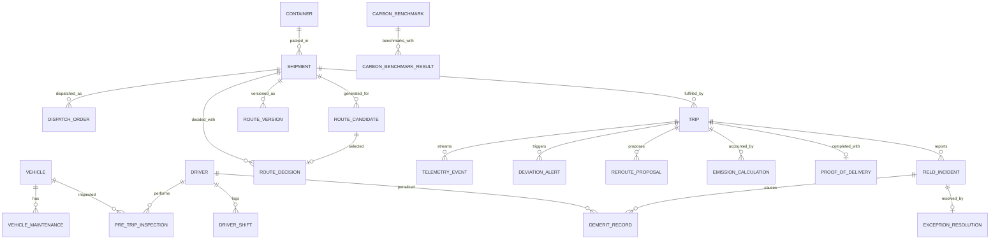

# CCADRO: LỊCH TRÌNH PHÁT TRIỂN 1 THÁNG & ĐẶC TẢ CƠ SỞ DỮ LIỆU CHI TIẾT
> **Green Supply Chain & Smart Logistics Tracker**  
> *Hệ thống điều vận logistics thông minh nhận thức phát thải carbon, giám sát thời gian thực & kế toán phát thải GLEC v3*  
> **Kiến trúc**: Spring Boot 3.3.x (Java 17) Modular Monolith, PostgreSQL 16 + PostGIS 3.4, React 18 + Leaflet, Redis 7.

---

## MỤC LỤC
1. [Lịch Trình Triển Khai Trong 1 Tháng (4 Tuần)](#1-lịch-trình-triển-khai-trong-1-tháng-4-tuần)
2. [Nguyên Tắc Thiết Kế JPA Entity Trong Spring Modulith](#2-nguyên-tắc-thiết-kế-jpa-entity-trong-spring-modulith)
3. [Sơ Đồ Quan Hệ Dữ Liệu Thực Thể (ERD Overview)](#3-sơ-đồ-quan-hệ-dữ-liệu-thực-thể-erd-overview)
4. [Đặc Tả Chi Tiết 24 Bảng Dữ Liệu & Entity Models Theo Module](#4-đặc-tả-chi-tiết-24-bảng-dữ-liệu--entity-models-theo-module)
   - [4.1. Module Asset (`com.ccadro.asset`)](#41-module-asset-comccadroasset)
   - [4.2. Module Shipment (`com.ccadro.shipment`)](#42-module-shipment-comccadroshipment)
   - [4.3. Module Routing (`com.ccadro.routing`)](#43-module-routing-comccadrorouting)
   - [4.4. Module Tracking (`com.ccadro.tracking`)](#44-module-tracking-comccadrotracking)
   - [4.5. Module Carbon (`com.ccadro.carbon`)](#45-module-carbon-comccadrocarbon)
   - [4.6. Module Exception & Governance (`com.ccadro.exception`)](#46-module-exception--governance-comccadroexception)
   - [4.7. Bảng Phụ Trợ Kiến Trúc: `event_publication`](#47-bảng-phụ-trợ-kiến-trúc-event_publication)
5. [Danh Mục Enums Hệ Thống (Java Domain Enums)](#5-danh-mục-enums-hệ-thống-java-domain-enums)
6. [Ma Trận Kiểm Soát & Tuân Thủ Quy Tắc Nghiệp Vụ (BRULE-01 -> BRULE-18)](#6-ma-trận-kiểm-soát--tuân-thủ-quy-tắc-nghiệp-vụ-brule-01---brule-18)

---

## 1. Lịch Trình Triển Khai Trong 1 Tháng (4 Tuần)

Hệ thống được tổ chức phát triển cuốn chiếu theo 4 tuần, đảm bảo mỗi tuần đều có sản phẩm chạy được (working increments) và vượt qua bài test kiến trúc `CcadroApplicationTests#verifyModularMonolithStructure`.

```mermaid
gantt
    title LỊCH TRÌNH 4 TUẦN TRIỂN KHAI CCADRO MVP
    dateFormat  YYYY-MM-DD
    section Tuần 1: Master Data & Assets
    Thiết kế toàn bộ 24 JPA Entity & Repositories     :active, 2026-11-01, 3d
    CRUD Quản lý Xe, Tài xế, Container, Maintenance   :2026-11-03, 2d
    Quản lý Shipment, Time Windows, Lệnh điều phối    :2026-11-05, 2d
    section Tuần 2: Green Multi-criteria Routing (UC05)
    Tích hợp Provider Abstraction (OSRM, GraphHopper) :2026-11-08, 2d
    Thuật toán Chuẩn hóa Min-Max & Trọng số Đa mục tiêu:2026-11-10, 3d
    UI Map Leaflet: Hiển thị 3 Tuyến Ứng viên (Pareto):2026-11-12, 2d
    section Tuần 3: Tracking & Dynamic Rerouting (UC09, UC10)
    GPS Telemetry Stream, Quality Gate & Persistence   :2026-11-15, 3d
    PostGIS Buffer Detection (50m Vàng, 200m Đỏ)      :2026-11-17, 2d
    Reroute Engine Human-in-the-Loop & Approval UI     :2026-11-19, 3d
    section Tuần 4: Carbon GLEC v3 & Hoàn thiện E2E
    Kế toán phát thải GLEC v3 (WTW, TTW, WTT) UC12    :2026-11-22, 2d
    Đối chuẩn Corridor & Trade-off UC13               :2026-11-24, 2d
    Demerit, ePOD, Smoke Test E2E & Báo cáo Audit     :2026-11-26, 3d
```

### Kế Hoạch Tuần & Tiêu Chí Nghiệm Thu (Acceptance Criteria)

| Tuần | Mục Tiêu Chính | Use Cases Trọng Tâm | Hạng Mục Công Việc Backend & Frontend | Tiêu Chí Nghiệm Thu (DoD) |
| :---: | :--- | :--- | :--- | :--- |
| **Tuần 1** | **Master Data & Asset Management** | UC01, UC02, UC03, UC04, UC06 | - Định nghĩa 24 Entity, thiết lập JPA Auditing.<br>- CRUD REST API cho Xe, Tài xế, Container, Lịch bảo trì.<br>- Kiểm tra an toàn trước chuyến (Pre-trip Inspection).<br>- Tạo Shipment với điểm đi/đến PostGIS Point, khung giờ giao nhận (Time Windows).<br>- Phát lệnh điều vận `dispatch_order`. | `mvn test` pass `verifyModularMonolithStructure`. Tạo thành công đơn hàng SH001 gán xe V001 và tài xế D001. |
| **Tuần 2** | **Carbon-Aware Route Planning** | **UC05 (Core)** | - Triển khai `RoutingProvider` (Mock, OSRM, GraphHopper).<br>- Bộ lọc ràng buộc cứng tải trọng (`BRULE-03`).<br>- Thuật toán chuẩn hóa Min-Max trên tập ứng viên (`BRULE-04`).<br>- Tính điểm tổng hợp với trọng số Carbon 0.4, Thời gian 0.3, Cự ly 0.2, Rủi ro 0.1 (`BRULE-05`).<br>- Lưu vết `route_candidate`, `route_decision`, `route_version`.<br>- Frontend: Vẽ Polyline 3 phương án tuyến với màu phân biệt trên Leaflet. | API `POST /api/v1/routing/plan` trả về 3 tuyến ứng viên có GeoJSON LineString hợp lệ và điểm composite score. |
| **Tuần 3** | **Real-Time Tracking & Dynamic Rerouting** | **UC09, UC10 (Core)**, UC07, UC08 | - API nạp GPS stream tần suất cao `POST /api/v1/tracking/telemetry`.<br>- Bộ lọc Quality Gate (loại bỏ GPS nhảy cóc / teleport).<br>- PostGIS `ST_Distance` tính khoảng cách tới `route_geometry`.<br>- Bộ đếm 3 điểm liên tiếp kích hoạt cảnh báo Vàng (50m) / Đỏ (200m) (`BRULE-10`).<br>- Engine sinh `reroute_proposal` khi lợi ích $\ge 10\%$ (`BRULE-08`).<br>- Giao diện Dispatcher phê duyệt Human-in-the-Loop (`BRULE-09`). | Chạy kịch bản `make simulate-deviation` kích hoạt cảnh báo Đỏ, sinh đề xuất tái định tuyến và Dispatcher bấm duyệt tạo `RouteVersion` 2. |
| **Tuần 4** | **GLEC v3 Carbon Accounting & Benchmarking** | **UC12, UC13 (Core)**, UC11, UC14, UC15-18 | - Xác nhận hoàn thành chuyến với ePOD và quãng đường GPS thực tế (`GPS_ACTUAL` không nhân DAF - `BRULE-11`).<br>- Kế toán phát thải Well-to-Wheel (WTW = TTW + WTT) chuẩn GLEC v3 / ISO 14083.<br>- Lưu vết Lineage hệ số phát thải (`BRULE-12`, `BRULE-14`).<br>- Đối chuẩn phát thải hành lang với tuyến cơ sở BAU/Shortest (`BRULE-15`).<br>- Ghi nhận vi phạm & điểm phạt Demerit (`BRULE-17`, `BRULE-18`).<br>- Chạy toàn bộ Smoke Test E2E 8/8 bước. | Hoàn thành `make smoke` đạt 8/8 test pass. Báo cáo phát thải lưu vết đầy đủ trong `emission_calculation`. |

---

## 2. Nguyên Tắc Thiết Kế JPA Entity Trong Spring Modulith

Hệ thống tuân thủ nghiêm ngặt mô hình **Modular Monolith** nhằm bảo đảm tính độc lập module, không gây hiệu ứng phụ (side effects) khi mở rộng:

1. **Ranh Giới Bounded Context (Spring Modulith Isolation)**:
   * **Trong cùng một module**: Được phép dùng quan hệ thực thể JPA `@ManyToOne`, `@OneToMany` (ví dụ: `VehicleMaintenance` $\rightarrow$ `Vehicle`).
   * **Giữa hai module khác nhau**: **TUYỆT ĐỐI KHÔNG** khai báo `@ManyToOne` trực tiếp tới Entity của module khác. Thay vào đó, chỉ lưu khóa ngoại dạng ID thuần túy: `UUID vehicleId`, `UUID driverId`, `UUID shipmentId`, `UUID tripId`.
   * Truy vấn xuyên module phải thông qua **Service Interface công khai** hoặc qua **Domain Events** (Spring Modulith Events).
2. **Khóa Chính & Quy Chuẩn Thời Gian**:
   * Khóa chính luôn là `UUID` ngẫu nhiên độc lập:
     ```java
     @Id
     @GeneratedValue(strategy = GenerationType.AUTO)
     private UUID id;
     ```
   * Toàn bộ thời gian dùng `java.time.Instant` và ánh xạ kiểu cột PostgreSQL `TIMESTAMPTZ`.
3. **Hình Học Không Gian (PostGIS & Hibernate Spatial)**:
   * Điểm tọa độ: `org.locationtech.jts.geom.Point` với SRID `4326` (WGS 84).
   * Tuyến đường polyline: `org.locationtech.jts.geom.LineString` với SRID `4326`.
   * Cần thêm `@JsonIgnore` trên thuộc tính hình học để tránh lỗi tuần tự hóa Jackson vòng lặp, đồng thời cung cấp getter tiện ích `getLatitude()` / `getLongitude()`.
4. **Dữ Liệu Động (JSONB)**:
   * Cột `JSONB` trong DB (checklist, waypoints, metrics breakdown) được ánh xạ qua `String` với cấu hình Hibernate hoặc lưu chuỗi JSON hợp lệ.
5. **Tính Bất Biến Của Kế Toán Phát Thải (Audit & Immutability)**:
   * Bản ghi tính toán phát thải `emission_calculation` là bất biến. Khi có dữ liệu mới, tăng `version_number`, chuyển trạng thái bản ghi cũ thành `SUPERSEDED`, tuyệt đối không ghi đè trực tiếp (`BRULE-14`).

---

## 3. Sơ Đồ Quan Hệ Dữ Liệu Thực Thể (ERD Overview)



---

## 4. Đặc Tả Chi Tiết 24 Bảng Dữ Liệu & Entity Models Theo Module

### 4.1. Module Asset (`com.ccadro.asset`)

Quản lý toàn bộ phương tiện, tài xế, container và quy trình kiểm tra an toàn vận hành.

#### 4.1.1. Bảng `vehicle` $\rightarrow$ Entity: `Vehicle` (UC01)
* **Package**: `com.ccadro.asset.domain`
* **Mô tả**: Thông tin hồ sơ kỹ thuật của xe đầu kéo và xe tải chở hàng.

| Cột SQL | Thuộc Tính Java | Kiểu SQL | Kiểu Java | Ràng Buộc / Mô Tả |
| :--- | :--- | :--- | :--- | :--- |
| `id` | `id` | `UUID` | `UUID` | Khóa chính, mặc định `uuid_generate_v4()`. |
| `vehicle_code` | `vehicleCode` | `VARCHAR(50)` | `String` | UNIQUE, NOT NULL. Mã định danh xe (VD: `VEH-001`). |
| `plate_number` | `plateNumber` | `VARCHAR(20)` | `String` | NOT NULL. Biển kiểm soát (VD: `51C-982.34`). |
| `fuel_type` | `fuelType` | `VARCHAR(30)` | `FuelType` | NOT NULL. Loại nhiên liệu: `DIESEL`, `ELECTRIC`, `HYBRID`, `CNG`. |
| `euro_standard` | `euroStandard` | `VARCHAR(20)` | `EuroStandard` | NOT NULL. Tiêu chuẩn khí thải: `EURO_4`, `EURO_5`, `EURO_6`. |
| `max_payload_tons` | `maxPayloadTons` | `NUMERIC(10,2)`| `BigDecimal` | NOT NULL. Tải trọng cho phép tối đa (tấn). Dùng kiểm tra `BRULE-03`. |
| `empty_weight_tons`| `emptyWeightTons`| `NUMERIC(10,2)`| `BigDecimal` | NOT NULL. Khối lượng bản thân xe không tải (tấn). Dùng tính GLEC v3. |
| `status` | `status` | `VARCHAR(30)` | `VehicleStatus` | NOT NULL, DEFAULT `'AVAILABLE'`. Trạng thái xe. |
| `created_at` | `createdAt` | `TIMESTAMPTZ` | `Instant` | NOT NULL, DEFAULT `CURRENT_TIMESTAMP`. |
| `updated_at` | `updatedAt` | `TIMESTAMPTZ` | `Instant` | NOT NULL, DEFAULT `CURRENT_TIMESTAMP`. |

* **Chỉ mục**: `idx_vehicle_status` trên `status`.

---

#### 4.1.2. Bảng `driver` $\rightarrow$ Entity: `Driver` (UC01)
* **Package**: `com.ccadro.asset.domain`
* **Mô tả**: Hồ sơ tài xế và trạng thái sẵn sàng nhận chuyến.

| Cột SQL | Thuộc Tính Java | Kiểu SQL | Kiểu Java | Ràng Buộc / Mô Tả |
| :--- | :--- | :--- | :--- | :--- |
| `id` | `id` | `UUID` | `UUID` | Khóa chính. |
| `driver_code` | `driverCode` | `VARCHAR(50)` | `String` | UNIQUE, NOT NULL. Mã nhân viên tài xế (VD: `DRV-001`). |
| `full_name` | `fullName` | `VARCHAR(100)`| `String` | NOT NULL. Họ và tên tài xế. |
| `phone` | `phone` | `VARCHAR(20)` | `String` | Số điện thoại liên lạc. |
| `license_number`| `licenseNumber`| `VARCHAR(50)` | `String` | Số bằng lái xe (hạng FC / C). |
| `status` | `status` | `VARCHAR(30)` | `DriverStatus` | NOT NULL, DEFAULT `'AVAILABLE'`. `AVAILABLE`, `ON_TRIP`, `INACTIVE`. |
| `created_at` | `createdAt` | `TIMESTAMPTZ` | `Instant` | Thời điểm tạo hồ sơ. |
| `updated_at` | `updatedAt` | `TIMESTAMPTZ` | `Instant` | Thời điểm cập nhật cuối. |

* **Chỉ mục**: `idx_driver_status` trên `status`.

---

#### 4.1.3. Bảng `container` $\rightarrow$ Entity: `Container` (UC01)
* **Package**: `com.ccadro.asset.domain`
* **Mô tả**: Quản lý vỏ container hàng khô và hàng lạnh.

| Cột SQL | Thuộc Tính Java | Kiểu SQL | Kiểu Java | Ràng Buộc / Mô Tả |
| :--- | :--- | :--- | :--- | :--- |
| `id` | `id` | `UUID` | `UUID` | Khóa chính. |
| `container_code` | `containerCode` | `VARCHAR(50)` | `String` | UNIQUE, NOT NULL. Mã định danh vỏ cont (VD: `CONT-40HC-001`). |
| `container_type` | `containerType` | `VARCHAR(30)` | `ContainerType`| NOT NULL. `DRY_20FT`, `DRY_40FT`, `REEFER_20FT`, `REEFER_40FT`, `FLAT_RACK`, `OPEN_TOP`. |
| `tare_weight_tons`| `tareWeightTons`| `NUMERIC(10,2)`| `BigDecimal`| NOT NULL. Khối lượng vỏ rỗng (tấn). |
| `max_payload_tons`| `maxPayloadTons`| `NUMERIC(10,2)`| `BigDecimal`| NOT NULL. Tải trọng hàng tối đa được đóng vào cont (tấn). |
| `is_reefer` | `isReefer` | `BOOLEAN` | `Boolean` | NOT NULL, DEFAULT `FALSE`. Đánh dấu cont lạnh (phục vụ tính phát thải phụ trợ). |
| `status` | `status` | `VARCHAR(30)` | `ContainerStatus`| NOT NULL, DEFAULT `'AVAILABLE'`. `AVAILABLE`, `ASSIGNED`, `IN_TRANSIT`, `MAINTENANCE`. |
| `created_at` | `createdAt` | `TIMESTAMPTZ` | `Instant` | Thời điểm tạo. |
| `updated_at` | `updatedAt` | `TIMESTAMPTZ` | `Instant` | Thời điểm cập nhật. |

* **Chỉ mục**: `idx_container_status` trên `status`.

---

#### 4.1.4. Bảng `vehicle_maintenance` $\rightarrow$ Entity: `VehicleMaintenance` (UC02)
* **Package**: `com.ccadro.asset.domain`
* **Mô tả**: Nhật ký bảo dưỡng phương tiện và điều kiện sẵn sàng kỹ thuật (`BRULE-01`).

| Cột SQL | Thuộc Tính Java | Kiểu SQL | Kiểu Java | Ràng Buộc / Mô Tả |
| :--- | :--- | :--- | :--- | :--- |
| `id` | `id` | `UUID` | `UUID` | Khóa chính. |
| `vehicle_id` | `vehicleId` | `UUID` | `UUID` | NOT NULL, REFERENCES `vehicle(id)`. |
| `maintenance_type`| `maintenanceType`| `VARCHAR(30)`| `MaintenanceType`| NOT NULL. `PERIODIC`, `PREVENTIVE`, `CORRECTIVE`, `EMERGENCY`. |
| `scheduled_date` | `scheduledDate` | `DATE` | `LocalDate` | NOT NULL. Ngày lên lịch bảo dưỡng. |
| `completed_date` | `completedDate` | `DATE` | `LocalDate` | Ngày nghiệm thu hoàn thành bảo dưỡng. |
| `odometer_km` | `odometerKm` | `NUMERIC(12,2)`| `BigDecimal` | NOT NULL, DEFAULT `0`. Chỉ số công-tơ-mét tại thời điểm bảo dưỡng. |
| `status` | `status` | `VARCHAR(30)` | `MaintenanceStatus`| NOT NULL, DEFAULT `'SCHEDULED'`. `SCHEDULED`, `IN_PROGRESS`, `COMPLETED`, `CANCELLED`. |
| `description` | `description` | `TEXT` | `String` | Chi tiết công việc và phụ tùng thay thế. |
| `cost` | `cost` | `NUMERIC(12,2)`| `BigDecimal` | Tổng chi phí hóa đơn (VND). |
| `performed_by` | `performedBy` | `VARCHAR(100)`| `String` | Đơn vị thực hiện (Garage/Xưởng bảo dưỡng). |
| `evidence_url` | `evidenceUrl` | `TEXT` | `String` | Link ảnh biên bản bảo dưỡng. |
| `created_at` | `createdAt` | `TIMESTAMPTZ` | `Instant` | Thời điểm lập lịch. |

* **Chỉ mục**: `idx_maintenance_vehicle` trên `vehicle_id`, `idx_maintenance_status` trên `status`.

---

#### 4.1.5. Bảng `pre_trip_inspection` $\rightarrow$ Entity: `PreTripInspection` (UC03)
* **Package**: `com.ccadro.asset.domain`
* **Mô tả**: Biên bản kiểm tra an toàn trước khi khởi hành (`BRULE-01`). Nếu FAILED, cấm xuất chuyến.

| Cột SQL | Thuộc Tính Java | Kiểu SQL | Kiểu Java | Ràng Buộc / Mô Tả |
| :--- | :--- | :--- | :--- | :--- |
| `id` | `id` | `UUID` | `UUID` | Khóa chính. |
| `vehicle_id` | `vehicleId` | `UUID` | `UUID` | NOT NULL, REFERENCES `vehicle(id)`. |
| `driver_id` | `driverId` | `UUID` | `UUID` | NOT NULL, REFERENCES `driver(id)`. |
| `shipment_id` | `shipmentId` | `UUID` | `UUID` | REFERENCES `shipment(id)` (nullable). |
| `inspection_time`| `inspectionTime`| `TIMESTAMPTZ` | `Instant` | NOT NULL, DEFAULT `CURRENT_TIMESTAMP`. |
| `status` | `status` | `VARCHAR(20)` | `InspectionStatus`| NOT NULL, DEFAULT `'PASSED'`. `PASSED`, `FAILED`. |
| `checklist_json` | `checklistJson` | `JSONB` | `String` | NOT NULL, DEFAULT `'{}'`. Kết quả kiểm tra phanh, lốp, đèn, bình cứu hỏa... |
| `critical_failures_count`| `criticalFailuresCount`| `INT` | `Integer` | NOT NULL, DEFAULT `0`. Số lỗi an toàn nghiêm trọng. |
| `remarks` | `remarks` | `TEXT` | `String` | Nhận xét của tài xế. |
| `created_at` | `createdAt` | `TIMESTAMPTZ` | `Instant` | Thời điểm kiểm tra. |

* **Chỉ mục**: `idx_inspection_vehicle` trên `vehicle_id`, `idx_inspection_driver` trên `driver_id`.

---

#### 4.1.6. Bảng `driver_shift` $\rightarrow$ Entity: `DriverShift` (UC15)
* **Package**: `com.ccadro.asset.domain`
* **Mô tả**: Quản lý ca làm việc, bàn giao xe và trách nhiệm tài xế.

| Cột SQL | Thuộc Tính Java | Kiểu SQL | Kiểu Java | Ràng Buộc / Mô Tả |
| :--- | :--- | :--- | :--- | :--- |
| `id` | `id` | `UUID` | `UUID` | Khóa chính. |
| `driver_id` | `driverId` | `UUID` | `UUID` | NOT NULL, REFERENCES `driver(id)`. |
| `vehicle_id` | `vehicleId` | `UUID` | `UUID` | NOT NULL, REFERENCES `vehicle(id)`. |
| `shift_start` | `shiftStart` | `TIMESTAMPTZ` | `Instant` | NOT NULL. Thời gian bắt đầu ca dự kiến. |
| `shift_end` | `shiftEnd` | `TIMESTAMPTZ` | `Instant` | NOT NULL. Thời gian kết thúc ca dự kiến. |
| `actual_start` | `actualStart` | `TIMESTAMPTZ` | `Instant` | Thời gian nhận ca thực tế. |
| `actual_end` | `actualEnd` | `TIMESTAMPTZ` | `Instant` | Thời gian trả ca thực tế. |
| `status` | `status` | `VARCHAR(30)` | `ShiftStatus` | NOT NULL, DEFAULT `'SCHEDULED'`. `SCHEDULED`, `ACTIVE`, `COMPLETED`, `CANCELLED`. |
| `handover_notes` | `handoverNotes` | `TEXT` | `String` | Biên bản tình trạng xe khi bàn giao. |
| `created_at` | `createdAt` | `TIMESTAMPTZ` | `Instant` | Thời điểm tạo ca. |

* **Chỉ mục**: `idx_shift_driver` trên `driver_id`, `idx_shift_vehicle` trên `vehicle_id`.

---

### 4.2. Module Shipment (`com.ccadro.shipment`)

Quản lý đơn vận chuyển hàng hóa, điểm đi/đến tọa độ không gian PostGIS và lệnh điều phối.

#### 4.2.1. Bảng `shipment` $\rightarrow$ Entity: `Shipment` (UC04)
* **Package**: `com.ccadro.shipment.domain`
* **Mô tả**: Đơn hàng vận tải chứa tọa độ địa lý xuất phát và đích đến cùng khung thời gian giao hàng.

| Cột SQL | Thuộc Tính Java | Kiểu SQL | Kiểu Java | Ràng Buộc / Mô Tả |
| :--- | :--- | :--- | :--- | :--- |
| `id` | `id` | `UUID` | `UUID` | Khóa chính. |
| `shipment_code` | `shipmentCode` | `VARCHAR(50)` | `String` | UNIQUE, NOT NULL. Mã đơn hàng (VD: `SH001`). |
| `customer_id` | `customerId` | `VARCHAR(50)` | `String` | NOT NULL. Mã khách hàng (`BRULE-16` cách ly dữ liệu). |
| `origin_name` | `originName` | `VARCHAR(200)`| `String` | NOT NULL. Tên điểm bốc hàng (VD: *Cảng Cát Lái*). |
| `origin_address` | `originAddress` | `TEXT` | `String` | Địa chỉ điểm bốc hàng. |
| `origin_geom` | `originGeom` | `GEOMETRY(Point, 4326)` | `Point` | NOT NULL. Tọa độ điểm bốc hàng (PostGIS WGS84). |
| `destination_name`| `destinationName`| `VARCHAR(200)`| `String` | NOT NULL. Tên điểm dỡ hàng (VD: *KCN VSIP 1 Thuận An*). |
| `destination_address`| `destinationAddress`| `TEXT` | `String` | Địa chỉ điểm dỡ hàng. |
| `destination_geom`| `destinationGeom`| `GEOMETRY(Point, 4326)` | `Point` | NOT NULL. Tọa độ điểm dỡ hàng (PostGIS WGS84). |
| `cargo_weight_tons`| `cargoWeightTons`| `NUMERIC(10,2)`| `BigDecimal` | NOT NULL. Khối lượng hàng (tấn). Căn cứ tính GLEC v3. |
| `cargo_volume_m3` | `cargoVolumeM3` | `NUMERIC(10,2)`| `BigDecimal` | Thể tích hàng ($m^3$). |
| `container_id` | `containerId` | `UUID` | `UUID` | REFERENCES `container(id)` (nullable). |
| `container_type_required`| `containerTypeRequired`| `VARCHAR(30)`| `ContainerType`| Loại vỏ container khách hàng yêu cầu. |
| `pickup_time_window_start`| `pickupTimeWindowStart`| `TIMESTAMPTZ`| `Instant` | Giờ mở cửa kho bốc hàng. |
| `pickup_time_window_end`| `pickupTimeWindowEnd`| `TIMESTAMPTZ`| `Instant` | Giờ đóng cửa kho bốc hàng. |
| `delivery_time_window_start`| `deliveryTimeWindowStart`| `TIMESTAMPTZ`| `Instant` | Giờ sớm nhất khách nhận hàng tại đích. |
| `delivery_time_window_end`| `deliveryTimeWindowEnd`| `TIMESTAMPTZ`| `Instant` | Giờ muộn nhất phải bàn giao hàng. |
| `required_delivery_time`| `requiredDeliveryTime`| `TIMESTAMPTZ`| `Instant` | Hạn chót giao hàng theo SLA. |
| `status` | `status` | `VARCHAR(30)` | `ShipmentStatus`| NOT NULL, DEFAULT `'DRAFT'`. `DRAFT`, `PLANNED`, `DISPATCHED`, `IN_TRANSIT`, `DELIVERED`, `CANCELLED`. |
| `assigned_vehicle_id`| `assignedVehicleId`| `UUID` | `UUID` | ID xe được phân bổ. |
| `assigned_driver_id` | `assignedDriverId` | `UUID` | `UUID` | ID tài xế được phân bổ. |
| `created_at` | `createdAt` | `TIMESTAMPTZ` | `Instant` | Thời điểm tạo đơn. |
| `updated_at` | `updatedAt` | `TIMESTAMPTZ` | `Instant` | Thời điểm cập nhật cuối. |

* **Chỉ mục**: `idx_shipment_status` trên `status`; Spatial GIST indexes `idx_shipment_origin_geom` trên `origin_geom` và `idx_shipment_dest_geom` trên `destination_geom`.

---

#### 4.2.2. Bảng `dispatch_order` $\rightarrow$ Entity: `DispatchOrder` (UC06)
* **Package**: `com.ccadro.shipment.domain`
* **Mô tả**: Lệnh điều phối chính thức liên kết đơn hàng, tài xế, xe và phiên bản tuyến đường hiệu lực.

| Cột SQL | Thuộc Tính Java | Kiểu SQL | Kiểu Java | Ràng Buộc / Mô Tả |
| :--- | :--- | :--- | :--- | :--- |
| `id` | `id` | `UUID` | `UUID` | Khóa chính. |
| `dispatch_code` | `dispatchCode` | `VARCHAR(50)` | `String` | UNIQUE, NOT NULL. Mã lệnh điều vận (VD: `DSP-2026-001`). |
| `shipment_id` | `shipmentId` | `UUID` | `UUID` | NOT NULL, REFERENCES `shipment(id)`. |
| `vehicle_id` | `vehicleId` | `UUID` | `UUID` | NOT NULL. ID xe được ấn định. |
| `driver_id` | `driverId` | `UUID` | `UUID` | NOT NULL. ID tài xế được ấn định. |
| `container_id` | `containerId` | `UUID` | `UUID` | ID container đi kèm. |
| `assigned_route_version_id`| `assignedRouteVersionId`| `UUID`| `UUID` | ID phiên bản tuyến hiệu lực ban đầu. |
| `dispatched_at` | `dispatchedAt` | `TIMESTAMPTZ` | `Instant` | NOT NULL, DEFAULT `CURRENT_TIMESTAMP`. |
| `dispatched_by` | `dispatchedBy` | `VARCHAR(100)`| `String` | NOT NULL, DEFAULT `'DISPATCHER'`. |
| `status` | `status` | `VARCHAR(30)` | `DispatchStatus`| NOT NULL, DEFAULT `'ASSIGNED'`. `ASSIGNED`, `ACKNOWLEDGED`, `IN_PROGRESS`, `COMPLETED`, `CANCELLED`. |
| `notes` | `notes` | `TEXT` | `String` | Ghi chú dặn dò tài xế. |
| `created_at` | `createdAt` | `TIMESTAMPTZ` | `Instant` | Thời điểm tạo lệnh. |

* **Chỉ mục**: `idx_dispatch_shipment` trên `shipment_id`, `idx_dispatch_status` trên `status`.

---

### 4.3. Module Routing (`com.ccadro.routing`)

Lõi thuật toán sinh phương án tuyến nhận thức carbon đa tiêu chí (UC05) và quản trị phiên bản tuyến đường.

#### 4.3.1. Bảng `route_candidate` $\rightarrow$ Entity: `RouteCandidate` (UC05)
* **Package**: `com.ccadro.routing.domain`
* **Mô tả**: Phương án tuyến đường ứng viên do các provider (OSRM, GraphHopper) tính toán.

| Cột SQL | Thuộc Tính Java | Kiểu SQL | Kiểu Java | Ràng Buộc / Mô Tả |
| :--- | :--- | :--- | :--- | :--- |
| `id` | `id` | `UUID` | `UUID` | Khóa chính. |
| `shipment_id` | `shipmentId` | `UUID` | `UUID` | NOT NULL, REFERENCES `shipment(id)`. |
| `candidate_name`| `candidateName`| `VARCHAR(100)`| `String` | NOT NULL. Tên phương án (VD: *Tuyến Xanh tránh kẹt xe*). |
| `provider_name` | `providerName` | `VARCHAR(50)` | `String` | NOT NULL. Nhà cung cấp: `OSRM`, `GRAPHHOPPER`, `MOCK`. |
| `distance_meters`| `distanceMeters`| `NUMERIC(12,2)`| `BigDecimal` | NOT NULL. Tổng chiều dài tuyến (mét). |
| `duration_seconds`| `durationSeconds`| `NUMERIC(12,2)`| `BigDecimal` | NOT NULL. Thời gian chạy dự kiến (giây). |
| `estimated_fuel_liters`| `estimatedFuelLiters`| `NUMERIC(10,2)`| `BigDecimal` | Nhiên liệu dự tính tiêu thụ (lít). |
| `estimated_co2_kg`| `estimatedCo2Kg`| `NUMERIC(10,2)`| `BigDecimal` | NOT NULL. Khối lượng $CO_2$ dự tính phát thải (kg). |
| `risk_score` | `riskScore` | `NUMERIC(5,4)` | `BigDecimal` | DEFAULT `0.0500`. Điểm rủi ro (đoạn dốc, điểm đen tai nạn). |
| `composite_score`| `compositeScore`| `NUMERIC(6,4)` | `BigDecimal` | Điểm số tổng hợp đa tiêu chí sau chuẩn hóa Min-Max (`BRULE-04`, `BRULE-05`). |
| `route_geometry`| `routeGeometry`| `GEOMETRY(LineString, 4326)`| `LineString` | Hình học polyline tuyến đường (PostGIS WGS84). |
| `waypoints_json`| `waypointsJson`| `JSONB` | `String` | Danh sách mảng tọa độ các điểm mốc trung gian. |
| `metrics_breakdown_json`| `metricsBreakdownJson`| `JSONB`| `String` | Chi tiết phân rã điểm thành phần. |
| `is_selected` | `isSelected` | `BOOLEAN` | `Boolean` | NOT NULL, DEFAULT `FALSE`. Đánh dấu tuyến được chọn. |
| `created_at` | `createdAt` | `TIMESTAMPTZ` | `Instant` | Thời điểm tạo ứng viên. |

* **Chỉ mục**: `idx_candidate_shipment` trên `shipment_id`.

---

#### 4.3.2. Bảng `route_decision` $\rightarrow$ Entity: `RouteDecision` (UC05)
* **Package**: `com.ccadro.routing.domain`
* **Mô tả**: Lưu vết quyết định lựa chọn phương án tuyến của Dispatcher (Audit Trail).

| Cột SQL | Thuộc Tính Java | Kiểu SQL | Kiểu Java | Ràng Buộc / Mô Tả |
| :--- | :--- | :--- | :--- | :--- |
| `id` | `id` | `UUID` | `UUID` | Khóa chính. |
| `shipment_id` | `shipmentId` | `UUID` | `UUID` | NOT NULL, REFERENCES `shipment(id)`. |
| `selected_candidate_id`| `selectedCandidateId`| `UUID`| `UUID` | NOT NULL, REFERENCES `route_candidate(id)`. |
| `decision_type` | `decisionType` | `VARCHAR(50)` | `DecisionType` | NOT NULL, DEFAULT `'RECOMMENDED'`. `RECOMMENDED`, `MANUAL_OVERRIDE`. |
| `dispatcher_notes`| `dispatcherNotes`| `TEXT` | `String` | Lý do lựa chọn của điều độ viên. |
| `decided_by` | `decidedBy` | `VARCHAR(50)` | `String` | NOT NULL, DEFAULT `'SYSTEM'`. Tên user hoặc `'SYSTEM'`. |
| `decided_at` | `decidedAt` | `TIMESTAMPTZ` | `Instant` | NOT NULL, DEFAULT `CURRENT_TIMESTAMP`. |

---

#### 4.3.3. Bảng `route_version` $\rightarrow$ Entity: `RouteVersion` (UC05, UC10)
* **Package**: `com.ccadro.routing.domain`
* **Mô tả**: Quản lý lịch sử các phiên bản tuyến đường hiệu lực (Version 1: Tuyến lập ban đầu; Version 2, 3: Sau tái định tuyến).

| Cột SQL | Thuộc Tính Java | Kiểu SQL | Kiểu Java | Ràng Buộc / Mô Tả |
| :--- | :--- | :--- | :--- | :--- |
| `id` | `id` | `UUID` | `UUID` | Khóa chính. |
| `shipment_id` | `shipmentId` | `UUID` | `UUID` | NOT NULL, REFERENCES `shipment(id)`. |
| `version_number`| `versionNumber`| `INT` | `Integer` | NOT NULL, DEFAULT `1`. Số thứ tự phiên bản ($1, 2, 3\dots$). |
| `route_geometry`| `routeGeometry`| `GEOMETRY(LineString, 4326)`| `LineString`| Hình học polyline hiệu lực của phiên bản. |
| `total_distance_meters`| `totalDistanceMeters`| `NUMERIC(12,2)`| `BigDecimal`| NOT NULL. Chiều dài tuyến của phiên bản này (mét). |
| `total_duration_seconds`| `totalDurationSeconds`| `NUMERIC(12,2)`| `BigDecimal`| NOT NULL. Thời gian chạy dự kiến (giây). |
| `is_active` | `isActive` | `BOOLEAN` | `Boolean` | NOT NULL, DEFAULT `TRUE`. Tuyến đang hoạt động. |
| `reason` | `reason` | `VARCHAR(100)`| `RouteVersionReason`| NOT NULL, DEFAULT `'INITIAL_PLANNING'`. `INITIAL_PLANNING`, `REROUTE_DEVIATION`, `REROUTE_TRAFFIC`. |
| `created_at` | `createdAt` | `TIMESTAMPTZ` | `Instant` | Thời điểm kích hoạt phiên bản tuyến. |

* **Ràng buộc**: `uq_shipment_version` UNIQUE `(shipment_id, version_number)`.
* **Chỉ mục**: `idx_route_version_shipment` trên `shipment_id`.

---

### 4.4. Module Tracking (`com.ccadro.tracking`)

Giám sát tọa độ GPS vi mô, phát hiện lệch hành lang đệm PostGIS và tái định tuyến động.

#### 4.4.1. Bảng `trip` $\rightarrow$ Entity: `Trip` (UC07)
* **Package**: `com.ccadro.tracking.domain`
* **Mô tả**: Chuyến xe thực tế đang lưu thông trên hành lang vận tải.

| Cột SQL | Thuộc Tính Java | Kiểu SQL | Kiểu Java | Ràng Buộc / Mô Tả |
| :--- | :--- | :--- | :--- | :--- |
| `id` | `id` | `UUID` | `UUID` | Khóa chính. |
| `trip_code` | `tripCode` | `VARCHAR(50)` | `String` | UNIQUE, NOT NULL. Mã chuyến đi (VD: `TRIP-2026-001`). |
| `shipment_id` | `shipmentId` | `UUID` | `UUID` | NOT NULL. ID đơn hàng vận chuyển. |
| `vehicle_id` | `vehicleId` | `UUID` | `UUID` | NOT NULL. ID xe đang chạy. |
| `driver_id` | `driverId` | `UUID` | `UUID` | NOT NULL. ID tài xế điều khiển. |
| `active_route_version_id`| `activeRouteVersionId`| `UUID`| `UUID` | ID phiên bản tuyến đang áp dụng điều hướng. |
| `start_time` | `startTime` | `TIMESTAMPTZ` | `Instant` | Thời điểm bắt đầu lăn bánh. |
| `end_time` | `endTime` | `TIMESTAMPTZ` | `Instant` | Thời điểm hoàn thành chuyến xe. |
| `status` | `status` | `VARCHAR(30)` | `TripStatus` | NOT NULL, DEFAULT `'SCHEDULED'`. `SCHEDULED`, `EN_ROUTE`, `DELAYED`, `COMPLETED`, `CANCELLED`. |
| `actual_distance_meters`| `actualDistanceMeters`| `NUMERIC(12,2)`| `BigDecimal`| NOT NULL, DEFAULT `0`. Cự ly tích lũy từ vết GPS (mét). |
| `created_at` | `createdAt` | `TIMESTAMPTZ` | `Instant` | Thời điểm khởi tạo chuyến. |
| `updated_at` | `updatedAt` | `TIMESTAMPTZ` | `Instant` | Thời điểm cập nhật cuối. |

---

#### 4.4.2. Bảng `telemetry_event` $\rightarrow$ Entity: `TelemetryEvent` (UC07, UC08, SOP-10)
* **Package**: `com.ccadro.tracking.domain`
* **Mô tả**: Tọa độ GPS vi mô stream từ thiết bị IoT trên phương tiện.

| Cột SQL | Thuộc Tính Java | Kiểu SQL | Kiểu Java | Ràng Buộc / Mô Tả |
| :--- | :--- | :--- | :--- | :--- |
| `id` | `id` | `UUID` | `UUID` | Khóa chính. |
| `trip_id` | `tripId` | `UUID` | `UUID` | NOT NULL, REFERENCES `trip(id)`. |
| `vehicle_id` | `vehicleId` | `UUID` | `UUID` | NOT NULL. ID xe phát tín hiệu. |
| `timestamp` | `timestamp` | `TIMESTAMPTZ` | `Instant` | NOT NULL. Thời điểm chốt tọa độ tại thiết bị. |
| `location_geom` | `locationGeom` | `GEOMETRY(Point, 4326)`| `Point` | NOT NULL. Tọa độ điểm GPS (PostGIS WGS84). |
| `speed_kmh` | `speedKmh` | `NUMERIC(6,2)` | `BigDecimal` | Vận tốc tức thời (km/h). |
| `heading_degrees`| `headingDegrees`| `NUMERIC(5,2)` | `BigDecimal` | Hướng di chuyển xe ($0^\circ - 360^\circ$). |
| `distance_from_route_meters`| `distanceFromRouteMeters`| `NUMERIC(10,2)`| `BigDecimal`| Khoảng cách vuông góc tới `route_geometry` (mét). |
| `accuracy_meters`| `accuracyMeters`| `NUMERIC(8,2)` | `BigDecimal` | DEFAULT `5.0`. Độ chính xác vệ tinh HDOP (mét). |
| `battery_percentage`| `batteryPercentage`| `NUMERIC(5,2)`| `BigDecimal` | Dung lượng pin thiết bị IoT (%). |
| `is_offline_buffered`| `isOfflineBuffered`| `BOOLEAN`| `Boolean` | DEFAULT `FALSE`. Tọa độ gửi bù sau khi mất mạng. |
| `quality_passed`| `qualityPassed`| `BOOLEAN` | `Boolean` | DEFAULT `TRUE`. Đã vượt qua bộ lọc nhiễu GPS. |
| `raw_payload` | `rawPayload` | `JSONB` | `String` | Dữ liệu thô gửi lên từ cảm biến IoT. |
| `created_at` | `createdAt` | `TIMESTAMPTZ` | `Instant` | Thời điểm server nhận bản ghi. |

* **Chỉ mục**: `idx_telemetry_trip` trên `trip_id`, `idx_telemetry_time` trên `timestamp`.

---

#### 4.4.3. Bảng `deviation_alert` $\rightarrow$ Entity: `DeviationAlert` (UC09, BRULE-10)
* **Package**: `com.ccadro.tracking.domain`
* **Mô tả**: Cảnh báo xe đi ra ngoài hành lang đệm an toàn ($>50$m Vàng, $>200$m Đỏ trong $\ge 3$ tọa độ liên tiếp).

| Cột SQL | Thuộc Tính Java | Kiểu SQL | Kiểu Java | Ràng Buộc / Mô Tả |
| :--- | :--- | :--- | :--- | :--- |
| `id` | `id` | `UUID` | `UUID` | Khóa chính. |
| `trip_id` | `tripId` | `UUID` | `UUID` | NOT NULL, REFERENCES `trip(id)`. |
| `severity` | `severity` | `VARCHAR(20)` | `AlertSeverity` | NOT NULL. Cấp độ cảnh báo: `YELLOW` ($>50$m), `RED` ($>200$m). |
| `deviation_distance_meters`| `deviationDistanceMeters`| `NUMERIC(10,2)`| `BigDecimal`| NOT NULL. Khoảng cách lệch lớn nhất ghi nhận (mét). |
| `location_geom` | `locationGeom` | `GEOMETRY(Point, 4326)`| `Point` | NOT NULL. Tọa độ GPS xảy ra vi phạm. |
| `persistence_count`| `persistenceCount`| `INT` | `Integer` | DEFAULT `1`. Số điểm GPS liên tiếp nằm ngoài hành lang. |
| `duration_seconds`| `durationSeconds`| `INT` | `Integer` | DEFAULT `0`. Tổng thời gian lệch tuyến kéo dài (giây). |
| `threshold_version`| `thresholdVersion`| `VARCHAR(50)` | `String` | DEFAULT `'v1.0'`. Phiên bản cấu hình ngưỡng áp dụng. |
| `route_version_id`| `routeVersionId`| `UUID` | `UUID` | Phiên bản tuyến đang bị lệch. |
| `status` | `status` | `VARCHAR(30)` | `AlertStatus` | NOT NULL, DEFAULT `'OPEN'`. `OPEN`, `ACKNOWLEDGED`, `RESOLVED`. |
| `detected_at` | `detectedAt` | `TIMESTAMPTZ` | `Instant` | Thời điểm phát hiện lệch tuyến. |
| `resolved_at` | `resolvedAt` | `TIMESTAMPTZ` | `Instant` | Thời điểm xe quay lại lộ trình. |
| `created_at` | `createdAt` | `TIMESTAMPTZ` | `Instant` | Thời điểm tạo cảnh báo. |

* **Chỉ mục**: `idx_deviation_trip` trên `trip_id`.

---

#### 4.4.4. Bảng `reroute_proposal` $\rightarrow$ Entity: `RerouteProposal` (UC10, BRULE-08, BRULE-09)
* **Package**: `com.ccadro.tracking.domain`
* **Mô tả**: Đề xuất tuyến đường mới khi phát hiện xe gặp sự cố hoặc lệch tuyến kéo dài. Yêu cầu Dispatcher duyệt.

| Cột SQL | Thuộc Tính Java | Kiểu SQL | Kiểu Java | Ràng Buộc / Mô Tả |
| :--- | :--- | :--- | :--- | :--- |
| `id` | `id` | `UUID` | `UUID` | Khóa chính. |
| `trip_id` | `tripId` | `UUID` | `UUID` | NOT NULL, REFERENCES `trip(id)`. |
| `trigger_reason`| `triggerReason`| `VARCHAR(50)` | `RerouteTriggerReason`| NOT NULL. `DEVIATION_RED`, `TRAFFIC_INCIDENT`, `ROAD_CLOSED`. |
| `original_remaining_distance_meters`| `originalRemainingDistanceMeters`| `NUMERIC(12,2)`| `BigDecimal`| NOT NULL. Cự ly còn lại theo tuyến cũ (mét). |
| `proposed_distance_meters`| `proposedDistanceMeters`| `NUMERIC(12,2)`| `BigDecimal`| NOT NULL. Cự ly theo tuyến mới đề xuất (mét). |
| `benefit_ratio` | `benefitRatio` | `NUMERIC(6,4)` | `BigDecimal` | NOT NULL. Tỷ lệ cải thiện ($\Delta \ge 0.10$ tức 10% theo `BRULE-08`). |
| `proposed_geometry`| `proposedGeometry`| `GEOMETRY(LineString, 4326)`| `LineString`| Hình học polyline đề xuất mới. |
| `status` | `status` | `VARCHAR(30)` | `RerouteStatus`| NOT NULL, DEFAULT `'PENDING_DISPATCHER'`. `PENDING_DISPATCHER`, `ACCEPTED`, `REJECTED`, `EXPIRED`. |
| `created_at` | `createdAt` | `TIMESTAMPTZ` | `Instant` | Thời điểm thuật toán tính ra đề xuất. |
| `updated_at` | `updatedAt` | `TIMESTAMPTZ` | `Instant` | Thời điểm Dispatcher ra quyết định. |

* **Chỉ mục**: `idx_reroute_trip` trên `trip_id`.

---

### 4.5. Module Carbon (`com.ccadro.carbon`)

Kế toán khí nhà kính chuẩn GLEC v3, ISO 14083 và đối chuẩn hiệu quả phát thải hành lang logistics.

#### 4.5.1. Bảng `emission_factor` $\rightarrow$ Entity: `EmissionFactor` (UC12, BRULE-12)
* **Package**: `com.ccadro.carbon.domain`
* **Mô tả**: Thư viện hệ số phát thải có truy xuất nguồn gốc (Lineage).

| Cột SQL | Thuộc Tính Java | Kiểu SQL | Kiểu Java | Ràng Buộc / Mô Tả |
| :--- | :--- | :--- | :--- | :--- |
| `id` | `id` | `UUID` | `UUID` | Khóa chính. |
| `factor_code` | `factorCode` | `VARCHAR(50)` | `String` | UNIQUE, NOT NULL. Mã hệ số (VD: `EF-DIESEL-EURO5-RIGID`). |
| `fuel_type` | `fuelType` | `VARCHAR(30)` | `FuelType` | NOT NULL. `DIESEL`, `ELECTRIC`, `HYBRID`, `CNG`. |
| `vehicle_category`| `vehicleCategory`| `VARCHAR(50)`| `VehicleCategory`| NOT NULL. `RIGID_TRUCK`, `ARTICULATED_TRUCK`, `VAN`. |
| `euro_standard` | `euroStandard` | `VARCHAR(20)` | `EuroStandard` | NOT NULL. `EURO_4`, `EURO_5`, `EURO_6`. |
| `empty_factor_kg_per_km`| `emptyFactorKgPerKm`| `NUMERIC(10,6)`| `BigDecimal`| NOT NULL. Hệ số xe chạy không tải ($kgCO_2e/km$). |
| `full_factor_kg_per_km`| `fullFactorKgPerKm`| `NUMERIC(10,6)`| `BigDecimal`| NOT NULL. Hệ số xe chạy đủ tải ($kgCO_2e/km$). |
| `default_tonne_km_factor`| `defaultTonneKmFactor`| `NUMERIC(10,6)`| `BigDecimal`| NOT NULL, DEFAULT `0.080000`. Hệ số mặc định ($kgCO_2e/t\text{-}km$). |
| `source_reference`| `sourceReference`| `VARCHAR(100)`| `String` | NOT NULL, DEFAULT `'GLEC_FRAMEWORK_V3'`. Nguồn hệ số. |
| `is_active` | `isActive` | `BOOLEAN` | `Boolean` | NOT NULL, DEFAULT `TRUE`. Còn hiệu lực tra cứu. |
| `created_at` | `createdAt` | `TIMESTAMPTZ` | `Instant` | Thời điểm công bố hệ số. |
| `updated_at` | `updatedAt` | `TIMESTAMPTZ` | `Instant` | Thời điểm cập nhật cuối. |

---

#### 4.5.2. Bảng `emission_calculation` $\rightarrow$ Entity: `EmissionCalculation` (UC12, BRULE-06, 11, 12, 13, 14)
* **Package**: `com.ccadro.carbon.domain`
* **Mô tả**: Bảng lưu kết quả kế toán phát thải chính thức sau chuyến và ước tính kế hoạch.

| Cột SQL | Thuộc Tính Java | Kiểu SQL | Kiểu Java | Ràng Buộc / Mô Tả |
| :--- | :--- | :--- | :--- | :--- |
| `id` | `id` | `UUID` | `UUID` | Khóa chính. |
| `trip_id` | `tripId` | `UUID` | `UUID` | NOT NULL, REFERENCES `trip(id)`. |
| `calculation_type`| `calculationType`| `VARCHAR(30)`| `CalculationType`| NOT NULL. `PLANNING`, `IN_TRANSIT`, `POST_TRIP_ACCOUNTING`. |
| `calculation_method`| `calculationMethod`| `VARCHAR(50)`| `String` | NOT NULL, DEFAULT `'GLEC_V3'`. `GLEC_V3`, `DEFRA`, `DISTANCE_WEIGHTED`. |
| `total_co2e_kg` | `totalCo2eKg` | `NUMERIC(12,4)`| `BigDecimal`| NOT NULL. Tổng lượng phát thải Well-to-Wheel ($kgCO_2e$). |
| `ttw_co2e_kg` | `ttwCo2eKg` | `NUMERIC(12,4)`| `BigDecimal`| Khí thải trực tiếp tại ống xả (Tank-to-Wheel). |
| `wtt_co2e_kg` | `wttCo2eKg` | `NUMERIC(12,4)`| `BigDecimal`| Khí thải giai đoạn nhiên liệu thượng nguồn (Well-to-Tank). |
| `wtw_co2e_kg` | `wtwCo2eKg` | `NUMERIC(12,4)`| `BigDecimal`| Tổng phát thải vòng đời ($WTW = TTW + WTT$). |
| `cargo_payload_tons`| `cargoPayloadTons`| `NUMERIC(10,2)`| `BigDecimal`| NOT NULL. Khối lượng hàng thực tế chở trên chuyến (tấn). |
| `total_distance_km`| `totalDistanceKm`| `NUMERIC(12,3)`| `BigDecimal`| NOT NULL. Cự ly chuyến đi áp dụng vào công thức (km). |
| `empty_running_distance_km`| `emptyRunningDistanceKm`| `NUMERIC(12,3)`| `BigDecimal`| NOT NULL, DEFAULT `0`. Cự ly chạy rỗng quay đầu (km). |
| `data_quality_tier`| `dataQualityTier`| `VARCHAR(30)`| `DataQualityTier`| DEFAULT `'TIER_1_PRIMARY'`. `TIER_1_PRIMARY`, `TIER_2_MODELED`, `TIER_3_DEFAULT`. |
| `factor_version` | `factorVersion` | `VARCHAR(50)` | `String` | DEFAULT `'GLEC_v3.0'`. Phiên bản hệ số sử dụng (`BRULE-12`). |
| `calculation_status`| `calculationStatus`| `VARCHAR(30)`| `CalculationStatus`| DEFAULT `'CALCULATED'`. `CALCULATED`, `BLOCKED`, `SUPERSEDED`. |
| `blocked_reason` | `blockedReason` | `TEXT` | `String` | Lý do không tính được phát thải (`BRULE-13`). |
| `is_daf_applied` | `isDafApplied` | `BOOLEAN` | `Boolean` | DEFAULT `FALSE`. Có áp dụng hệ số DAF không (`BRULE-11` = FALSE khi GPS). |
| `version_number` | `versionNumber` | `INT` | `Integer` | DEFAULT `1`. Phiên bản tính toán (`BRULE-14`). |
| `details_json` | `detailsJson` | `JSONB` | `String` | Tham số phục vụ kiểm toán bên thứ ba. |
| `calculated_at` | `calculatedAt` | `TIMESTAMPTZ` | `Instant` | Thời điểm hoàn tất phép tính. |

* **Chỉ mục**: `idx_emission_trip` trên `trip_id`, `idx_emission_type` trên `calculation_type`.

---

#### 4.5.3. Bảng `carbon_benchmark` $\rightarrow$ Entity: `CarbonBenchmark` (UC13)
* **Package**: `com.ccadro.carbon.domain`
* **Mô tả**: Chuẩn đối sánh phát thải trung bình và chuẩn xanh trên các hành lang vận tải tiêu biểu.

| Cột SQL | Thuộc Tính Java | Kiểu SQL | Kiểu Java | Ràng Buộc / Mô Tả |
| :--- | :--- | :--- | :--- | :--- |
| `id` | `id` | `UUID` | `UUID` | Khóa chính. |
| `benchmark_name`| `benchmarkName`| `VARCHAR(100)`| `String` | NOT NULL. Tên hành lang (VD: *Cát Lái - VSIP 1 Corridor*). |
| `origin_zone` | `originZone` | `VARCHAR(100)`| `String` | NOT NULL. Khu vực xuất phát (VD: `HCMC_PORT`). |
| `destination_zone`| `destinationZone`| `VARCHAR(100)`| `String` | NOT NULL. Khu vực kết thúc (VD: `BINH_DUONG_IND`). |
| `average_co2e_per_tonne_km`| `averageCo2ePerTonneKm`| `NUMERIC(10,6)`| `BigDecimal`| NOT NULL. Phát thải trung bình thị trường ($kgCO_2e/t\text{-}km$). |
| `best_in_class_co2e_per_tonne_km`| `bestInClassCo2ePerTonneKm`| `NUMERIC(10,6)`| `BigDecimal`| NOT NULL. Chuẩn đội xe dẫn đầu xanh ($10\%$ xuất sắc nhất). |
| `period_month` | `periodMonth` | `VARCHAR(7)` | `String` | NOT NULL. Tháng áp dụng chỉ số (VD: `'2026-10'`). |
| `created_at` | `createdAt` | `TIMESTAMPTZ` | `Instant` | Thời điểm ban hành mốc chuẩn. |

* **Chỉ mục**: `idx_benchmark_corridor` trên `(origin_zone, destination_zone)`.

---

#### 4.5.4. Bảng `carbon_benchmark_result` $\rightarrow$ Entity: `CarbonBenchmarkResult` (UC13, BRULE-15)
* **Package**: `com.ccadro.carbon.domain`
* **Mô tả**: Bảng so sánh chuyến hàng thực tế với các kịch bản đối chứng (Đường ngắn nhất, nhanh nhất, BAU).

| Cột SQL | Thuộc Tính Java | Kiểu SQL | Kiểu Java | Ràng Buộc / Mô Tả |
| :--- | :--- | :--- | :--- | :--- |
| `id` | `id` | `UUID` | `UUID` | Khóa chính. |
| `trip_id` | `tripId` | `UUID` | `UUID` | REFERENCES `trip(id)`. |
| `shipment_id` | `shipmentId` | `UUID` | `UUID` | ID đơn hàng vận chuyển. |
| `benchmark_corridor_id`| `benchmarkCorridorId`| `UUID` | `UUID` | REFERENCES `carbon_benchmark(id)`. |
| `benchmark_type`| `benchmarkType`| `VARCHAR(50)` | `BenchmarkType`| NOT NULL, DEFAULT `'EX_POST_MODELLED'`. `EX_ANTE_SAME_SNAPSHOT`, `EX_POST_MODELLED`, `REFERENCE_ONLY`. |
| `baseline_route_type`| `baselineRouteType`| `VARCHAR(50)`| `BaselineRouteType`| NOT NULL, DEFAULT `'SHORTEST_DISTANCE'`. `SHORTEST_DISTANCE`, `FASTEST_TIME`, `BAU_CONVENTIONAL`. |
| `baseline_co2e_kg`| `baselineCo2eKg`| `NUMERIC(12,4)`| `BigDecimal`| NOT NULL. Khối lượng phát thải của kịch bản đối chứng ($kgCO_2e$). |
| `ccadro_co2e_kg`| `ccadroCo2eKg`| `NUMERIC(12,4)`| `BigDecimal`| NOT NULL. Phát thải thực tế đạt được từ CCADRO ($kgCO_2e$). |
| `carbon_reduction_percent`| `carbonReductionPercent`| `NUMERIC(6,2)`| `BigDecimal`| NOT NULL. Tỷ lệ giảm phát thải (%). |
| `time_tradeoff_minutes`| `timeTradeoffMinutes`| `NUMERIC(8,2)`| `BigDecimal`| DEFAULT `0`. Thời gian phải đánh đổi thêm (phút). |
| `distance_tradeoff_km`| `distanceTradeoffKm`| `NUMERIC(10,3)`| `BigDecimal`| DEFAULT `0`. Quãng đường phải đi vòng thêm (km). |
| `estimation_error_percent`| `estimationErrorPercent`| `NUMERIC(6,2)`| `BigDecimal`| Sai số giữa ước tính kế hoạch và thực tế sau chuyến. |
| `comparability_status`| `comparabilityStatus`| `VARCHAR(30)`| `ComparabilityStatus`| NOT NULL, DEFAULT `'COMPARABLE'`. `COMPARABLE`, `REFERENCE_ONLY`, `INCONCLUSIVE` (`BRULE-15`). |
| `confidence_score`| `confidenceScore`| `NUMERIC(5,2)` | `BigDecimal` | DEFAULT `0.95`. Độ tin cậy của phép so sánh. |
| `limitations_notes`| `limitationsNotes`| `TEXT` | `String` | Ghi chú các hạn chế của kịch bản so sánh. |
| `evaluated_at` | `evaluatedAt` | `TIMESTAMPTZ` | `Instant` | Thời điểm đánh giá đối chuẩn. |

* **Chỉ mục**: `idx_benchmark_result_trip` trên `trip_id`.

---

#### 4.5.5. Bảng `proof_of_delivery` $\rightarrow$ Entity: `ProofOfDelivery` (UC11, BRULE-11)
* **Package**: `com.ccadro.carbon.domain`
* **Mô tả**: Bằng chứng giao nhận hàng điện tử (ePOD) và chốt cự ly thực tế thẩm định từ GPS.

| Cột SQL | Thuộc Tính Java | Kiểu SQL | Kiểu Java | Ràng Buộc / Mô Tả |
| :--- | :--- | :--- | :--- | :--- |
| `id` | `id` | `UUID` | `UUID` | Khóa chính. |
| `trip_id` | `tripId` | `UUID` | `UUID` | NOT NULL, REFERENCES `trip(id)`. |
| `shipment_id` | `shipmentId` | `UUID` | `UUID` | NOT NULL, REFERENCES `shipment(id)`. |
| `recipient_name`| `recipientName`| `VARCHAR(100)`| `String` | NOT NULL. Họ tên người ký nhận hàng. |
| `recipient_phone`| `recipientPhone`| `VARCHAR(20)` | `String` | Số điện thoại người nhận. |
| `delivery_time` | `deliveryTime` | `TIMESTAMPTZ` | `Instant` | NOT NULL, DEFAULT `CURRENT_TIMESTAMP`. |
| `signature_url` | `signatureUrl` | `TEXT` | `String` | Link ảnh chữ ký điện tử. |
| `photo_evidence_url`| `photoEvidenceUrl`| `TEXT` | `String` | Link ảnh chụp niêm phong container lúc dỡ hàng. |
| `actual_distance_km`| `actualDistanceKm`| `NUMERIC(10,3)`| `BigDecimal`| NOT NULL. Quãng đường chốt sổ làm căn cứ tính $CO_2$ (km). |
| `distance_source`| `distanceSource`| `VARCHAR(30)` | `DistanceSource`| NOT NULL, DEFAULT `'GPS_ACTUAL'`. `GPS_ACTUAL`, `ODOMETER`, `APPROVED_FALLBACK`. |
| `is_quality_approved`| `isQualityApproved`| `BOOLEAN`| `Boolean` | NOT NULL, DEFAULT `TRUE`. Xác nhận dữ liệu không bị lỗi/ảo. |
| `notes` | `notes` | `TEXT` | `String` | Ghi chú giao hàng. |
| `created_at` | `createdAt` | `TIMESTAMPTZ` | `Instant` | Thời điểm lập biên bản bàn giao. |

* **Chỉ mục**: `idx_pod_trip` trên `trip_id`.

---

#### 4.5.6. Bảng `carbon_report_export` $\rightarrow$ Entity: `CarbonReportExport` (UC14)
* **Package**: `com.ccadro.carbon.domain`
* **Mô tả**: Lịch sử kết xuất báo cáo phát thải carbon cho kiểm toán ESG.

| Cột SQL | Thuộc Tính Java | Kiểu SQL | Kiểu Java | Ràng Buộc / Mô Tả |
| :--- | :--- | :--- | :--- | :--- |
| `id` | `id` | `UUID` | `UUID` | Khóa chính. |
| `report_name` | `reportName` | `VARCHAR(200)`| `String` | NOT NULL. Tên báo cáo xuất bản. |
| `export_format` | `exportFormat` | `VARCHAR(20)` | `ExportFormat` | NOT NULL, DEFAULT `'CSV'`. `CSV`, `EXCEL`, `JSON`, `PDF`. |
| `filter_params_json`| `filterParamsJson`| `JSONB` | `String` | Bộ lọc: khoảng ngày, hành lang, khách hàng. |
| `total_shipments_count`| `totalShipmentsCount`| `INT` | `Integer` | NOT NULL, DEFAULT `0`. Tổng số chuyến hàng tổng hợp. |
| `total_co2e_kg` | `totalCo2eKg` | `NUMERIC(14,4)`| `BigDecimal`| NOT NULL, DEFAULT `0`. Tổng lượng phát thải kết xuất ($kgCO_2e$). |
| `file_hash` | `fileHash` | `VARCHAR(128)`| `String` | Mã băm SHA-256 xác thực chống chỉnh sửa file audit. |
| `exported_by` | `exportedBy` | `VARCHAR(100)`| `String` | NOT NULL, DEFAULT `'SYSTEM'`. |
| `exported_at` | `exportedAt` | `TIMESTAMPTZ` | `Instant` | Thời điểm xuất file. |

---

### 4.6. Module Exception & Governance (`com.ccadro.exception`)

Quản trị sự cố hiện trường, biên bản xử lý ngoại lệ và điểm phạt kỷ luật tài xế.

#### 4.6.1. Bảng `field_incident` $\rightarrow$ Entity: `FieldIncident` (UC16, BRULE-17)
* **Package**: `com.ccadro.exception.domain`
* **Mô tả**: Báo cáo sự cố hiện trường từ ứng dụng tài xế gửi về trung tâm điều hành.

| Cột SQL | Thuộc Tính Java | Kiểu SQL | Kiểu Java | Ràng Buộc / Mô Tả |
| :--- | :--- | :--- | :--- | :--- |
| `id` | `id` | `UUID` | `UUID` | Khóa chính. |
| `incident_code` | `incidentCode` | `VARCHAR(50)` | `String` | UNIQUE, NOT NULL. Mã sự cố (VD: `INC-2026-001`). |
| `trip_id` | `tripId` | `UUID` | `UUID` | REFERENCES `trip(id)` (nullable). |
| `driver_id` | `driverId` | `UUID` | `UUID` | NOT NULL. ID tài xế báo cáo. |
| `incident_type` | `incidentType` | `VARCHAR(50)` | `IncidentType` | NOT NULL. `CONGESTION`, `ACCIDENT`, `BREAKDOWN`, `ROAD_CLOSURE`, `SEVERE_WEATHER`, `DEVIATION_ESCALATION`. |
| `severity` | `severity` | `VARCHAR(20)` | `IncidentSeverity`| NOT NULL, DEFAULT `'MODERATE'`. `MINOR`, `MODERATE`, `CRITICAL`. |
| `incident_location`| `incidentLocation`| `GEOMETRY(Point, 4326)`| `Point` | Tọa độ GPS xảy ra sự việc (PostGIS WGS84). |
| `description` | `description` | `TEXT` | `String` | NOT NULL. Mô tả hiện trường chi tiết. |
| `evidence_urls` | `evidenceUrls` | `JSONB` | `String` | DEFAULT `'[]'`. Mảng liên kết ảnh chụp bằng chứng. |
| `status` | `status` | `VARCHAR(30)` | `IncidentStatus`| NOT NULL, DEFAULT `'PENDING_REVIEW'`. `PENDING_REVIEW`, `APPROVED`, `REJECTED`, `RESOLVED`. |
| `reported_at` | `reportedAt` | `TIMESTAMPTZ` | `Instant` | Thời điểm tài xế gửi tin báo. |
| `created_at` | `createdAt` | `TIMESTAMPTZ` | `Instant` | Thời điểm lưu bản ghi. |

* **Chỉ mục**: `idx_incident_trip` trên `trip_id`, `idx_incident_driver` trên `driver_id`, `idx_incident_status` trên `status`.

---

#### 4.6.2. Bảng `exception_resolution` $\rightarrow$ Entity: `ExceptionResolution` (UC17)
* **Package**: `com.ccadro.exception.domain`
* **Mô tả**: Quyết định thẩm định và hướng giải quyết của Supervisor/Dispatcher đối với sự cố hiện trường.

| Cột SQL | Thuộc Tính Java | Kiểu SQL | Kiểu Java | Ràng Buộc / Mô Tả |
| :--- | :--- | :--- | :--- | :--- |
| `id` | `id` | `UUID` | `UUID` | Khóa chính. |
| `incident_id` | `incidentId` | `UUID` | `UUID` | NOT NULL, REFERENCES `field_incident(id)`. |
| `reviewed_by` | `reviewedBy` | `VARCHAR(100)`| `String` | NOT NULL. Cán bộ thẩm định. |
| `decision` | `decision` | `VARCHAR(50)` | `ResolutionDecision`| NOT NULL. `APPROVED_TRIGGER_REROUTE`, `APPROVED_EXCUSED`, `REJECTED`, `ESCALATE_TO_DEMERIT`. |
| `review_notes` | `reviewNotes` | `TEXT` | `String` | Căn cứ phê duyệt hoặc bác bỏ. |
| `resolved_at` | `resolvedAt` | `TIMESTAMPTZ` | `Instant` | Thời điểm ra quyết định. |

* **Chỉ mục**: `idx_resolution_incident` trên `incident_id`.

---

#### 4.6.3. Bảng `demerit_record` $\rightarrow$ Entity: `DemeritRecord` (UC18, BRULE-17, BRULE-18)
* **Package**: `com.ccadro.exception.domain`
* **Mô tả**: Sổ theo dõi điểm phạt hành vi của tài xế. Đảm bảo quyết định kỷ luật do con người duyệt (`BRULE-18`).

| Cột SQL | Thuộc Tính Java | Kiểu SQL | Kiểu Java | Ràng Buộc / Mô Tả |
| :--- | :--- | :--- | :--- | :--- |
| `id` | `id` | `UUID` | `UUID` | Khóa chính. |
| `driver_id` | `driverId` | `UUID` | `UUID` | NOT NULL. ID tài xế bị ghi nhận lỗi. |
| `incident_id` | `incidentId` | `UUID` | `UUID` | REFERENCES `field_incident(id)` (nullable). |
| `points` | `points` | `INT` | `Integer` | NOT NULL, DEFAULT `0`. Điểm phạt ($1 - 10$ điểm). |
| `violation_category`| `violationCategory`| `VARCHAR(50)`| `ViolationCategory`| NOT NULL. `ROUTE_DEVIATION_UNAUTHORIZED`, `SPEEDING`, `SAFETY_CHECK_BYPASS`, `DELAY_UNREPORTED`. |
| `status` | `status` | `VARCHAR(30)` | `DemeritStatus`| NOT NULL, DEFAULT `'RECORDED'`. `RECORDED`, `REVIEW_REQUIRED`, `WARNING`, `SUSPENDED`, `BLACKLISTED`, `DISMISSED`. |
| `reviewed_by` | `reviewedBy` | `VARCHAR(100)`| `String` | Người duyệt kỷ luật. |
| `audit_decision`| `auditDecision`| `VARCHAR(50)` | `String` | Quyết định cuối cùng của ban hội đồng. |
| `decision_notes`| `decisionNotes`| `TEXT` | `String` | Ghi chú quyết định. |
| `recorded_at` | `recordedAt` | `TIMESTAMPTZ` | `Instant` | Thời điểm ghi nhận điểm phạt. |

* **Chỉ mục**: `idx_demerit_driver` trên `driver_id`, `idx_demerit_status` trên `status`.

---

### 4.7. Bảng Phụ Trợ Kiến Trúc: `event_publication`
* **Mô tả**: Bảng Transactional Outbox tự động của Spring Modulith (`V008__create_event_publication.sql`). Dùng để duy trì tính nhất quán khi xuất bản Domain Events liên module mà không cần Kafka hay RabbitMQ. Được thư viện `spring-modulith-starter-jpa` tự động quản lý.

---

## 5. Danh Mục Enums Hệ Thống (Java Domain Enums)

Để đảm bảo an toàn kiểu dữ liệu (Type Safety) và tính toàn vẹn nghiệp vụ, bạn thiết kế các Enum sau:

```java
// Asset Enums
public enum FuelType { DIESEL, ELECTRIC, HYBRID, CNG }
public enum EuroStandard { EURO_4, EURO_5, EURO_6 }
public enum VehicleStatus { AVAILABLE, ASSIGNED, IN_TRANSIT, MAINTENANCE }
public enum DriverStatus { AVAILABLE, ON_TRIP, INACTIVE }
public enum ContainerType { DRY_20FT, DRY_40FT, REEFER_20FT, REEFER_40FT, FLAT_RACK, OPEN_TOP }
public enum ContainerStatus { AVAILABLE, ASSIGNED, IN_TRANSIT, MAINTENANCE }
public enum MaintenanceType { PERIODIC, PREVENTIVE, CORRECTIVE, EMERGENCY }
public enum MaintenanceStatus { SCHEDULED, IN_PROGRESS, COMPLETED, CANCELLED }
public enum InspectionStatus { PASSED, FAILED }
public enum ShiftStatus { SCHEDULED, ACTIVE, COMPLETED, CANCELLED }

// Shipment Enums
public enum ShipmentStatus { DRAFT, PLANNED, DISPATCHED, IN_TRANSIT, DELIVERED, CANCELLED }
public enum DispatchStatus { ASSIGNED, ACKNOWLEDGED, IN_PROGRESS, COMPLETED, CANCELLED }

// Routing Enums
public enum DecisionType { RECOMMENDED, MANUAL_OVERRIDE }
public enum RouteVersionReason { INITIAL_PLANNING, REROUTE_DEVIATION, REROUTE_TRAFFIC }

// Tracking Enums
public enum TripStatus { SCHEDULED, EN_ROUTE, DELAYED, COMPLETED, CANCELLED }
public enum AlertSeverity { YELLOW, RED }
public enum AlertStatus { OPEN, ACKNOWLEDGED, RESOLVED }
public enum RerouteTriggerReason { DEVIATION_RED, TRAFFIC_INCIDENT, ROAD_CLOSED }
public enum RerouteStatus { PENDING_DISPATCHER, ACCEPTED, REJECTED, EXPIRED }

// Carbon Enums
public enum VehicleCategory { RIGID_TRUCK, ARTICULATED_TRUCK, VAN }
public enum CalculationType { PLANNING, IN_TRANSIT, POST_TRIP_ACCOUNTING }
public enum DataQualityTier { TIER_1_PRIMARY, TIER_2_MODELED, TIER_3_DEFAULT }
public enum CalculationStatus { CALCULATED, BLOCKED, SUPERSEDED }
public enum BenchmarkType { EX_ANTE_SAME_SNAPSHOT, EX_POST_MODELLED, REFERENCE_ONLY }
public enum BaselineRouteType { SHORTEST_DISTANCE, FASTEST_TIME, BAU_CONVENTIONAL }
public enum ComparabilityStatus { COMPARABLE, REFERENCE_ONLY, INCONCLUSIVE }
public enum DistanceSource { GPS_ACTUAL, ODOMETER, APPROVED_FALLBACK }
public enum ExportFormat { CSV, EXCEL, JSON, PDF }

// Exception Enums
public enum IncidentType { CONGESTION, ACCIDENT, BREAKDOWN, ROAD_CLOSURE, SEVERE_WEATHER, DEVIATION_ESCALATION }
public enum IncidentSeverity { MINOR, MODERATE, CRITICAL }
public enum IncidentStatus { PENDING_REVIEW, APPROVED, REJECTED, RESOLVED }
public enum ResolutionDecision { APPROVED_TRIGGER_REROUTE, APPROVED_EXCUSED, REJECTED, ESCALATE_TO_DEMERIT }
public enum ViolationCategory { ROUTE_DEVIATION_UNAUTHORIZED, SPEEDING, SAFETY_CHECK_BYPASS, DELAY_UNREPORTED }
public enum DemeritStatus { RECORDED, REVIEW_REQUIRED, WARNING, SUSPENDED, BLACKLISTED, DISMISSED }
```

---

## 6. Ma Trận Kiểm Soát & Tuân Thủ Quy Tắc Nghiệp Vụ (BRULE-01 -> BRULE-18)

| Mã Quy Tắc | Tên Quy Tắc Nghiệp Vụ | Cột / Thực Thể Chịu Trách Nhiệm | Cơ Chế Kiểm Soát Bắt Buộc |
| :--- | :--- | :--- | :--- |
| **BRULE-01** | Safety eligibility | `pre_trip_inspection.status`, `vehicle.status` | Xe đang bảo dưỡng hoặc kiểm tra an toàn `FAILED` không được xuất bến. |
| **BRULE-02** | Master uniqueness | `vehicle_code`, `container_code`, `shipment_code`, `trip_code` | Ràng buộc `UNIQUE` trong PostgreSQL, ngăn chặn dữ liệu trùng lặp. |
| **BRULE-03** | Hard constraints | `RoutingService#filterHardConstraints` | Loại bỏ ngay lập tức các tuyến cấm tải hoặc vi phạm tải trọng cầu đường. |
| **BRULE-04** | Normalization | `RoutingService#normalizeCandidates` | Chuẩn hóa Min-Max các chỉ số ($CO_2$, Thời gian, Cự ly, Rủi ro) trong cùng 1 tập ứng viên. |
| **BRULE-05** | Weight integrity | `ccadro.optimization.*` | Tổng trọng số tối ưu hóa phải bằng $1.0$ (Mặc định: Carbon 0.4, Time 0.3, Cost 0.2, Risk 0.1). |
| **BRULE-06** | Plan vs Accounting | `emission_calculation.calculation_type` | Tách biệt rạch ròi giữa phát thải dự báo (`PLANNING`) và kế toán thực tế (`POST_TRIP_ACCOUNTING`). |
| **BRULE-07** | Cross-time comparison| `RerouteProposal` | Không so sánh điểm số min-max giữa hai thời điểm khác nhau. |
| **BRULE-08** | Anti-oscillation | `ccadro.rerouting.*` | Đề xuất tái định tuyến yêu cầu lợi ích tối thiểu $\Delta \ge 10\%$ và thời gian nghỉ (cooldown) 300s. |
| **BRULE-09** | Human route approval | `reroute_proposal.status`, `route_version` | Tuyến đề xuất chỉ có hiệu lực khi Dispatcher bấm duyệt (`ACCEPTED`). |
| **BRULE-10** | Deviation persistence| `deviation_alert.persistence_count` | Cảnh báo lệch tuyến yêu cầu tối thiểu 3 tọa độ liên tiếp vi phạm khoảng cách ($50$m/$200$m). |
| **BRULE-11** | Actual distance | `emission_calculation.is_daf_applied` | Quãng đường chốt từ vết GPS thực tế (`GPS_ACTUAL`) không được nhân thêm hệ số DAF (1.05). |
| **BRULE-12** | Factor lineage | `emission_factor`, `emission_calculation` | Kế toán phát thải phải ghi nhận rõ mã hệ số, phiên bản và nguồn gốc tra cứu. |
| **BRULE-13** | Blocked calculation | `emission_calculation.calculation_status` | Không tìm thấy hệ số phát thải hợp lệ $\rightarrow$ trạng thái `BLOCKED`, tuyệt đối không tự bịa số. |
| **BRULE-14** | Immutable calculation| `emission_calculation.version_number` | Tính toán lại phải tạo bản ghi phiên bản mới, không được ghi đè bản ghi cũ. |
| **BRULE-15** | Benchmark integrity | `carbon_benchmark_result.comparability_status`| Giữ nguyên các kết quả đối chuẩn âm hoặc chưa kết luận, không che giấu kết quả bất lợi. |
| **BRULE-16** | Customer isolation | `shipment.customer_id` | Khách hàng chỉ được xem đơn hàng và báo cáo carbon thuộc sở hữu của mình. |
| **BRULE-17** | Incident governance | `field_incident` $\rightarrow$ `exception_resolution` | Sự cố hiện trường không được tự động chuyển thành hình phạt cá nhân. |
| **BRULE-18** | Blacklist governance | `demerit_record.status` | Vượt ngưỡng điểm phạt chỉ chuyển trạng thái `REVIEW_REQUIRED`; quyết định kỷ luật do con người duyệt. |
