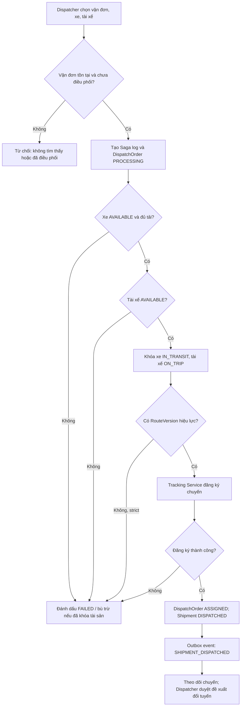

# Rà soát nghiệp vụ Dispatcher

## Kết luận

Dispatcher hiện có nghiệp vụ điều phối chuyến ở mức luồng chính, nhưng chưa đủ để xem là quy trình vận hành hoàn chỉnh. Backend đã có kiểm tra điều kiện xe/tài xế, khóa tài sản, xác minh tuyến, đăng ký chuyến và bù trừ khi Saga lỗi. UI có màn hình chọn xe/tài xế và phát lệnh. Tuy nhiên còn thiếu một số kiểm soát vận hành, và có khả năng tạo chuyến Tracking hai lần do cả backend Saga lẫn UI cùng gọi tạo chuyến.

## Các nghiệp vụ Dispatcher hiện có

| Nghiệp vụ | Hiện trạng | Bằng chứng trong mã nguồn |
|---|---|---|
| Chọn vận đơn, xe, tài xế | Có UI; dữ liệu fallback demo được dùng khi API không trả dữ liệu | `frontend/src/systems/operations/features/dispatch/DispatchPage.jsx` |
| Phát hành lệnh điều phối | Có `POST /api/v1/shipments/dispatch`, tạo DispatchOrder trạng thái PROCESSING rồi ASSIGNED/FAILED | `ShipmentController`, `TripDispatchSagaOrchestrator` |
| Chặn vận đơn đã điều phối / mã lệnh trùng | Có kiểm tra shipment DISPATCHED, dispatch đang tồn tại và dispatchCode trùng | `TripDispatchSagaOrchestrator.executeDispatchSaga` |
| Kiểm tra xe sẵn sàng và tải trọng | Có kiểm tra AVAILABLE và cargo weight không vượt maxPayloadTons | `DispatchEligibilityValidator` |
| Kiểm tra tài xế sẵn sàng | Có kiểm tra trạng thái AVAILABLE | `DispatchEligibilityValidator` |
| Khóa xe và tài xế sau khi gán | Có cập nhật xe IN_TRANSIT, tài xế ON_TRIP | `DispatchEligibilityValidator.updateAssetStatusesOnDispatch` |
| Gắn tuyến hiệu lực | Saga truy vấn active RouteVersion; strict mode yêu cầu phải có tuyến | `TripDispatchSagaOrchestrator.verifyActiveRoute` |
| Khởi tạo chuyến theo dõi | Saga gọi Tracking Service và sau đó lưu trạng thái vận đơn DISPATCHED | `TripDispatchSagaOrchestrator` |
| Bù trừ nếu Saga thất bại | Có mở khóa tài sản đã reserve, DispatchOrder FAILED và ghi saga/outbox | `TripDispatchSagaOrchestrator` |
| Phát sự kiện và tra cứu lệnh | Có transactional outbox và API lấy dispatch theo shipment | `TripDispatchSagaOrchestrator`, `ShipmentController` |
| Duyệt đề xuất đổi tuyến | Có luồng human-in-the-loop tại màn hình theo dõi chuyến | `TripTrackingPage.jsx`, UC10 |

## Luồng nghiệp vụ đang được triển khai

Mã nguồn sơ đồ: [`dispatcher-current-flow.mmd`](dispatcher-current-flow.mmd).

## Đánh giá mức độ đáp ứng

**Đã đáp ứng một phần:** gán xe/tài xế, kiểm tra trạng thái và tải trọng, kiểm soát phát lệnh trùng, gắn tuyến, phối hợp đa dịch vụ, ghi log/outbox, bù trừ lỗi, và duyệt đổi tuyến.

**Chưa đủ / cần xác minh trước vận hành thật:**

1. **Rủi ro tạo chuyến hai lần:** `TripDispatchSagaOrchestrator` đã gọi Tracking Service để đăng ký trip. Sau khi `createDispatchOrder` trả về, `DispatchPage.jsx` lại gọi `api.createTrip`, rồi gọi `startTrip`. Nếu Saga đã tạo trip thành công, thao tác thứ hai có thể tạo bản ghi trùng hoặc làm luồng lỗi tùy ràng buộc Tracking Service.
2. **Pre-trip chưa được backend xác thực trong điều phối:** UI hiển thị `preTripPassed` từ fallback, nhưng `DispatchEligibilityValidator` chỉ kiểm tra status xe và tải trọng; không kiểm tra bản ghi kiểm tra an toàn hợp lệ, thời hạn/đúng xe/đúng chuyến. Cần enforcement phía server.
3. **Tính nguyên tử khi khóa tài sản:** xe được cập nhật IN_TRANSIT trước tài xế; nếu cập nhật một bên thành công rồi bên kia lỗi, cờ `assetLocked` chỉ được đặt sau khi cả hàm trả về nên Saga có thể không chạy bù trừ. API đổi status cũng không phải thao tác reserve nguyên tử có compare-and-set, nên có nguy cơ hai Dispatcher cùng chọn một xe/tài xế.
4. **Phân quyền và danh tính người thao tác:** request controller không thấy dùng actor từ security context; UI gửi tên dispatcher cố định/không truyền trong payload hiện tại. Cần xác thực ROLE_DISPATCHER và lưu actor thật, lý do/ghi chú và dấu vết audit.
5. **Luồng huỷ/điều chỉnh lệnh:** đã có trạng thái CANCELLED trong truy vấn chống trùng nhưng chưa thấy nghiệp vụ/API hủy lệnh, giải phóng xe/tài xế và đồng bộ trạng thái shipment/trip.
6. **Tính sẵn sàng tài nguyên:** UI khởi tạo bằng dữ liệu demo và chỉ thay khi API trả danh sách; khi API lỗi, Dispatcher vẫn có thể thấy/chọn dữ liệu fallback. Cần hiển thị trạng thái lỗi dữ liệu và không cho phát lệnh bằng tài nguyên demo.
7. **Giao dịch liên dịch vụ và retry:** Saga hiện là gọi HTTP đồng bộ; cần quy tắc idempotency, timeout/retry có giới hạn, đối soát trạng thái khi timeout không rõ kết quả, và khả năng khôi phục Saga bị treo.
8. **Ràng buộc nghiệp vụ vận đơn:** code chặn đã DISPATCHED và soft-delete, nhưng cần xác nhận các trạng thái nguồn được phép điều phối (ví dụ chỉ PLANNED/READY), container/loại xe, giấy phép phù hợp, giờ làm việc tài xế và quy tắc tải theo cấu hình pháp lý.

## Luồng mục tiêu đề xuất

```mermaid
flowchart LR
    A[Chọn vận đơn PLANNED/READY] --> B[Server lấy danh sách xe và tài xế khả dụng]
    B --> C[Kiểm tra Pre-trip, giấy phép, tải trọng, loại xe, ca làm]
    C --> D[Lập tuyến xanh và Dispatcher chốt RouteVersion]
    D --> E[Reserve xe + tài xế nguyên tử, có idempotency key]
    E --> F[Phát hành DispatchOrder và khởi tạo đúng một trip]
    F --> G{Thành công?}
    G -- Có --> H[Chuyển trạng thái + audit + thông báo]
    G -- Không --> I[Compensate/retry/đưa vào hàng đối soát]
    H --> J[Giám sát GPS, cảnh báo, xử lý sự cố]
    J --> K{Có đề xuất đổi tuyến?}
    K -- Có --> L[Dispatcher duyệt/từ chối; lưu actor và lý do]
    K -- Không --> M[Tiếp tục chuyến]
    L --> M
    M --> N[ePOD, hoàn chuyến, giải phóng xe/tài xế, đối soát carbon]
```

## Ưu tiên hoàn thiện

| Ưu tiên | Việc cần làm | Lý do |
|---|---|---|
| P0 | Chọn một nơi duy nhất tạo trip; xác định Saga trả tripId để UI điều hướng/start theo hợp đồng thống nhất | Tránh tạo trùng chuyến và sai trạng thái |
| P0 | Backend xác thực pre-trip và reserve xe/tài xế nguyên tử, có chống cạnh tranh | An toàn và tránh phân công trùng |
| P1 | Bỏ fallback tài nguyên demo khi API lỗi; xác thực role và actor từ security context | Ngăn điều phối bằng dữ liệu giả, tăng truy vết |
| P1 | Bổ sung huỷ/đổi phân công có Saga bù trừ và audit | Bao phủ vòng đời lệnh |
| P1 | Idempotency, xử lý timeout/retry và màn hình đối soát Saga | Chịu lỗi khi các service không ổn định |
| P2 | Chốt tiêu chí vận đơn, loại xe, bằng lái, ca làm và tải trọng theo quy định áp dụng | Hoàn chỉnh eligibility theo vận hành |

Phạm vi rà soát dựa trên mã nguồn và tài liệu hiện có; chưa chạy end-to-end với các service đang hoạt động. Kết luận về tạo trip trùng là rủi ro từ hai điểm gọi trong code, cần kiểm chứng thêm với tính idempotent/ràng buộc unique của Tracking Service.
