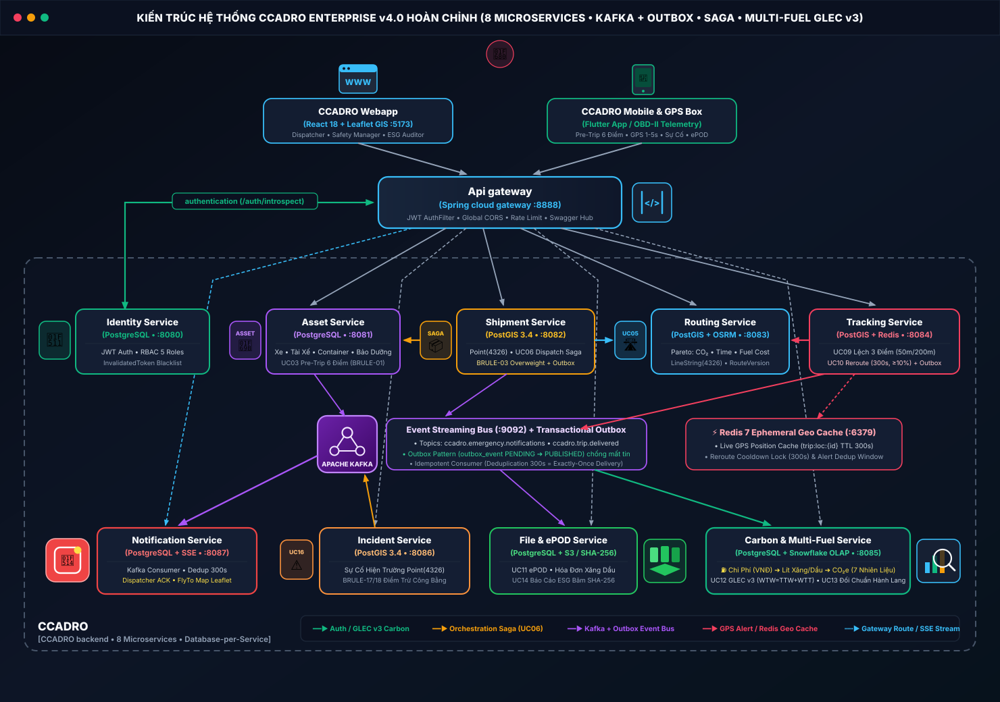
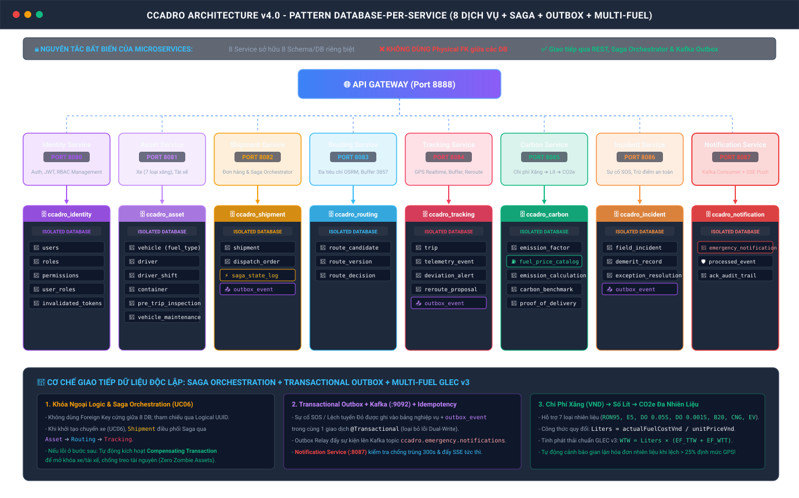
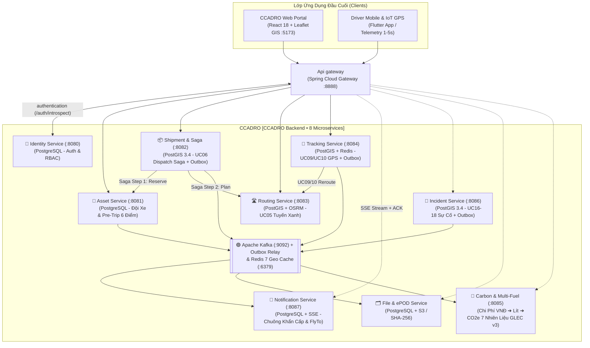
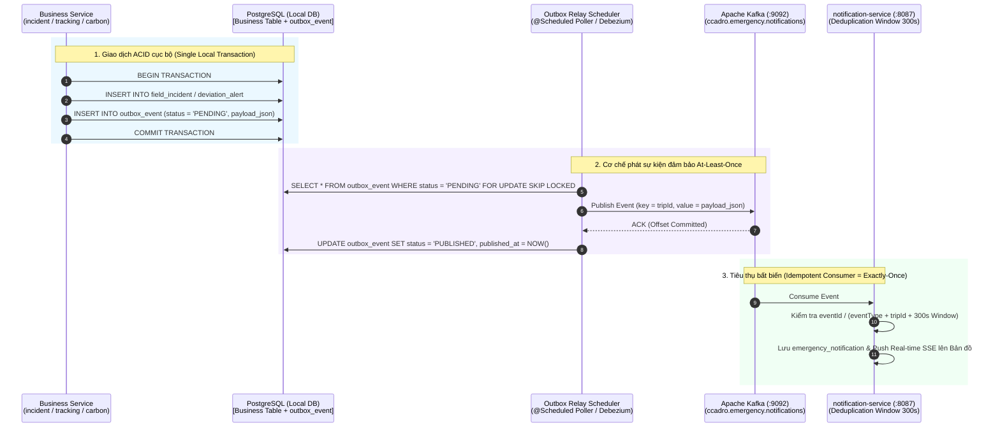
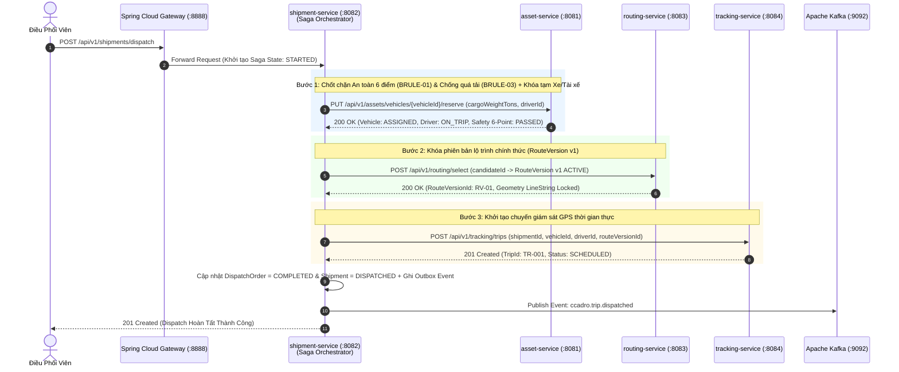

# CCADRO Enterprise Microservices Architecture Specification
**Hệ Thống Giám Sát Chuỗi Cung Ứng Xanh & Điều Vận Logistics Thông Minh**
*Green Supply Chain & Smart Logistics Tracker (CCADRO)*

---

## 1. Tổng Quan Kiến Trúc (Architecture Overview - Theo Mẫu Chuẩn Bookteria / Devteria)

Hệ thống **CCADRO Enterprise v4.0** được thiết kế dựa trên mô hình **Spring Boot 3 Microservices chuẩn Bookteria (Devteria)** kết hợp kiến trúc dữ liệu không gian PostGIS 3.4 & kế toán phát thải quốc tế GLEC v3:
1. **Single Entry Point & Edge Authentication (`api-gateway :8888` $\leftrightarrow$ `identity-service :8080`)**: Toàn bộ ứng dụng đầu cuối (Web Portal React 18 Leaflet `:5173`, Mobile App Tài xế, Thiết bị GPS) chỉ giao tiếp qua `api-gateway (:8888)`. Gateway thực hiện xác thực tập trung qua nhánh `authentication` (`POST /api/v1/auth/introspect`) sang `identity-service (:8080)` trước khi điều phối vào khung Backend nội bộ.
2. **Domain-Driven Design & Polyglot Persistence (`Database-per-Service`)**: Phân tách hệ thống thành **8 Microservices độc lập (`:8080`–`:8087`)**, mỗi service sở hữu Database/Schema riêng biệt phù hợp nhất với bài toán nghiệp vụ (PostgreSQL ACID, PostGIS Spatial `Point/LineString/Polygon`, Redis 7 Ephemeral Geo Cache, Apache Kafka `:9092` + Transactional Outbox, S3/SHA-256 Object Storage, Snowflake OLAP).
3. **Hybrid Sync Hard-Gates, Orchestration Saga & Async Event-Driven Architecture**:
   - **Đồng bộ (`RestClient` & `Orchestration Saga UC06`)**: Thực thi các chốt chặn an toàn & tải trọng tức thời (`BRULE-01` Pre-Trip 6 điểm, `BRULE-03` Chống quá tải) kèm giao dịch bù trừ tự động (`Compensating Transaction`).
   - **Bất đồng bộ (`Kafka :9092 + Transactional Outbox`)**: Giải ghép các luồng sự kiện tần suất cao (cảnh báo lệch tuyến Đỏ `UC09`, thông báo sự cố khẩn cấp `UC16-18` sang `notification-service :8087`, quyết toán phát thải đa nhiên liệu `UC12`).
4. **Immutable Auditability & Human-in-the-Loop**: Mọi quyết định đổi tuyến động (`UC10 / BRULE-09`) và kỷ luật tài xế vượt ngưỡng 20 điểm (`UC18 / BRULE-18`) đều bắt buộc có sự phê duyệt của con người; mọi bản tính phát thải (`SUPERSEDED` + `versionNumber++`) và báo cáo ESG (`SHA-256`) đều bất biến.

### 1.1. Sơ Đồ Kiến Trúc Tương Tác Hệ Thống Hoàn Chỉnh (Bookteria-Style Vector Diagram)



### 1.2. Sơ Đồ Kiến Trúc Database-per-Service (8 Dịch Vụ Độc Lập + Saga + Outbox + Multi-Fuel)



### 1.3. Lưu Đồ Luồng Tương Tác (Mermaid Flowchart)



---

## 2. Chi Tiết 6 Microservices Độc Lập

### 2.1. `asset-service` (Dịch Vụ Quản Trị Tài Sản & Đội Xe)
* **Port**: `8081`
* **Cơ sở dữ liệu**: `ccadro_asset_db` (PostgreSQL 16)
* **Trách nhiệm nghiệp vụ**:
  * Quản lý xe tải (`vehicle`), thông số tải trọng, tiêu chuẩn Euro, loại nhiên liệu.
  * Quản lý hồ sơ tài xế (`driver`), bằng lái, trạng thái hoạt động (`DriverStatus`).
  * Quản lý vỏ container khô / lạnh (`container`, `ContainerType`).
  * Quản lý lịch trình bảo dưỡng (`vehicle_maintenance`).
  * Thực thi **Pre-Trip 6 Điểm An Toàn (`pre_trip_inspection`)** trước giờ xuất bến: Lốp, phanh, đèn, dầu làm mát, bình cứu hỏa, khóa container. Tự động chuyển xe sang `MAINTENANCE` nếu `critical_failures_count > 0`.
* **API Endpoints chính**:
  * `POST /api/v1/assets/inspections` (Nộp biên bản kiểm tra 6 điểm)
  * `GET /api/v1/assets/vehicles/{id}/readiness` (Thẩm định điều kiện an toàn xe - `BRULE-01`)
  * `GET /api/v1/assets/containers` (Danh sách container sẵn sàng)
  * `POST /api/v1/assets/maintenance` (Đặt lịch bảo dưỡng)

---

### 2.2. `shipment-service` (Dịch Vụ Đơn Vận & Điều Phối Dispatch)
* **Port**: `8082`
* **Cơ sở dữ liệu**: `ccadro_shipment_db` (PostgreSQL 16 + PostGIS 3.4)
* **Trách nhiệm nghiệp vụ**:
  * Quản lý vận đơn hàng hóa (`shipment`), tọa độ xuất phát (`origin_geom`), tọa độ đích (`destination_geom`).
  * Lập lệnh điều vận (`dispatch_order`), ghép cặp xe - tài xế - container - lộ trình đã duyệt.
  * Đóng vai trò **Saga Orchestrator** trong chu trình điều phối chuyến hàng.
* **Sự kiện xuất bản (Kafka Events)**:
  * `shipment.created`: Khi đơn hàng mới được tạo.
  * `dispatch.ordered`: Khi Dispatcher phê duyệt lệnh xuất phát.
* **API Endpoints chính**:
  * `POST /api/v1/shipments` (Tạo đơn hàng mới)
  * `POST /api/v1/shipments/{id}/dispatch` (Kích hoạt lệnh điều vận)
  * `GET /api/v1/shipments/{id}/status` (Tra cứu tiến độ đơn hàng)

---

### 2.3. `routing-service` (Dịch Vụ Định Tuyến Đa Tiêu Chí Xanh)
* **Port**: `8083`
* **Cơ sở dữ liệu**: `ccadro_routing_db` (PostgreSQL 16 + PostGIS 3.4)
* **Trách nhiệm nghiệp vụ (UC05, UC10)**:
  * Tích hợp các nhà cung cấp bản đồ số qua `RoutingProvider` (OSRM, OpenRouteService, Google Maps).
  * Thuật toán đa mục tiêu tính toán trọng số tổng hợp:
    $$\text{Score} = w_1 \cdot \text{CO}_2 + w_2 \cdot \text{Time} + w_3 \cdot \text{Cost} + w_4 \cdot \text{Risk}$$
  * Lưu các phương án đề xuất (`route_candidate`), biên bản lựa chọn (`route_decision`), và phiên bản lộ trình chính thức (`route_version`).
  * Tự động sinh lộ trình thay thế khi nhận cảnh báo tắc đường / sự cố từ `tracking-service`.
* **API Endpoints chính**:
  * `POST /api/v1/routes/plan` (Tính toán các phương án định tuyến đa tiêu chí)
  * `POST /api/v1/routes/select` (Dispatcher chốt lộ trình chính thức)
  * `POST /api/v1/routes/replan` (Tính toán lộ trình thay thế khi có tắc đường)

---

### 2.4. `tracking-service` (Dịch Vụ Giám Sát Thời Gian Thực & Lệch Tuyến)
* **Port**: `8084`
* **Cơ sở dữ liệu**: `ccadro_tracking_db` (PostgreSQL 16 + PostGIS 3.4 + TimescaleDB Extension)
* **Trách nhiệm nghiệp vụ (UC07, UC08, UC09, UC10)**:
  * Ingestion luồng GPS tốc độ cao (1.000+ points/giây) từ thiết bị IoT hoặc Mobile App của tài xế.
  * Lọc nhiễu tọa độ (Quality Gate), lọc điểm nhảy tọa độ do mất sóng hầm / trạm thu phí.
  * Tính toán khoảng cách hình học tới tuyến đường (`ST_Distance(telemetry_point, active_route_linestring)`).
  * Kích hoạt máy trạng thái cảnh báo lệch tuyến (**Deviation State Machine**):
    * Lệch $> 50m$ kéo dài 3 lần quét $\rightarrow$ Cảnh báo Vàng (`YELLOW`).
    * Lệch $> 200m$ $\rightarrow$ Báo động Đỏ (`RED`) $\rightarrow$ Kích hoạt tính toán Reroute.
  * Đề xuất phương án đổi đường (`reroute_proposal`) khi chỉ số tiết kiệm $\ge 10\%$ (`benefit_ratio >= 0.10`).
* **Sự kiện xuất bản (Kafka Events)**:
  * `tracking.telemetry.ingested`
  * `tracking.deviation.detected` (Payload: tripId, severity, distanceMeters, coords)
  * `tracking.reroute.proposed`
* **API Endpoints chính**:
  * `POST /api/v1/tracking/telemetry` (Nhận gói tin GPS từ xe)
  * `GET /api/v1/tracking/trips/{id}/live` (Lấy vị trí hiện tại & trạng thái lệch tuyến)
  * `PUT /api/v1/tracking/reroute-proposals/{id}/decision` (Dispatcher duyệt/từ chối đề xuất đổi đường)

---

### 2.5. `carbon-service` (Dịch Vụ Kế Toán Phát Thải GLEC v3 & Chuẩn Đích ESG)
* **Port**: `8085`
* **Cơ sở dữ liệu**: `ccadro_carbon_db` (PostgreSQL 16)
* **Trách nhiệm nghiệp vụ (UC11, UC12, UC13, UC14)**:
  * Lưu trữ hệ số phát thải GLEC v3 (`emission_factor`): Hệ số chạy rỗng (Empty Factor), hệ số tải đầy (Full Factor), hệ số tấn-km mặc định.
  * Tính toán lượng phát thải chính xác sau chuyến theo phương pháp Well-to-Wheel (WTW = WTT + TTW):
    $$\text{Emission (kg } CO_2e) = \text{Distance (km)} \times \text{Payload (tons)} \times \text{GLEC\_Factor} \times \text{DAF}$$
  * So sánh đối chứng hành lang phát thải (`carbon_benchmark`, `carbon_benchmark_result`): So sánh tuyến CCADRO với đường ngắn nhất, nhanh nhất và kịch bản kinh doanh thông thường (BAU).
  * Lưu trữ bằng chứng giao hàng điện tử (`proof_of_delivery` - ePOD) để chốt quãng đường thực tế hợp lệ (`actual_distance_km`).
  * Xuất báo cáo kiểm toán ESG (`carbon_report_export`) định dạng CSV, PDF, JSON.
* **API Endpoints chính**:
  * `POST /api/v1/carbon/calculate` (Kích hoạt tính toán phát thải chuyến hàng)
  * `POST /api/v1/carbon/pod` (Xác nhận giao hàng & chốt khoảng cách)
  * `GET /api/v1/carbon/benchmarks/{corridorId}` (Tra cứu dữ liệu đối chuẩn hành lang)
  * `POST /api/v1/carbon/reports/export` (Xuất file báo cáo kiểm toán)

---

### 2.6. `exception-service` (Dịch Vụ Quản Trị Sự Cố & Kỷ Luật Tài Xế)
* **Port**: `8086`
* **Cơ sở dữ liệu**: `ccadro_exception_db` (PostgreSQL 16)
* **Trách nhiệm nghiệp vụ (UC16, UC17, UC18)**:
  * Tiếp nhận báo cáo sự cố hiện trường (`field_incident`): Tai nạn, ùn tắc nghiêm trọng, sự cố hỏng xe, đường cấm, thời tiết cực đoan.
  * Quy trình phê duyệt giải trình của Supervisor/Dispatcher (`exception_resolution`).
  * Sổ chấm điểm phạt hành vi tài xế (`demerit_record`): Lệch tuyến không phép, vi phạm tốc độ, trốn kiểm tra an toàn 6 điểm.
  * Cơ chế thẩm định kỷ luật bảo đảm có sự can thiệp của con người (**Human-in-the-Loop**, Rule `BRULE-18`) trước khi đưa tài xế vào danh sách đình chỉ (`SUSPENDED`) hoặc cấm (`BLACKLISTED`).
* **API Endpoints chính**:
  * `POST /api/v1/exceptions/incidents` (Tài xế báo cáo sự cố)
  * `PUT /api/v1/exceptions/incidents/{id}/resolve` (Điều phối viên thẩm định giải pháp)
  * `GET /api/v1/exceptions/drivers/{driverId}/demerits` (Xem lịch sử điểm phạt tài xế)

---

## 3. Kiến Trúc Dữ Liệu Phân Tán: Bảng Ánh Xạ Database-per-Service

| Tên Microservice | Tên Database Riêng | Căn Cứ Schema Flyway Cũ | Danh Sách Bảng Quản Trị Độc Quyền |
| :--- | :--- | :--- | :--- |
| **`asset-service`** | `ccadro_asset_db` | V002, V009 | `vehicle`, `driver`, `container`, `vehicle_maintenance`, `pre_trip_inspection`, `driver_shift` |
| **`shipment-service`**| `ccadro_shipment_db`| V003, V009 | `shipment`, `dispatch_order` |
| **`routing-service`** | `ccadro_routing_db` | V004, V009 | `route_candidate`, `route_decision`, `route_version` |
| **`tracking-service`**| `ccadro_tracking_db`| V005, V009 | `trip`, `telemetry_event`, `deviation_alert`, `reroute_proposal` |
| **`carbon-service`**  | `ccadro_carbon_db`  | V006, V009 | `emission_factor`, `emission_calculation`, `carbon_benchmark`, `carbon_benchmark_result`, `proof_of_delivery`, `carbon_report_export` |
| **`exception-service`**| `ccadro_exception_db`| V009 | `field_incident`, `exception_resolution`, `demerit_record` |

> [!IMPORTANT]
> **Nguyên tắc cô lập dữ liệu (Data Isolation Invariant)**:
> Không có bất kỳ truy vấn SQL liên database (`CROSS-DB JOIN`). Tất cả việc tham chiếu giữa các dịch vụ bắt buộc phải thông qua **UUID Định Danh Khách Trừu Tượng** và trao đổi thông tin qua REST/OpenFeign hoặc Kafka Event.

---

## 4. Phân Tích & Thiết Kế Saga Pattern + Transactional Outbox Pattern

### 4.1. Đánh Giá Kiến Trúc: Khi Nào Nên Và Không Nên Áp Dụng Saga & Outbox?

Trong kiến trúc Microservices của CCADRO (`Database-per-Service`), việc áp dụng **Saga Pattern** và **Transactional Outbox Pattern** cần tuân thủ nguyên lý **Thực dụng & Đúng Trọng Tâm (Selective & Pragmatic Design)** để tránh làm phức tạp hóa hệ thống (Over-engineering):

| Mẫu Thiết Kế (Pattern) | Luồng Nghiệp Vụ NÊN Áp Dụng Trong CCADRO | Luồng KHÔNG NÊN Áp Dụng | Lý Do Kiến Trúc & Độ Bền Vững |
| :--- | :--- | :--- | :--- |
| **Transactional Outbox Pattern** | 1. Báo cáo sự cố khẩn cấp (`UC16` $\rightarrow$ `notification-service`)<br>2. Phát hiện lệch tuyến Đỏ $>200\text{m}$ (`UC09` $\rightarrow$ `notification-service`)<br>3. Nộp biên bản giao hàng ePOD (`UC11` $\rightarrow$ `UC12` Tính Carbon) | Luồng thu nhận điểm GPS thô 1–5s/lần (`UC08` Raw Telemetry Stream) | Giải quyết triệt để lỗi **Dual-Write** (lưu DB thành công nhưng Kafka rớt mạng làm mất thông báo khẩn cấp). Không dùng cho GPS thô vì tần suất quá cao sẽ làm phình bảng Outbox. |
| **Orchestration Saga Pattern** | **Lệnh Điều Phối Xuất Bến (`UC06 - Trip Dispatch Saga`)** đi qua 4 services: `shipment` $\rightarrow$ `asset` $\rightarrow$ `routing` $\rightarrow$ `tracking` | Các thao tác CRUD đơn lẻ hoặc tính toán nội bộ 1 service (`UC01, UC03, UC05, UC13`) | Chỉ khi Xuất bến mới xảy ra việc **khóa tài nguyên chéo** (khóa Xe/Tài xế ở `asset-service`, khóa `RouteVersion` ở `routing-service`, tạo `Trip` ở `tracking-service`). Nếu bước cuối lỗi, bắt buộc phải có **Giao dịch bù trừ (Compensating Rollback)** để mở khóa xe. |

---

### 4.2. Thiết Kế Chi Tiết Transactional Outbox Pattern + Idempotent Consumer



* **Cấu trúc bảng `outbox_event` chuẩn doanh nghiệp**:
  * `id (UUID PK)`: Mã định danh duy nhất của sự kiện (dùng làm `idempotencyKey` ở phía Consumer).
  * `aggregate_type (VARCHAR)`: Loại thực thể nguồn (`FIELD_INCIDENT`, `DEVIATION_ALERT`, `DISPATCH_ORDER`, `PROOF_OF_DELIVERY`).
  * `aggregate_id (UUID)`: ID của bản ghi nghiệp vụ.
  * `event_type (VARCHAR)`: Tên sự kiện (`INCIDENT_CRITICAL_REPORTED`, `DEVIATION_RED_DETECTED`, `TRIP_DELIVERED`).
  * `payload_json (JSONB)`: Toàn bộ nội dung sự kiện đóng gói dạng JSON.
  * `status (VARCHAR)`: `PENDING` $\rightarrow$ `PUBLISHED` (hoặc `FAILED_DLQ` nếu vượt quá `max_retries = 5`).
  * `retry_count (INT)`: Số lần thử lại với chiến lược **Exponential Backoff**.

---

### 4.3. Thiết Kế Saga Chu Trình Khởi Tạo & Điều Vận Chuyến Đi (`Trip Dispatch Orchestration Saga - UC06`)

Khi Điều phối viên bấm **"Duyệt Chuyến & Xuất Bến"**, quy trình phân tán được điều phối bởi `shipment-service` như sau:



#### Bảng Giao Dịch Bù Trừ (Compensating Transactions Matrix) Khi Xảy Ra Lỗi Phân Tán:

| Bước Bị Lỗi | Nguyên Nhân Lỗi Điển Hình | Hành Động Bù Trừ Tự Động (Compensating Action) Của `shipment-service` | Trạng Thái Cuối Cùng Đảm Bảo Nhất Quán |
| :--- | :--- | :--- | :--- |
| **Bước 1 lỗi** (`asset-service`) | Xe đang `MAINTENANCE` (`BRULE-01`) hoặc `cargoWeightTons > maxPayloadTons` (`BRULE-03`) | Dừng ngay lập tức (Fail-Fast), chưa có tài nguyên nào bị khóa nên không cần gọi rollback. | `Shipment = CREATED`, trả mã lỗi `1107` hoặc `2104`. |
| **Bước 2 lỗi** (`routing-service`) | Chưa có tuyến đường hợp lệ hoặc lỗi khóa `RouteVersion` | Gọi `PUT /api/v1/assets/vehicles/{vehicleId}/release` sang `asset-service` để trả trạng thái Xe & Tài xế về `AVAILABLE`. | Xe & Tài xế quay về `AVAILABLE`, `DispatchOrder = COMPENSATED`. |
| **Bước 3 lỗi** (`tracking-service`) | `tracking-service` timeout hoặc không khởi tạo được `Trip` | 1. Gọi `POST /api/v1/routing/versions/{rvId}/deactivate` hủy kích hoạt `RouteVersion v1`.<br>2. Gọi `PUT /api/v1/assets/vehicles/{vehicleId}/release` mở khóa Xe & Tài xế về `AVAILABLE`. | Không có xe nào bị "treo" ở trạng thái `ON_TRIP` ảo. |

---

## 5. Phân Tích & Thiết Kế Mô Hình Chi Phí Nhiên Liệu $\rightarrow$ Lượng Xăng/Dầu Tiêu Thụ $\rightarrow$ Phát Thải $\text{CO}_2\text{e}$ Đa Loại Nhiên Liệu (Chuẩn GLEC v3 & ISO 14083)

### 5.1. Tại Sao Cần Bổ Sung Mô Hình Nhiên Liệu & Chi Phí Vào CCADRO?

Trong tiêu chuẩn quốc tế **GLEC Framework v3.0 & ISO 14083**, độ chính xác của kế toán phát thải khí nhà kính được chia làm **3 Bậc Dữ Liệu (3 Data Quality Tiers)**:
1. **Bậc 3 & Bậc 2 (Distance-Based / Modeled — Hiện đang có trong CCADRO)**:
   $$\text{CO}_2\text{e} = \text{Distance (km)} \times \text{Payload (tons)} \times \text{EF}_{\text{tonne-km}}$$
   *Hạn chế*: Hai chuyến xe đi cùng quãng đường $100\text{ km}$ và chở cùng $15\text{ tấn}$ hàng nhưng một chuyến đi đường bằng phẳng ban đêm, một chuyến kẹt xe $2\text{ giờ}$ trên đường Vành Đai 2 hoặc leo dốc sẽ tiêu thụ lượng xăng/dầu chênh lệch tới **25%–40%**. Nếu chỉ nhân theo $\text{tấn}\cdot\text{km}$ thì không phản ánh đúng lượng nhiên liệu thực tế đã đốt cháy và không tính được **Chi phí tiền nhiên liệu (VNĐ)** cho doanh nghiệp.
2. **Bậc 1 (Primary Fuel-Based & Spend-Based — Mức Chính Xác Cao Nhất Trong Kiểm Toán ESG)**:
   Tính toán trực tiếp từ **Chi phí hóa đơn nhiên liệu (VNĐ)** hoặc **Lượng nhiên liệu tiêu thụ thực tế (Lít / kg / kWh)** nhân với **Hệ số phát thải đặc trưng của từng loại xăng/dầu ($\text{EF}_{\text{fuel}}$)**.

---

### 5.2. Chuỗi Công Thức Toán Học Liên Hoàn: Chi Phí (VNĐ) $\leftrightarrow$ Lượng Nhiên Liệu (Lít) $\leftrightarrow$ Khí Thải $\text{CO}_2\text{e}$ ($\text{TTW, WTT, WTW}$)

Hệ thống hỗ trợ **3 Phương thức Quy đổi Linh hoạt** cho cả khâu **Lập kế hoạch (`PLANNING - UC05`)** và **Quyết toán sau chuyến (`POST_TRIP_ACCOUNTING - UC12`)**:

#### Phương thức 1: Quy đổi từ Hóa đơn Chi phí Nhiên liệu thực tế (Spend-to-Fuel Method)
Khi tài xế nộp biên bản giao hàng `ePOD` kèm tổng tiền đổ xăng/dầu trên hóa đơn ($\text{Cost}_{\text{fuel\_vnd}}$) và đơn giá nhiên liệu tại thời điểm đổ ($P_{\text{unit\_vnd}}$):
$$V_{\text{fuel (Liters)}} = \frac{\text{Cost}_{\text{fuel\_vnd}}}{P_{\text{unit\_vnd}}}$$

#### Phương thức 2: Ước lượng Lượng Xăng/Dầu & Chi phí từ Quãng đường, Tải trọng và Độ lệch/Kẹt xe (Load & Traffic-Adjusted Fuel Model)
Khi lập lộ trình (`UC05`) hoặc khi chuyến đi không có hóa đơn nhiên liệu riêng lẻ, lượng xăng/dầu tiêu thụ ($V_{\text{fuel}}$) được tính chính xác theo **Định mức tiêu hao rỗng ($C_{\text{empty}}$)**, **Định mức tiêu hao đầy tải ($C_{\text{full}}$)** (đơn vị: $\text{Lít}/100\text{km}$) và **Hệ số tải trọng ($\text{Load Factor } LF$)**:
$$LF = \min\left(1.0, \; \frac{W_{\text{cargo\_tons}}}{W_{\text{max\_payload\_tons}}}\right)$$
$$C_{\text{effective}} \text{ (Lít/100km)} = \left[ C_{\text{empty}} + \left(C_{\text{full}} - C_{\text{empty}}\right) \times LF \right] \times \alpha_{\text{traffic}}$$
$$V_{\text{fuel (Liters)}} = \frac{D_{\text{loaded\_km}}}{100} \times C_{\text{effective}} + \frac{D_{\text{empty\_km}}}{100} \times C_{\text{empty}}$$
$$\text{Cost}_{\text{fuel\_vnd}} = V_{\text{fuel (Liters)}} \times P_{\text{unit\_vnd}}$$
*(Trong đó $\alpha_{\text{traffic}} \ge 1.0$ là hệ số phạt tiêu hao nhiên liệu khi tắc đường hoặc đi đường đèo dốc; mặc định $\alpha_{\text{traffic}} = 1.00$ cho tuyến thông thoáng, $1.15$ cho tuyến kẹt xe nhẹ, $1.30$ cho tuyến ùn tắc nghiêm trọng).*

#### Phương thức 3: Tính Phát thải Khí nhà kính $\text{CO}_2\text{e}$ theo Từng Loại Xăng / Dầu / Năng lượng ($\text{WTW} = \text{TTW} + \text{WTT}$)
Từ lượng nhiên liệu tiêu thụ $V_{\text{fuel}}$ (Lít, kg hoặc kWh), lượng phát thải khí nhà kính được tính tách bạch theo chuẩn **GLEC Framework v3.0**:
$$\text{TTW}_{\text{kgCO}_2\text{e}} = V_{\text{fuel}} \times EF_{\text{TTW}} \quad \text{(Phát thải trực tiếp tại ống xả động cơ - Scope 1)}$$
$$\text{WTT}_{\text{kgCO}_2\text{e}} = V_{\text{fuel}} \times EF_{\text{WTT}} \quad \text{(Phát thải thượng nguồn khai thác & lọc dầu - Scope 3)}$$
$$\text{WTW}_{\text{kgCO}_2\text{e}} = \text{TTW}_{\text{kgCO}_2\text{e}} + \text{WTT}_{\text{kgCO}_2\text{e}} = V_{\text{fuel}} \times EF_{\text{WTW}}$$

---

### 5.3. Bảng Ma Trận Chuẩn Hóa 7 Loại Xăng / Dầu / Năng Lượng Xanh Trong CCADRO

Bảng dưới đây chuẩn hóa đầy đủ thông số kỹ thuật, định mức tiêu hao, đơn giá tham chiếu tại Việt Nam và hệ số phát thải **GLEC v3 / ISO 14083** cho 7 loại nhiên liệu để nạp vào bảng `emission_factor`:

| Mã Nhiên Liệu (`fuel_type`) | Tên Nhiên Liệu & Loại Xe Áp Dụng | Đơn Vị | Đơn Giá Tham Chiếu ($P_{\text{unit}}$) | Định Mức Rỗng $\rightarrow$ Đầy Tải ($C_{\text{empty}} \rightarrow C_{\text{full}}$) | Hệ Số $\text{TTW}$ ($\text{kg CO}_2\text{e}$) | Hệ Số $\text{WTT}$ ($\text{kg CO}_2\text{e}$) | Tổng $\text{WTW}$ ($\text{kg CO}_2\text{e}$) | So Sánh Mức Giảm $\text{CO}_2\text{e}$ |
| :--- | :--- | :---: | :---: | :---: | :---: | :---: | :---: | :--- |
| **`GASOLINE_RON95`** | **Xăng khoáng RON 95-V**<br>*(Xe tải nhẹ / Xe Van nội đô)* | Lít | `21,500 đ/L` | `9.5` $\rightarrow$ `13.5 L/100km` | `2.310` | `0.580` | **`2.890 kg/L`** | Mức cơ sở cho xe chạy xăng |
| **`BIO_GASOLINE_E5`** | **Xăng sinh học E5 RON 92**<br>*(Pha 5% Bio-ethanol sắn/mía)* | Lít | `20,500 đ/L` | `9.7` $\rightarrow$ `13.8 L/100km` | `2.200` | `0.540` | **`2.740 kg/L`** | Giảm **~5.2% $\text{CO}_2\text{e}$/L** & rẻ hơn RON95 |
| **`DIESEL_DO_005S`** | **Dầu Diesel DO 0.05S-II**<br>*(Xe tải nặng & Đầu kéo Euro 4)* | Lít | `19,200 đ/L` | `22.0` $\rightarrow$ `34.0 L/100km` | `2.680` | `0.560` | **`3.240 kg/L`** | Mức cơ sở cho đội xe tải/container |
| **`DIESEL_DO_0001S`** | **Dầu Diesel DO 0.001S-V**<br>*(Chuẩn sạch Euro 5/6)* | Lít | `20,100 đ/L` | `21.0` $\rightarrow$ `32.5 L/100km` | `2.640` | `0.540` | **`3.180 kg/L`** | Giảm **~6.2% $\text{CO}_2\text{e}$/km** nhờ hiệu suất Euro 5 |
| **`BIODIESEL_B20`** | **Dầu Sinh học Biodiesel B20**<br>*(Pha 20% FAME dầu thực vật)* | Lít | `20,800 đ/L` | `22.5` $\rightarrow$ `34.5 L/100km` | `2.140` | `0.490` | **`2.630 kg/L`** | Giảm mạnh **~18.8% $\text{CO}_2\text{e}$/L** (Chuyển đổi xanh) |
| **`CNG_COMPRESSED`** | **Khí thiên nhiên nén CNG**<br>*(Đầu kéo/Xe tải xanh CNG)* | kg | `16,500 đ/kg` | `18.0` $\rightarrow$ `28.0 kg/100km` | `2.540` | `0.480` | **`3.020 kg/kg`** | Giảm **~22% chi phí** & **~16% $\text{CO}_2\text{e}$/km** |
| **`EV_GRID_VN`** | **Xe tải Điện (Battery EV)**<br>*(Sạc lưới điện Việt Nam)* | kWh | `3,200 đ/kWh` | `85.0` $\rightarrow$ `130.0 kWh/100km` | `0.000` | `0.676` | **`0.676 kg/kWh`** | **$\text{TTW} = 0$** tại đô thị; giảm **~45% chi phí** |

---

### 5.4. Thiết Kế Mở Rộng Schema Database Cho Tính Toán Nhiên Liệu & Chi Phí

Để tích hợp trọn vẹn bài toán **Chi phí (VNĐ) $\rightarrow$ Số Lít Xăng/Dầu $\rightarrow$ $\text{CO}_2\text{e}$** mà không phá vỡ bất kỳ bảng hiện có nào, thiết kế mở rộng trên 3 bảng của `carbon-service` như sau:

1. **Mở rộng bảng `emission_factor` (Thêm thông số vật lý & đơn giá của từng loại xăng/dầu)**:
   * `fuel_unit (VARCHAR(15))`: `'LITER'`, `'KG'`, `'KWH'`
   * `reference_price_vnd_per_unit (NUMERIC(12,2))`: Đơn giá nhiên liệu chuẩn (VNĐ/Lít)
   * `ttw_kg_co2e_per_unit (NUMERIC(10,4))`: Hệ số phát thải đốt cháy trực tiếp ($\text{kg CO}_2\text{e}/\text{Lít}$)
   * `wtt_kg_co2e_per_unit (NUMERIC(10,4))`: Hệ số phát thải thượng nguồn ($\text{kg CO}_2\text{e}/\text{Lít}$)
   * `wtw_kg_co2e_per_unit (NUMERIC(10,4))`: Tổng hệ số phát thải ($\text{TTW} + \text{WTT}$)
   * `avg_consumption_empty_per_100km (NUMERIC(8,2))`: Định mức tiêu hao khi chạy rỗng ($C_{\text{empty}}$)
   * `avg_consumption_full_per_100km (NUMERIC(8,2))`: Định mức tiêu hao khi đầy tải ($C_{\text{full}}$)

2. **Mở rộng bảng `proof_of_delivery` (Thu thập dữ liệu nhiên liệu thực tế tại hiện trường - `UC11`)**:
   * `fuel_type_used (VARCHAR(30))`: Loại nhiên liệu thực tế đã đổ/sử dụng (`GASOLINE_RON95`, `BIO_GASOLINE_E5`, `DIESEL_DO_005S`, `BIODIESEL_B20`...)
   * `actual_fuel_consumed_liters (NUMERIC(10,2))`: Số lít xăng/dầu thực tế tiêu thụ (nếu đo từ đồng hồ xe/OBD-II)
   * `fuel_cost_vnd (NUMERIC(14,2))`: Tổng chi phí tiền xăng/dầu thực tế trên hóa đơn (VNĐ)
   * `fuel_unit_price_vnd (NUMERIC(10,2))`: Đơn giá 1 lít xăng/dầu tại trạm (VNĐ/Lít)

3. **Mở rộng bảng `emission_calculation` (Báo cáo kiểm toán kép: Kinh tế & Môi trường - `UC12`)**:
   * `fuel_consumed_liters (NUMERIC(10,2))`: Lượng xăng/dầu tiêu thụ đã dùng để tính phát thải
   * `estimated_fuel_cost_vnd (NUMERIC(14,2))`: Chi phí nhiên liệu của chuyến đi (VNĐ)
   * `fuel_calculation_source (VARCHAR(30))`: `'INVOICE_COST_BASED'` (tính từ tiền hóa đơn), `'DIRECT_METER_LITERS'` (tính từ số lít thực tế), hoặc `'LOAD_DISTANCE_MODELED'` (ước lượng từ quãng đường & tải trọng)

---

## 5. Danh Mục Kafka Topics & Cấu Trúc Event

| Tên Topic | Producer | Consumer Chính | Mô Tả Nghiệp Vụ |
| :--- | :--- | :--- | :--- |
| `ccadro.telemetry.ingested` | `tracking-service` | `routing-service`, Dashboard | GPS raw stream từ xe container (Lat, Lon, Speed, Heading, Timestamp). |
| `ccadro.deviation.alerts` | `tracking-service` | `exception-service`, `routing-service` | Phát hiện xe chạy chệch hành lang an toàn $>50m$ hoặc $>200m$. |
| `ccadro.reroute.proposed` | `tracking-service` | Web Portal (Dispatcher UI) | Đề xuất tuyến đường mới khi tuyến cũ bị kẹt xe $>30$ phút. |
| `ccadro.trip.dispatched` | `shipment-service` | `asset-service`, `tracking-service` | Chuyến xe chính thức được cấp phép lăn bánh xuất bến. |
| `ccadro.trip.delivered` | `carbon-service` (ePOD) | `shipment-service`, `asset-service` | Hàng đã giao đến kho nhận, kích hoạt tính toán $CO_2$ GLEC v3. |
| `ccadro.carbon.calculated` | `carbon-service` | Web Portal, Báo Cáo ESG | Kết quả phát thải cuối cùng được đóng dấu kiểm toán. |

---

## 6. Kiến Trúc Triển Khai Container & Kubernetes (K8s Topology)

```text
k8s-cluster (Namespace: ccadro-production)
│
├── Ingress Controller (NGINX / AWS ALB)
│   └── SSL Termination (https://ccadro.greenlogistics.io)
│
├── Pod: spring-cloud-gateway (2 Replicas, HPA autoscaling)
│
├── Pods: Core Domain Services
│   ├── asset-service (2 Replicas)
│   ├── shipment-service (2 Replicas)
│   ├── routing-service (3 Replicas - CPU Intensive)
│   ├── tracking-service (4 Replicas - High-Throughput GPS Streaming)
│   ├── carbon-service (2 Replicas)
│   └── exception-service (2 Replicas)
│
├── Middleware Cluster
│   ├── Apache Kafka (3 Brokers + Kraft Controller)
│   ├── Redis Sentinel (1 Master, 2 Replicas - Caching & PubSub)
│   └── HashiCorp Consul / Eureka Cluster
│
└── Persistent Storage
    └── Amazon Aurora PostgreSQL / PostGIS 16 (Multi-AZ with Read-Replicas)
```

---

## 7. Khả Năng Mở Rộng & Chiến Lược Chống Lỗi (Resilience & Fault Tolerance)

1. **Circuit Breaker (Resilience4j)**:
   * Nếu nhà cung cấp bản đồ OSRM ngoài mạng gặp sự cố hoặc quá tải $\ge 50\%$, Circuit Breaker chuyển sang trạng thái `OPEN` trong 30 giây, tự động chuyển luồng sang `FallbackRoutingProvider` (OpenRouteService hoặc tuyến dự phòng offline).
2. **Rate Limiting (Chống Nghẽn GPS)**:
   * Áp dụng thuật toán **Token Bucket** trong Redis tại Spring Cloud Gateway: Giới hạn mỗi thiết bị IoT chỉ được push tối đa 1 điểm GPS/giây. Nếu xe gửi dồn dập (ví dụ sau khi qua vùng mất sóng), gói tin được chuyển vào buffer hàng đợi Kafka để xử lý tuần tự mà không làm nghẽn CPU.
3. **Graceful Degradation**:
   * Nếu `carbon-service` tạm thời bảo trì, việc giao hàng (`proof_of_delivery`) tại hiện trường vẫn hoàn tất bình thường; sự kiện được giữ trong Kafka Topic `ccadro.trip.delivered` và sẽ tự động bù đắp tính toán $CO_2$ ngay khi service online trở lại.
