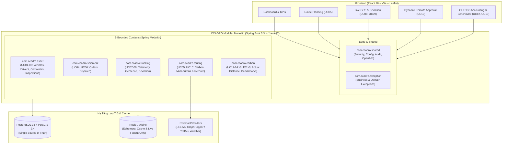

# TỔNG QUAN HỆ THỐNG CCADRO (BRD v4.0 BASELINE)
> **Green Supply Chain & Smart Logistics Tracker**  
> *Hệ thống điều vận logistics thông minh nhận thức phát thải carbon, giám sát thời gian thực & kế toán phát thải GLEC v3*

---

## 1. Giới Thiệu & Mục Tiêu Nghiệp Vụ

Dự án **CCADRO** giải quyết bài toán cốt lõi trong chuỗi cung ứng xanh:
1. **Lập tuyến nhận thức carbon (UC05)**: Sinh và xếp hạng phương án tuyến đa tiêu chí (Phát thải $CO_2e$, Thời gian di chuyển, Chi phí/Quãng đường, Mức độ rủi ro) thay vì chỉ chọn đường ngắn nhất/nhanh nhất.
2. **Giám sát thời gian thực & Cảnh báo lệch tuyến bền vững (UC08, UC09)**: Tiếp nhận GPS stream với quality gate và bộ lọc persistence counter để loại bỏ GPS spike, kích hoạt cảnh báo Vàng (50m) / Đỏ (200m).
3. **Tái tối ưu tuyến động Human-in-the-Loop (UC10)**: Tự động đề xuất tuyến mới khi phát sinh tắc đường, sự cố hoặc lệch tuyến kéo dài; yêu cầu Dispatcher phê duyệt trước khi kích hoạt `RouteVersion` mới.
4. **Kế toán phát thải sau chuyến chuẩn GLEC v3 (UC12)**: Tính toán $CO_2e$ dựa trên quãng đường GPS thực tế (`GPS_ACTUAL`), tải trọng và hệ số phát thải có truy xuất nguồn gốc (lineage), không nhân đôi DAF.
5. **Đối chuẩn hiệu quả giảm phát thải (UC13)**: So sánh kết quả thực tế với tuyến cơ sở giả định (Shortest, Fastest, BAU) trên cùng hành lang logistics, minh bạch cả các trade-off và kết quả âm/chưa kết luận.

---

## 2. Kiến Trúc Kỹ Thuật (Architecture & Tech Stack)

Hệ thống tuân thủ triệt để mô hình **Modular Monolith** theo chỉ thị kiến trúc:



### Công Nghệ Chủ Đạo:
* **Backend**: Java 17, Spring Boot 3.3.4, Spring Modulith 1.2.4, Spring Data JPA, Hibernate Spatial.
* **Database**: PostgreSQL 16 + PostGIS 3.4 (quản lý schema 100% bằng Flyway migrations `V001` - `V009`).
* **Cache & Fanout**: Redis 7-alpine (chỉ dùng cho cache đệm và live UI fanout; **không dùng** làm nguồn lưu trữ bền vững).
* **Frontend**: React 18, Vite 5, Leaflet 1.9 (bản đồ vệ tinh/tuyến đường), Lucide React, Vanilla CSS Tokens.
* **Môi trường Container**: Docker Compose (chạy `postgres` trên cổng 5433, `redis` trên cổng 6379).

---

## 3. Danh Mục 5 Module & 18 Use Case (BRD v4.0)

| Module | Use Case | Tên Nghiệp Vụ | Actor Chính | MoSCoW | Trạng Thái Hạ Tầng & Mã Nguồn |
| :--- | :--- | :--- | :--- | :---: | :--- |
| **M1: Asset** | **UC01** | Quản lý Container & Phương tiện | Fleet Admin | **Must** | Bảng `vehicle`, `driver`, `container` (V009) |
| | **UC02** | Quản lý bảo trì & sẵn sàng | Fleet Tech / Admin | **Must** | Bảng `vehicle_maintenance` (V009) |
| | **UC03** | Kiểm tra an toàn trước chuyến (Pre-trip) | Driver | **Must** | Bảng `pre_trip_inspection` (V009), rule `BRULE-01` |
| **M2: Shipment & Routing** | **UC04** | Tạo Shipment & Quản lý điểm đi/đến | Customer Service | **Must** | Bảng `shipment` (Point 4326 PostGIS, V003/V009) |
| | **UC05** | Sinh tuyến nhận thức carbon đa tiêu chí | Dispatcher | **Must (Core)** | Bảng `route_candidate`, `route_decision`, `RoutingService` |
| | **UC06** | Gán tài xế, xe & lệnh điều vận | Dispatcher | **Must** | Bảng `dispatch_order`, `route_version` (V004/V009) |
| **M3: Tracking & Dynamic Routing** | **UC07** | Bắt đầu chuyến & stream GPS telemetry | Driver | **Must** | Bảng `trip`, `telemetry_event` (V005/V009, SOP-10) |
| | **UC08** | Theo dõi vị trí, Live ETA & cự ly | Dispatcher / Shipper | **Must** | `TrackingController`, MapView, GPS simulator |
| | **UC09** | Phát hiện & cảnh báo lệch tuyến | Dispatcher | **Must (Core)** | Bảng `deviation_alert`, persistence filter (V005/V009) |
| | **UC10** | Tái tối ưu tuyến động (Re-routing) | Dispatcher | **Must (Core)** | Bảng `reroute_proposal`, Dispatcher Human-in-the-Loop |
| **M4: Carbon Accounting** | **UC11** | Chốt giao hàng & cự ly thực tế (ePOD) | Driver | **Must** | Bảng `proof_of_delivery` (`GPS_ACTUAL`, V009) |
| | **UC12** | Tính phát thải $CO_2e$ sau chuyến GLEC v3 | Sustainability Mgr | **Must (Core)** | Bảng `emission_calculation`, `emission_factor` |
| | **UC13** | Đối chuẩn hiệu quả giảm phát thải | Sustainability / Researcher | **Must (Core)** | Bảng `carbon_benchmark_result`, `carbon_benchmark` |
| | **UC14** | Xuất báo cáo carbon & audit trail | Sustainability Mgr | **Must** | Bảng `carbon_report_export` (V009) |
| **M5: Driver & Exception** | **UC15** | Quản lý ca trực & bàn giao xe | Dispatcher / Manager | Should | Bảng `driver_shift` (V009) |
| | **UC16** | Báo cáo sự cố hiện trường & bằng chứng | Driver | Should | Bảng `field_incident` (V009) |
| | **UC17** | Thẩm định & xử lý ngoại lệ hiện trường | Supervisor / Dispatcher | Should | Bảng `exception_resolution` (V009) |
| | **UC18** | Quản lý điểm phạt & xem xét blacklist | Fleet Manager / HR | Should | Bảng `demerit_record` (V009, `BRULE-17`, `BRULE-18`) |

---

## 4. Danh Mục 18 Quy Tắc Nghiệp Vụ (BRULE-01 -> BRULE-18)

| Rule ID | Nhóm Nghiệp Vụ | Nội Dung Quy Tắc | Vị Trí Cấu Hình / Thực Thi |
| :--- | :--- | :--- | :--- |
| **BRULE-01** | Safety eligibility | Xe đang bảo dưỡng hoặc Pre-trip checklist FAILED không được điều vận / start chuyến. | `pre_trip_inspection.status`, `vehicle.status` |
| **BRULE-02** | Master uniqueness | Biển số xe, mã container, mã shipment, mã chuyến phải là duy nhất. | Unique constraints trong PostgreSQL |
| **BRULE-03** | Hard constraints | Tuyến vi phạm tải trọng, đường cấm tải, time window bị loại bỏ trước khi tính điểm soft score. | `RoutingService#filterHardConstraints` |
| **BRULE-04** | Normalization | Chuẩn hóa Min-Max các chỉ số ($CO_2$, Time, Cost, Risk) chỉ thực hiện trong cùng candidate set. | `RoutingService#normalizeCandidates` |
| **BRULE-05** | Weight integrity | Trọng số tối ưu hóa không âm và có tổng bằng 1.0 (mặc định: Carbon 0.4, Time 0.3, Cost 0.2, Risk 0.1). | `ccadro.optimization.*` trong `application.yml` |
| **BRULE-06** | Plan vs Accounting | Phát thải ước tính kế hoạch (`ESTIMATE`) tách biệt hoàn toàn với phát thải kế toán sau chuyến (`ACTUAL`). | `emission_calculation.calculation_type` |
| **BRULE-07** | Cross-time comparison| Không so sánh điểm số min-max giữa các thời điểm khác nhau trong UC10. | `RerouteProposal` so sánh raw deltas |
| **BRULE-08** | Anti-oscillation | Tái tối ưu phi khẩn cấp yêu cầu lợi ích tối thiểu $\ge 10\%$ (`minimumBenefit: 0.10`) và cooldown 300s. | `ccadro.rerouting.*` |
| **BRULE-09** | Human route approval | Tuyến mới chỉ trở thành tuyến hiệu lực khi Dispatcher bấm duyệt (`ACCEPTED`). | `reroute_proposal.status`, `route_version` |
| **BRULE-10** | Deviation persistence | Cảnh báo lệch tuyến kết hợp khoảng cách (50m/200m) và chuỗi tọa độ liên tiếp (`consecutivePointsRequired: 3`). | `ccadro.deviation.*`, `deviation_alert` |
| **BRULE-11** | Actual distance | Quãng đường đã thẩm định từ vết GPS (`GPS_ACTUAL`) không được nhân thêm hệ số DAF (1.05). | `ccadro.carbon.applyDafOnActualGps: false` |
| **BRULE-12** | Factor lineage | Kế toán phát thải phải lưu vết mã hệ số, phiên bản, thời hạn hiệu lực, phương pháp và Tier. | `emission_factor`, `emission_calculation` |
| **BRULE-13** | Blocked calculation | Không có hệ số phát thải hợp lệ $\rightarrow$ trạng thái `BLOCKED`, tuyệt đối không tự ý đoán mò. | `emission_calculation.calculation_status` |
| **BRULE-14** | Immutable calculation | Tính toán lại tạo ra bản ghi phiên bản mới (`version_number`), không ghi đè dữ liệu cũ. | `emission_calculation.version_number` |
| **BRULE-15** | Benchmark integrity | Giữ lại đầy đủ kết quả âm/chưa kết luận trong đối chuẩn carbon, không ẩn giấu kết quả bất lợi. | `carbon_benchmark_result.comparability_status` |
| **BRULE-16** | Customer isolation | Khách hàng chỉ được phép truy cập và xem dữ liệu đơn hàng thuộc phạm vi của mình. | `shipment.customer_id`, Multi-tenancy gate |
| **BRULE-17** | Incident governance | Lệch tuyến và sự cố hiện trường không tự động biến thành hình phạt nhân sự. | `field_incident` $\rightarrow$ `exception_resolution` |
| **BRULE-18** | Blacklist governance | Vượt ngưỡng điểm phạt chỉ tạo trạng thái `REVIEW_REQUIRED`; quyết định kỷ luật do con người phê duyệt. | `ccadro.demerit.*`, `demerit_record` |

---

## 5. Tiến Trình Database Schema (Flyway V001 - V009)

Hệ thống cơ sở dữ liệu đã trải qua 9 bản migration tự động, đảm bảo không có schema drift:

```text
db/migration/
├── V001__enable_postgis.sql            (Khởi tạo extension PostGIS & uuid-ossp)
├── V002__create_vehicle.sql            (Bảng vehicle, driver)
├── V003__create_shipment.sql           (Bảng shipment với PostGIS Geometry Points)
├── V004__create_route_tables.sql       (Bảng route_candidate, route_decision, route_version)
├── V005__create_trip_tracking.sql      (Bảng trip, telemetry_event, deviation_alert, reroute_proposal)
├── V006__create_emission_factor.sql    (Bảng emission_factor, emission_calculation, carbon_benchmark)
├── V007__seed_demo_data.sql            (Dữ liệu mẫu Cát Lái -> VSIP 1, xe V001, tài xế D001, hệ số EF001)
├── V008__create_event_publication.sql  (Bảng outbox event_publication cho Spring Modulith)
└── V009__expand_brd_v4_support.sql     (Mở rộng toàn diện 18 Use Case: container, maintenance, 
                                         pre_trip, dispatch, ePOD, GLEC v3 Tier, demerit, incident)
```

---

## 6. Môi Trường Vận Hành & Lệnh Điều Khiển (DevOps)

### Trạng Thái Cổng & Dịch Vụ:
* **PostgreSQL + PostGIS**: `localhost:5433` (Container `ccadro-postgres`, database `ccadro`).
* **Redis**: `localhost:6379` (Container `ccadro-redis`).
* **Backend API**: `localhost:8080` (Spring Boot REST + OpenAPI Swagger tại `/swagger-ui.html`).
* **Frontend SPA**: `localhost:5173` (Vite dev server).

### Bộ Lệnh Điều Khiển Make:
```bash
make setup              # Tự động hóa toàn bộ (Docker, DB Flyway, npm packages)
make start              # Khởi động đồng thời Containers, Backend và Frontend
make stop               # Tắt toàn bộ dev server và dọn dẹp background process
make test               # Chạy song song kiểm thử Backend (JUnit/Modulith) và Frontend (Vitest)
make smoke              # Chạy bộ 8 bài kiểm tra smoke test đầu cuối
make simulate-normal    # Chạy mô phỏng GPS xe di chuyển bình thường theo lộ trình
make simulate-deviation # Chạy mô phỏng GPS xe bị lệch tuyến 300m (kích hoạt UC09/UC10)
make simulate-traffic   # Chạy mô phỏng xe gặp sự cố ùn tắc trên hành lang
```

---

## 7. Trạng Thái Kiểm Thử Hiện Tại (Verification Status)

1. **Spring Modulith Structural Verification**:
   * Kiểm tra tính toàn vẹn của cấu trúc Module Monolith: `PASSED`.
   * Giao tiếp giữa các module tuân thủ ranh giới API và Domain events.
2. **PostGIS Spatial Database Integration**:
   * Kiểm tra truy vấn không gian ST_Distance, ST_DWithin: `PASSED` (PostGIS 3.4).
3. **Frontend Component & App Test Suite**:
   * Chạy trên Vitest + JSDOM: `PASSED`.
   * Build bundle tĩnh Vite: `PASSED` trong 6.6s.
4. **Smoke Test Suite**:
   * Đạt `8/8` bước kiểm tra (PostgreSQL, PostGIS, Redis, Seed Data, Actuator, UC05 API, GPS Simulator, Frontend build).
5. **Git Version Control**:
   * Nhánh chính: `main` (đã đồng bộ remote).
   * Nhánh phát triển: `develop` (đã đồng bộ remote).
   * Nhánh tính năng môi trường: `feature/env-setup-brd-v4` (đã đồng bộ remote).
