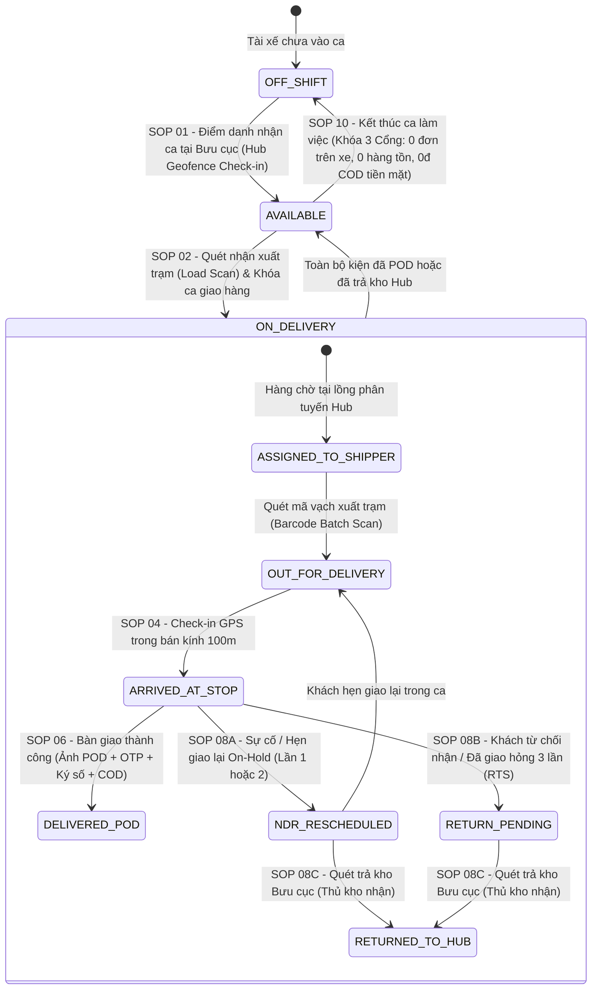

# BỘ QUY TRÌNH TIÊU CHUẨN NGHIỆP VỤ TÁC NGHIỆP TÀI XẾ GIAO NHẬN CHẶNG CUỐI (STANDARD OPERATING PROCEDURE - LAST-MILE SHIPPER SOP)
## ÁP DỤNG MÔ HÌNH VẬN HÀNH THỰC TẾ: SPX EXPRESS (SHOPEE EXPRESS) & GRABEXPRESS TRONG HỆ THỐNG CCADRO 3PL

---

### 1. TỔNG QUAN & MỤC TIÊU NGHIỆP VỤ

Trong chuỗi cung ứng logistics hiện đại và thương mại điện tử / phân phối B2B-3PL, chặng giao nhận cuối cùng (**Last-Mile Delivery**) chiếm từ **41% đến 53%** tổng chi phí logistics và là mắt xích trực tiếp quyết định sự hài lòng của khách hàng (CSAT), tỷ lệ giao hàng thành công (FADR), và an toàn tài chính (quản lý công nợ thu hộ COD).

Tài liệu này chuẩn hóa toàn bộ quy trình tác nghiệp của tài xế giao nhận (**Hub Local Shipper**) trên ứng dụng buồng lái tác nghiệp hiện trường, kế thừa và nâng chuẩn từ các hệ thống giao vận hàng đầu Đông Nam Á:
- **SPX Express (Shopee Express Driver)**: Tiêu chuẩn quét mã nhận tải, quy tắc bắt buộc 3 cuộc gọi (`3-Call Rule`), phân định Hàng giữ On-Hold vs Hàng hoàn Bưu cục (`RTS`), hạch toán COD tiền mặt vs QR động, và khóa kết thúc ca 3 điều kiện (`3-Gate End-Shift Checkout`).
- **GrabExpress Driver**: Cơ chế điều hướng lộ trình đa điểm dừng thời gian thực (`Multi-Stop Routing`), tính năng GPS Check-in tại điểm dừng, chuỗi lạnh bảo quản hàng đặc thù, và hệ thống thưởng mốc ngọc năng suất (`Daily SLA Gem Quest`).
- **Lazada Logistics (LEX) & Viettel Post (VTP)**: Cơ chế kiểm tra ngoại quan gói hàng (`Package Integrity Verification`) trước khi xuất trạm và quy trình kiểm soát nhiệt độ thùng bảo ôn (`Cold-Chain Probing`).

---

### 2. SƠ ĐỒ CHU TRÌNH VÒNG ĐỜI CA TRỰC & VẬN ĐƠN (STATE MACHINE)

---

### 3. CÁC QUY TRÌNH TÁC NGHIỆP TIÊU CHUẨN (SOP 01 - SOP 10)

#### SOP 01: ĐIỂM DANH NHẬN CA TẠI BƯU CỤC (STATION CHECK-IN)
1. **Mục đích**: Xác thực sự có mặt thực tế của tài xế tại Bưu cục chốt chặn (Hub Center) trước khi bắt đầu nhận hàng.
2. **Quy định**:
   - Tài xế phải có mặt trong bán kính địa giới của Bưu cục (`Geofence <= coverageRadiusKm`).
   - Kiểm tra phương tiện đầu ca: Xe máy/Van điện có chứng nhận kiểm định còn hiệu lực, thùng hàng bảo ôn sạch sẽ, nhiệt độ buồng lạnh đạt yêu cầu (nếu nhận tuyến hàng lạnh).
   - Hệ thống kích hoạt trạng thái `shiftStatus = 'AVAILABLE'` và ghi nhận timestamp `shiftCheckedInAt`.

#### SOP 02: QUÉT MÃ NHẬN TẢI & KIỂM TRA NGOẠI QUAN (LOAD SCAN & INTEGRITY CHECK)
1. **Mục đích**: Chuyển quyền quản lý và trách nhiệm pháp lý đối với hàng hóa từ Bưu cục sang cá nhân tài xế.
2. **Quy định**:
   - Tài xế dùng máy quét vạch / camera quét từng kiện hàng hoặc quét mã bảng kê (`Batch Pickup Scan`).
   - Phân loại ngoại quan:
     - **Nguyên vẹn (`INTACT`)**: Cho phép nhận tải lên xe, chuyển trạng thái sang `OUT_FOR_DELIVERY`.
     - **Rách / vỡ / ướt / có dấu hiệu cạy phá (`DAMAGED_TAMPERED`)**: Từ chối nhận tải, lập biên bản bàn giao tại trạm, không chuyển hàng lên xe.
   - **Khóa ca giao hàng**: Ngay khi có ít nhất 01 kiện ở trạng thái `OUT_FOR_DELIVERY`, trạng thái ca trực của tài xế bị khóa cứng ở chế độ `ON_DELIVERY` (Đang đi giao) — không cho phép chuyển sang `Tạm nghỉ` nhằm chống gian lận bỏ hàng giữa tuyến.

#### SOP 03: TỐI ƯU HÓA LỘ TRÌNH ĐA ĐIỂM DỪNG (MULTI-STOP ROAD ROUTING)
1. **Mục đích**: Sắp xếp thứ tự các điểm dừng theo đường phố thực tế (`Bưu cục Hub -> Điểm #1 -> Điểm #2 -> Điểm #3`) nhằm giảm thiểu quãng đường di chuyển và khí thải Carbon.
2. **Quy định**:
   - Sử dụng thuật toán định tuyến đường bộ OSRM/Leaflet thực tế thay vì đường chim bay (Haversine đường cong nhân hệ số uốn lượn đô thị 1.28).
   - Hiển thị đầy đủ khoảng cách từng chặng (`legDistanceKm`) và thời gian dự kiến tiếp cận (`ETA`).
   - Cảnh báo khung giờ cam kết dịch vụ (**SLA Delivery Window**): Điểm giao có mốc SLA sớm hơn được ưu tiên đưa lên đầu tuyến.

#### SOP 04: TIẾP CẬN ĐIỂM GIAO & CHECK-IN GPS (ARRIVAL VERIFICATION)
1. **Mục đích**: Ghi nhận bằng chứng tài xế đã di chuyển thực tế đến địa chỉ người nhận, ngăn chặn tình trạng tài xế ngồi một chỗ báo không liên lạc được.
2. **Quy định**:
   - Tọa độ GPS của tài xế phải nằm trong bán kính cho phép (thông thường <= 100m tính từ tọa độ địa chỉ khách hàng `deliveryLat, deliveryLng`).
   - Bấm nút **"Đã tới điểm giao (Check-in GPS)"** để ghi nhận `arrivedAtStop = true` và `arrivedAt = now()`.

#### SOP 05: QUY TẮC BẮT BUỘC 3 CUỘC GỌI SPX EXPRESS (MANDATORY 3-CALL RULE)
1. **Mục đích**: Bảo vệ quyền lợi người nhận, hạn chế tối đa các trường hợp tài xế tự ý hủy đơn vì lười giao hàng.
2. **Quy định của Shopee Express / SPX**:
   - Để được phép chọn lý do sự cố *"Không liên lạc được người nhận"*, tài xế **bắt buộc phải thực hiện tối thiểu 03 cuộc gọi** cho khách hàng:
     - Cuộc gọi #1: Khi vừa tiếp cận điểm giao hoặc trước khi đến 5-10 phút.
     - Cuộc gọi #2: Cách cuộc gọi đầu tối thiểu 3-5 phút.
     - Cuộc gọi #3: Cách cuộc gọi thứ hai tối thiểu 3-5 phút.
   - Ứng dụng tích hợp bộ đếm cuộc gọi tự động (`callAttemptsCount`).
   - Nếu `callAttemptsCount < 3`, hệ thống hiển thị cảnh báo đỏ vi phạm chất lượng và **vô hiệu hóa hoàn toàn** nút xác nhận sự cố không nghe máy.

#### SOP 06: BÀN GIAO THÀNH CÔNG & CHỨNG TỪ ĐIỆN TỬ (PHOTO POD & DUAL VERIFICATION)
1. **Mục đích**: Thu thập bằng chứng giao hàng thành công không thể chối cãi để đối soát khiếu nại.
2. **Quy định**:
   - **Ảnh chụp POD hợp lệ**: Bắt buộc chụp rõ nét:
     - Nhãn vận đơn có mã vạch (`PKG-*`).
     - Toàn cảnh gói hàng đặt tại vị trí bàn giao (Cổng công ty, Bàn lễ tân, Kho nhận, hoặc trên tay người nhận).
     - Không chấp nhận ảnh tối đen, ảnh chụp vô lăng xe, ảnh chụp mặt đất trống không có kiện hàng.
   - **Xác thực phương thức bàn giao**: Chọn đúng đối tượng tiếp nhận (`Người nhận trực tiếp / Thủ kho`, `Lễ tân / Bảo vệ`, `Cửa nhập Kho lạnh`).
   - **Đối soát mã OTP nhận hàng**: Với các đơn hàng giá trị cao hoặc hàng B2B, khách hàng cung cấp mã OTP 4 số. Hệ thống đối chiếu trực tiếp trước khi cho phép đóng đơn.
   - **Kiểm soát Chuỗi lạnh (Cold-Chain)**: Đo và nhập nhiệt độ thùng bảo ôn (°C) tại thời điểm mở nắp dỡ hàng.
   - **Chữ ký điện tử (e-Signature)**: Người nhận ký xác nhận trực tiếp trên màn hình cảm ứng của tài xế.

#### SOP 07: QUẢN LÝ THU HỘ COD & TRÁCH NHIỆM TÀI CHÍNH (COD CASH & DYNAMIC QR)
1. **Mục đích**: Bảo toàn 100% dòng tiền thu hộ cho người bán / đối tác 3PL.
2. **Quy định**:
   - **Thu tiền mặt (`COLLECTED_CASH`)**:
     - Tài xế thu đủ số tiền mặt theo phiếu gửi.
     - Hệ thống tự động ghi tăng công nợ tài xế cầm tay: `cod_holding_vnd = cod_holding_vnd + cod_amount_vnd`.
     - Hạn mức ký quỹ giữ tiền mặt tối đa của mỗi tài xế được cấu hình theo chính sách Bưu cục (mặc định 30.000.000 ₫). Vượt hạn mức sẽ bị tạm khóa nhận đơn mới.
   - **Thanh toán qua QR Động SPX (`COLLECTED_QR`)**:
     - Người nhận quét mã VietQR động do ứng dụng tài xế hiển thị (chứa đúng số tiền và mã vận đơn định danh).
     - Tiền chuyển thẳng vào tài khoản chuyên thu của Bưu cục / Công ty.
     - Hệ thống ghi nhận vào `cod_collected_qr_today_vnd`, **không tính công nợ tiền mặt** cho tài xế.

#### SOP 08: XỬ LÝ SỰ CỐ & LEO THANG HÀNG HOÀN (NDR & RETURN-TO-HUB)
1. **Mục đích**: Quy chuẩn hóa lộ trình luân chuyển hàng hóa chưa giao được.
2. **Phân loại**:
   - **Hàng giữ On-Hold (`NDR_RESCHEDULED`)**:
     - Áp dụng khi khách hẹn giao lại ca sau, bảo vệ KCN yêu cầu giấy tờ, hoặc sự cố bất khả kháng.
     - Số lần giao tối đa: **03 lần** (`delivery_attempt_count <= 3`).
     - Hàng được bảo quản an toàn trên xe hoặc tạm gửi lại kho Bưu cục.
   - **Chờ hoàn Hub (`RETURN_PENDING`)**:
     - Áp dụng khi khách từ chối nhận, hàng vỡ hỏng, sai địa chỉ, hoặc đã phát đủ 3 lần mà không thành công.
     - Không cho phép phát lại tự do trên đường.
3. **Quét mã trả kho Bưu cục (`SCAN_HUB_RETURN`)**:
   - Cuối ca trực, tài xế bắt buộc phải mang toàn bộ các kiện On-Hold và Chờ hoàn về Bưu cục.
   - Bấm nút **"Quét trả kho Bưu cục"**, Thủ kho tiếp nhận kiểm đếm và ký xác nhận chuyển trạng thái sang `RETURNED_TO_HUB`.

#### SOP 09: ĐỐI SOÁT NỘP QUỸ COD (COD REMITTANCE)
1. **Mục đích**: Thanh toán toàn bộ dư nợ tiền mặt thu hộ trong ca trước khi rời Bưu cục.
2. **Phương thức thực hiện**:
   - **Phương thức 1 - Nộp tiền mặt cho Thủ quỹ Bưu cục**:
     - Tài xế đến quầy quỹ Bưu cục, nộp đúng số tiền mặt `cod_holding_vnd`.
     - Nhập tên Thủ quỹ tiếp nhận và mã biên lai.
     - Thủ quỹ xác nhận trên hệ thống -> `cod_holding_vnd` trở về `0 ₫`.
   - **Phương thức 2 - Chuyển khoản VietQR định danh**:
     - Tài xế quét mã QR chuyển khoản đúng số tiền vào tài khoản thụ hưởng của Bưu cục.
     - Cổng thanh toán ghi nhận và gạch nợ tự động.

#### SOP 10: KHÓA KẾT THÚC CA LÀM VIỆC 3 ĐIỀU KIỆN (SPX 3-GATE CHECKOUT)
1. **Mục đích**: Đảm bảo ca làm việc kết thúc sạch sẽ, không có thất thoát hàng hóa hay công nợ trôi nổi qua đêm.
2. **Quy tắc 3 Cổng Kiểm Tra Nghiêm Ngặt**:
   - **Gate 1 (Không còn hàng trên đường)**: `inTransitItems.length === 0` (Tất cả đơn đã được giao thành công POD hoặc đã lập biên bản sự cố).
   - **Gate 2 (Không còn hàng tồn chưa bàn giao kho)**: `unreturnedItems.length === 0` (100% kiện On-Hold và Chờ hoàn đã quét bàn giao cho Thủ kho Hub).
   - **Gate 3 (Sạch công nợ tiền mặt COD)**: `cod_holding_vnd === 0` (Đã nộp toàn bộ tiền mặt thu hộ cho Thủ quỹ Bưu cục).
3. **Hành vi hệ thống**:
   - Nếu bất kỳ Gate nào bị đỏ (FAIL), nút xác nhận kết ca bị khóa hoàn toàn kèm thông báo chi tiết số lượng đơn/tiền còn thiếu.
   - Khi cả 3 Gate đều xanh (PASS), tài xế bấm xác nhận -> Trạng thái ca trực chuyển sang `OFF_SHIFT`, ghi nhận `shiftEndedAt = now()`.

---

### 4. MA TRẬN THƯỞNG NĂNG SUẤT SLA & THƯỞNG NGỌC (DAILY SLA GEM QUEST)

Để khuyến khích tài xế tuân thủ quy trình chất lượng, hệ thống áp dụng cơ chế Gamification tương tự GrabExpress Driver:
1. **Cước chặng cơ bản**: 38.000 ₫ / điểm giao thành công.
2. **Phụ phí bảo quản Chuỗi lạnh**: +22.000 ₫ / điểm giao lạnh đạt chuẩn nhiệt độ (°C).
3. **Phụ phí trọng lượng**: +12.000 ₫ / mỗi 100 kg vượt tải.
4. **Thưởng Ngọc SLA Ngày (Daily SLA Quest)**:
   - Hoàn tất 100% dải mã được giao trong ca với đầy đủ Ảnh POD hợp lệ và đúng hẹn OTD: Thưởng nóng **+120.000 ₫** vào ví thu nhập ca.
5. **Tiêu chuẩn xếp hạng Đối tác**:
   - Đối tác Kim Cương: Tỷ lệ nhận tuyến 100%, Giao đúng hẹn OTD >= 98%, Tỷ lệ POD hợp lệ 100%, Đánh giá người nhận >= 4.95/5.0.

---

### 5. KIẾN TRÚC LƯU TRỮ VÀ ĐỒNG BỘ DỮ LIỆU THỜI GIAN THỰC

- **PostgreSQL Database (`ccadro-postgres:5433`)**:
  - Bảng `public.container_cargo_manifest_item`: Lưu trữ dải mã vận đơn, trạng thái phát hàng, số lần gọi điện (`call_attempts_count`), lần phát (`delivery_attempt_count`), ngoại quan (`package_condition`), ảnh POD, mã OTP, chữ ký số, và trạng thái trả kho Bưu cục.
  - Bảng `public.hub_local_shipper`: Quản lý hồ sơ tài xế, tọa độ GPS thời gian thực, số dư ví tiền mặt COD (`cod_holding_vnd`), COD QR động trong ca, và lịch sử giờ vào/ra ca.
  - Bảng `public.hub_shipper_cod_remittance`: Lưu trữ toàn bộ biên lai nộp quỹ COD (mã phiếu, số tiền, hình thức nộp, thủ quỹ ký nhận, trạng thái đối soát).
  - Bảng `public.hub_shipper_shift_settlement`: Lưu trữ bảng đối soát cước và chứng từ chốt ca.
- **Microservices & Event Stream**:
  - Microservice `hub-shipper-service` (:8089) xử lý toàn bộ logic nghiệp vụ, phát sự kiện thời gian thực qua kênh `Server-Sent Events (SSE)` tới máy trạm của Điều phối viên và tài xế.

