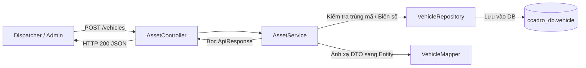

# TASK-01: Quản Trị Đội Xe, Tài Xế & Vỏ Container
> **Thời gian:** Ngày 1 (Thứ Hai, Tuần 1)  
> **Phân hệ:** `com.ccadro.asset`  
> **Mức độ ưu tiên:** P1 (Cao)  
> **Trạng thái:** [ ] Chưa bắt đầu | [ ] Đang làm | [ ] Đã hoàn thành

---

## 🎯 1. Mục Tiêu Nghiệp Vụ
Xây dựng nền tảng quản trị tài sản logistics: tiếp nhận thông tin phương tiện vận tải (xe đầu kéo, xe tải thùng), hồ sơ lái xe và vỏ container rỗng. Đây là dữ liệu gốc phục vụ cho quá trình kiểm tra xuất bến (`Pre-Trip Inspection`) và điều vận (`Dispatch Order`).



---

## 📂 2. Các File Cần Mở Để Làm Việc

| Tầng (Layer) | Đường Dẫn File | Trách Nhiệm |
| :--- | :--- | :--- |
| **Controller** | `com.ccadro.asset.controller.AssetController` | Tiếp nhận REST request, trả về `ApiResponse<T>` |
| **Service** | `com.ccadro.asset.service.AssetService` | Xử lý logic kiểm tra trùng lặp, gán trạng thái |
| **Repository** | `com.ccadro.asset.repository.VehicleRepository` | Giao tiếp DB tìm theo `vehicleCode`, `plateNumber` |
| **DTO Request**| `com.ccadro.asset.dto.request.VehicleCreateRequest` | Chứa validation `@NotBlank`, `@DecimalMin` |
| **DTO Response**| `com.ccadro.asset.dto.response.VehicleResponse` | Dữ liệu trả về cho client sạch sẽ |
| **Mapper** | `com.ccadro.asset.mapper.VehicleMapper` | MapStruct interface ánh xạ tự động |

---

## ⚙️ 3. Chi Tiết Thực Hiện Từng Bước (Step-by-Step)

### Bước 1: Bổ sung phương thức tìm kiếm vào `VehicleRepository`
Mở file `backend/src/main/java/com/ccadro/asset/repository/VehicleRepository.java`:
```java
package com.ccadro.asset.repository;

import com.ccadro.asset.entity.Vehicle;
import org.springframework.data.jpa.repository.JpaRepository;
import org.springframework.stereotype.Repository;

import java.util.Optional;
import java.util.UUID;

@Repository
public interface VehicleRepository extends JpaRepository<Vehicle, UUID> {
    Optional<Vehicle> findByVehicleCode(String vehicleCode);
    Optional<Vehicle> findByPlateNumber(String plateNumber);
}
```

### Bước 2: Viết logic nghiệp vụ trong `AssetService`
Mở file `backend/src/main/java/com/ccadro/asset/service/AssetService.java`:
```java
@Transactional
public VehicleResponse createVehicle(VehicleCreateRequest request) {
    // 1. Kiểm tra trùng mã phương tiện
    if (vehicleRepository.findByVehicleCode(request.getVehicleCode()).isPresent()) {
        throw new AppException(ErrorCode.VEHICLE_ALREADY_EXISTS, "Mã xe " + request.getVehicleCode() + " đã tồn tại!");
    }
    
    // 2. Ánh xạ DTO sang Entity
    Vehicle vehicle = vehicleMapper.toEntity(request);
    
    // 3. Thiết lập trạng thái mặc định sẵn sàng
    vehicle.setStatus(VehicleStatus.AVAILABLE);
    
    // 4. Lưu vào Database và trả về Response DTO
    Vehicle saved = vehicleRepository.save(vehicle);
    return vehicleMapper.toResponse(saved);
}
```

> [!TIP]
> Sử dụng `AppException(ErrorCode.VEHICLE_ALREADY_EXISTS)` thay vì `throw new RuntimeException(...)` để `GlobalExceptionHandler` tự động trả về JSON chuẩn mã lỗi 1102 và HTTP 409 Conflict.

---

## 🧪 4. Kịch Bản Kiểm Thử (cURL / Swagger)

### Test Case 1: Đăng ký xe mới thành công
```bash
curl -X POST http://localhost:8080/api/v1/assets/vehicles \
  -H "Content-Type: application/json" \
  -d '{
    "vehicleCode": "TRUCK-VN-001",
    "plateNumber": "51C-987.65",
    "fuelType": "DIESEL",
    "euroStandard": "EURO_5",
    "maxPayloadTons": 15.00,
    "emptyWeightTons": 7.50
  }'
```
*Kết quả kỳ vọng (HTTP 200 OK):*
```json
{
  "code": 1000,
  "message": "Đăng ký phương tiện thành công",
  "result": {
    "vehicleCode": "TRUCK-VN-001",
    "plateNumber": "51C-987.65",
    "status": "AVAILABLE"
  }
}
```

### Test Case 2: Đăng ký trùng mã xe (Bắt lỗi nghiệp vụ)
Chạy lại lệnh cURL trên lần 2 $\rightarrow$ Kết quả kỳ vọng:
```json
{
  "code": 1102,
  "message": "Mã xe TRUCK-VN-001 đã tồn tại!",
  "timestamp": "..."
}
```
*(HTTP Status: 409 Conflict)*

