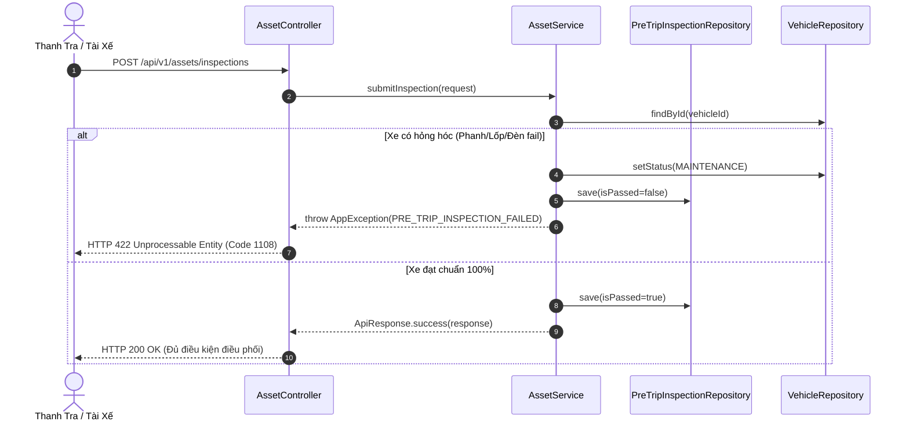

# TASK-02: Kiểm Tra An Toàn Tiền Xuất Bến (Pre-Trip Inspection)
> **Thời gian:** Ngày 2 (Thứ Ba, Tuần 1)  
> **Phân hệ:** `com.ccadro.asset`  
> **Quy tắc bắt buộc:** `BRULE-01` (Kiểm tra 6 điểm kỹ thuật trước giờ lăn bánh)  
> **Trạng thái:** [ ] Chưa bắt đầu | [ ] Đang làm | [ ] Đã hoàn thành

---

## 🎯 1. Mục Tiêu Nghiệp Vụ
Thực thi quy chuẩn an toàn trước khi xe xuất bến: Tài xế hoặc thanh tra viên kiểm tra 6 hạng mục (Lốp, Phanh, Hệ thống đèn, Mức dầu/nước làm mát, Khóa container, Trang bị cứu hỏa).  
Nếu phát hiện bất kỳ lỗi nghiêm trọng nào $\rightarrow$ **Xe lập tức bị khóa xuất bến và chuyển trạng thái sang `MAINTENANCE`**.



---

## 📂 2. Các File Cần Mở Để Làm Việc

| Tầng | Đường Dẫn File |
| :--- | :--- |
| **Controller** | `com.ccadro.asset.controller.AssetController` |
| **Service** | `com.ccadro.asset.service.AssetService` |
| **Repository** | `com.ccadro.asset.repository.PreTripInspectionRepository` |
| **DTOs** | `PreTripInspectionRequest.java`, `PreTripInspectionResponse.java` |
| **Mapper** | `com.ccadro.asset.mapper.PreTripInspectionMapper` |

---

## ⚙️ 3. Chi Tiết Thực Hiện Từng Bước (Step-by-Step)

### Bước 1: Viết hàm xử lý trong `AssetService.java`
```java
@Transactional
public PreTripInspectionResponse submitInspection(PreTripInspectionRequest request) {
    // 1. Kiểm tra xe tồn tại
    Vehicle vehicle = vehicleRepository.findById(request.getVehicleId())
            .orElseThrow(() -> new AppException(ErrorCode.VEHICLE_NOT_FOUND));

    // 2. Đánh giá tính an toàn
    boolean isPassed = Boolean.TRUE.equals(request.getBrakesPassed())
                    && Boolean.TRUE.equals(request.getTiresPassed())
                    && Boolean.TRUE.equals(request.getLightsPassed());

    // 3. Khởi tạo đối tượng Inspection
    PreTripInspection inspection = preTripInspectionMapper.toEntity(request);
    inspection.setIsPassed(isPassed);
    inspection.setInspectedAt(Instant.now());

    // 4. Cập nhật trạng thái xe theo kết quả kiểm tra
    if (!isPassed) {
        vehicle.setStatus(VehicleStatus.MAINTENANCE);
        vehicleRepository.save(vehicle);
        preTripInspectionRepository.save(inspection);

        throw new AppException(
            ErrorCode.PRE_TRIP_INSPECTION_FAILED,
            "Xe " + vehicle.getVehicleCode() + " không đạt tiêu chuẩn an toàn xuất bến! Đã chuyển trạng thái sang BẢO DƯỠNG."
        );
    }

    // 5. Nếu đạt chuẩn, xe giữ nguyên trạng thái AVAILABLE
    return preTripInspectionMapper.toResponse(preTripInspectionRepository.save(inspection));
}
```

### Bước 2: Thêm Endpoint vào `AssetController.java`
```java
@PostMapping("/inspections")
@Operation(summary = "Nộp biên bản kiểm tra an toàn 6 điểm tiền xuất bến")
public ApiResponse<PreTripInspectionResponse> submitInspection(@RequestBody @Valid PreTripInspectionRequest request) {
    return ApiResponse.success("Kiểm tra an toàn đạt chuẩn", assetService.submitInspection(request));
}
```

---

## 🧪 4. Kịch Bản Kiểm Thử

### Test Case 1: Xe hỏng phanh (Bắt lỗi an toàn)
```bash
curl -X POST http://localhost:8080/api/v1/assets/inspections \
  -H "Content-Type: application/json" \
  -d '{
    "vehicleId": "<UUID_XE_VUA_TAO>",
    "driverId": "<UUID_TAI_XE>",
    "brakesPassed": false,
    "tiresPassed": true,
    "lightsPassed": true,
    "remarks": "Má phanh mòn vượt mức cho phép"
  }'
```
*Kết quả kỳ vọng (HTTP 422 Unprocessable Entity):*
```json
{
  "code": 1108,
  "message": "Xe TRUCK-VN-001 không đạt tiêu chuẩn an toàn xuất bến! Đã chuyển trạng thái sang BẢO DƯỠNG."
}
```
*(Kiểm tra DB: `SELECT status FROM vehicle;` $\rightarrow$ Thấy giá trị `MAINTENANCE`)*.

