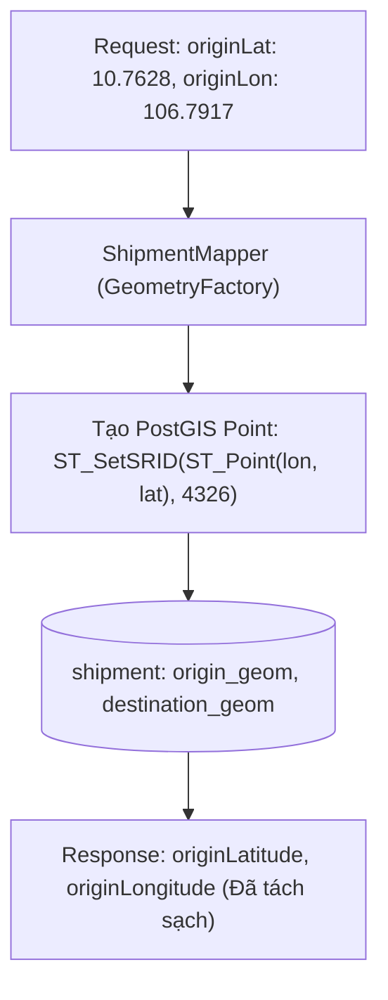

# TASK-03: Tạo Đơn Hàng & Xử Lý Tọa Độ Không Gian PostGIS
> **Thời gian:** Ngày 3 (Thứ Tư, Tuần 1)  
> **Phân hệ:** `com.ccadro.shipment`  
> **Mức độ ưu tiên:** P1 (Cao)  
> **Trạng thái:** [ ] Chưa bắt đầu | [ ] Đang làm | [ ] Đã hoàn thành

---

## 🎯 1. Mục Tiêu Nghiệp Vụ
Tiếp nhận đơn đặt hàng vận chuyển hàng hóa, chuyển đổi kinh độ / vĩ độ người dùng gửi thành kiểu dữ liệu không gian PostGIS `geometry(Point, 4326)` để lưu trữ trong database. Tọa độ này là đầu vào của thuật toán lập lộ trình xanh (UC05).



---

## 📂 2. Các File Cần Mở Để Làm Việc

| Tầng | Đường Dẫn File |
| :--- | :--- |
| **Controller** | `com.ccadro.shipment.controller.ShipmentController` |
| **Service** | `com.ccadro.shipment.service.ShipmentService` |
| **Repository** | `com.ccadro.shipment.repository.ShipmentRepository` |
| **Mapper** | `com.ccadro.shipment.mapper.ShipmentMapper` |
| **DTOs** | `ShipmentCreationRequest.java`, `ShipmentResponse.java` |

---

## ⚙️ 3. Chi Tiết Thực Hiện Từng Bước (Step-by-Step)

### Bước 1: Kiểm tra `ShipmentMapper.java` đã cấu hình ánh xạ PostGIS Point
Mở file `backend/src/main/java/com/ccadro/shipment/mapper/ShipmentMapper.java`:
```java
@Mapper(componentModel = "spring")
public abstract class ShipmentMapper {

    private final GeometryFactory geometryFactory = new GeometryFactory(new PrecisionModel(), 4326);

    @Mapping(target = "id", ignore = true)
    @Mapping(target = "originGeom", ignore = true)
    @Mapping(target = "destinationGeom", ignore = true)
    @Mapping(target = "status", constant = "PENDING")
    public abstract Shipment toEntity(ShipmentCreationRequest request);

    @AfterMapping
    protected void enrichGeometries(ShipmentCreationRequest request, @MappingTarget Shipment entity) {
        if (request.getOriginLatitude() != null && request.getOriginLongitude() != null) {
            entity.setOriginGeom(geometryFactory.createPoint(
                new Coordinate(request.getOriginLongitude(), request.getOriginLatitude())
            ));
        }
        if (request.getDestinationLatitude() != null && request.getDestinationLongitude() != null) {
            entity.setDestinationGeom(geometryFactory.createPoint(
                new Coordinate(request.getDestinationLongitude(), request.getDestinationLatitude())
            ));
        }
    }

    @Mapping(target = "originLatitude", expression = "java(entity.getOriginGeom() != null ? entity.getOriginGeom().getY() : null)")
    @Mapping(target = "originLongitude", expression = "java(entity.getOriginGeom() != null ? entity.getOriginGeom().getX() : null)")
    @Mapping(target = "destinationLatitude", expression = "java(entity.getDestinationGeom() != null ? entity.getDestinationGeom().getY() : null)")
    @Mapping(target = "destinationLongitude", expression = "java(entity.getDestinationGeom() != null ? entity.getDestinationGeom().getX() : null)")
    public abstract ShipmentResponse toResponse(Shipment entity);
}
```

### Bước 2: Hoàn thiện hàm tạo đơn trong `ShipmentService.java`
```java
@Transactional
public ShipmentResponse createShipmentResponse(ShipmentCreationRequest request) {
    // 1. Kiểm tra trùng mã đơn hàng
    if (shipmentRepository.findByShipmentCode(request.getShipmentCode()).isPresent()) {
        throw new AppException(ErrorCode.SHIPMENT_CODE_EXISTS, "Mã đơn " + request.getShipmentCode() + " đã tồn tại");
    }

    // 2. MapStruct tự sinh đối tượng Point PostGIS
    Shipment shipment = shipmentMapper.toEntity(request);

    // 3. Lưu vào Database
    Shipment saved = shipmentRepository.save(shipment);
    return shipmentMapper.toResponse(saved);
}
```

---

## 🧪 4. Kịch Bản Kiểm Thử

### Test Case: Tạo đơn vận chuyển Cát Lái đi VSIP 1 Bình Dương
```bash
curl -X POST http://localhost:8080/api/v1/shipments \
  -H "Content-Type: application/json" \
  -d '{
    "shipmentCode": "SHIP-HCM-BD-001",
    "customerId": "CUST-UNILEVER-01",
    "originName": "Cảng Cát Lái - TP.HCM",
    "originLatitude": 10.7628,
    "originLongitude": 106.7917,
    "destinationName": "KCN VSIP 1 - Bình Dương",
    "destinationLatitude": 10.9383,
    "destinationLongitude": 106.7028,
    "cargoWeightTons": 14.20,
    "cargoVolumeM3": 32.50,
    "cargoType": "FMCG",
    "isHazardous": false
  }'
```
*Kiểm tra kết quả trong cơ sở dữ liệu:*
```sql
SELECT shipment_code, ST_AsText(origin_geom), ST_AsText(destination_geom), status 
FROM shipment WHERE shipment_code = 'SHIP-HCM-BD-001';
```
*(Kết quả: `POINT(106.7917 10.7628)` và trạng thái `PENDING`)*.

