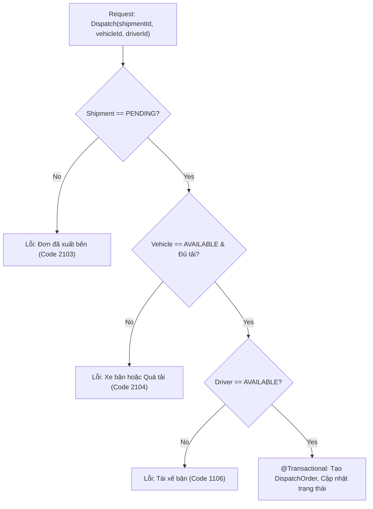

# TASK-04: Lệnh Điều Phối Xuất Bến & Kiểm Soát Tải Trọng
> **Thời gian:** Ngày 4 (Thứ Năm, Tuần 1)  
> **Phân hệ:** `com.ccadro.shipment`  
> **Mức độ ưu tiên:** P1 (Cao)  
> **Trạng thái:** [ ] Chưa bắt đầu | [ ] Đang làm | [x] Đã hoàn thành

---

## 🎯 1. Mục Tiêu Nghiệp Vụ
Ghép cặp liên phân hệ: Đơn hàng (`Shipment`) + Phương tiện (`Vehicle`) + Lái xe (`Driver`).  
Kiểm tra điều kiện tiên quyết: Xe và tài xế phải ở trạng thái sẵn sàng (`AVAILABLE`) và **Khối lượng hàng không được vượt quá tải trọng cho phép của xe**.



---

## 📂 2. Các File Cần Mở Để Làm Việc

| Tầng | Đường Dẫn File |
| :--- | :--- |
| **Controller** | `com.ccadro.shipment.controller.ShipmentController` |
| **Service** | `com.ccadro.shipment.service.DispatchOrderService` |
| **Repository** | `com.ccadro.shipment.repository.DispatchOrderRepository` |
| **Asset Service**| `com.ccadro.asset.service.AssetService` |
| **DTOs** | `DispatchOrderRequest.java`, `DispatchOrderResponse.java` |
| **Mapper** | `com.ccadro.shipment.mapper.DispatchOrderMapper` |

---

## ⚙️ 3. Chi Tiết Thực Hiện Từng Bước (Step-by-Step)

### Bước 1: Viết logic điều phối trong `DispatchOrderService.java`
Mở file `backend/src/main/java/com/ccadro/shipment/service/DispatchOrderService.java`:
```java
package com.ccadro.shipment.service;

import com.ccadro.asset.entity.Driver;
import com.ccadro.asset.entity.Vehicle;
import com.ccadro.asset.entity.enums.DriverStatus;
import com.ccadro.asset.entity.enums.VehicleStatus;
import com.ccadro.asset.repository.DriverRepository;
import com.ccadro.asset.repository.VehicleRepository;
import com.ccadro.shared.exception.AppException;
import com.ccadro.shared.exception.ErrorCode;
import com.ccadro.shipment.dto.request.DispatchOrderRequest;
import com.ccadro.shipment.dto.response.DispatchOrderResponse;
import com.ccadro.shipment.entity.DispatchOrder;
import com.ccadro.shipment.entity.Shipment;
import com.ccadro.shipment.mapper.DispatchOrderMapper;
import com.ccadro.shipment.repository.DispatchOrderRepository;
import com.ccadro.shipment.repository.ShipmentRepository;
import lombok.AccessLevel;
import lombok.RequiredArgsConstructor;
import lombok.experimental.FieldDefaults;
import org.springframework.stereotype.Service;
import org.springframework.transaction.annotation.Transactional;

import java.time.Instant;

@Service
@Transactional(readOnly = true)
@RequiredArgsConstructor
@FieldDefaults(level = AccessLevel.PRIVATE, makeFinal = true)
public class DispatchOrderService {

    DispatchOrderRepository dispatchOrderRepository;
    ShipmentRepository shipmentRepository;
    VehicleRepository vehicleRepository;
    DriverRepository driverRepository;
    DispatchOrderMapper dispatchOrderMapper;

    @Transactional
    public DispatchOrderResponse createDispatchOrder(DispatchOrderRequest request) {
        // 1. Kiểm tra đơn hàng
        Shipment shipment = shipmentRepository.findById(request.getShipmentId())
                .orElseThrow(() -> new AppException(ErrorCode.SHIPMENT_NOT_FOUND));
        if ("DISPATCHED".equalsIgnoreCase(shipment.getStatus())) {
            throw new AppException(ErrorCode.SHIPMENT_ALREADY_DISPATCHED);
        }

        // 2. Kiểm tra phương tiện
        Vehicle vehicle = vehicleRepository.findById(request.getVehicleId())
                .orElseThrow(() -> new AppException(ErrorCode.VEHICLE_NOT_FOUND));
        if (vehicle.getStatus() != VehicleStatus.AVAILABLE) {
            throw new AppException(ErrorCode.VEHICLE_MAINTENANCE_REQUIRED, "Xe đang không sẵn sàng vận hành!");
        }

        // Kiểm tra tải trọng xe
        if (shipment.getCargoWeightTons().compareTo(vehicle.getMaxPayloadTons()) > 0) {
            throw new AppException(
                ErrorCode.INVALID_CARGO_WEIGHT,
                "Khối lượng hàng (" + shipment.getCargoWeightTons() + " tấn) vượt tải trọng xe (" + vehicle.getMaxPayloadTons() + " tấn)!"
            );
        }

        // 3. Kiểm tra tài xế
        Driver driver = driverRepository.findById(request.getDriverId())
                .orElseThrow(() -> new AppException(ErrorCode.DRIVER_NOT_FOUND));
        if (driver.getStatus() != DriverStatus.AVAILABLE) {
            throw new AppException(ErrorCode.DRIVER_NOT_AVAILABLE);
        }

        // 4. Tạo lệnh điều phối
        DispatchOrder dispatch = dispatchOrderMapper.toEntity(request);
        dispatch.setDispatchedAt(Instant.now());
        dispatch.setStatus("ASSIGNED");

        // 5. Cập nhật trạng thái đồng bộ
        shipment.setStatus("DISPATCHED");
        vehicle.setStatus(VehicleStatus.IN_TRANSIT);
        driver.setStatus(DriverStatus.ON_DUTY);

        shipmentRepository.save(shipment);
        vehicleRepository.save(vehicle);
        driverRepository.save(driver);

        return dispatchOrderMapper.toResponse(dispatchOrderRepository.save(dispatch));
    }
}
```

---

## 🧪 4. Kịch Bản Kiểm Thử

### Test Case: Điều phối hàng 16 tấn cho xe 15 tấn (Quá tải)
*Gửi request điều phối với đơn hàng vượt tải trọng $\rightarrow$ Kỳ vọng kết quả HTTP 400 Bad Request:*
```json
{
  "code": 2104,
  "message": "Khối lượng hàng (16.00 tấn) vượt tải trọng xe (15.00 tấn)!"
}
```

