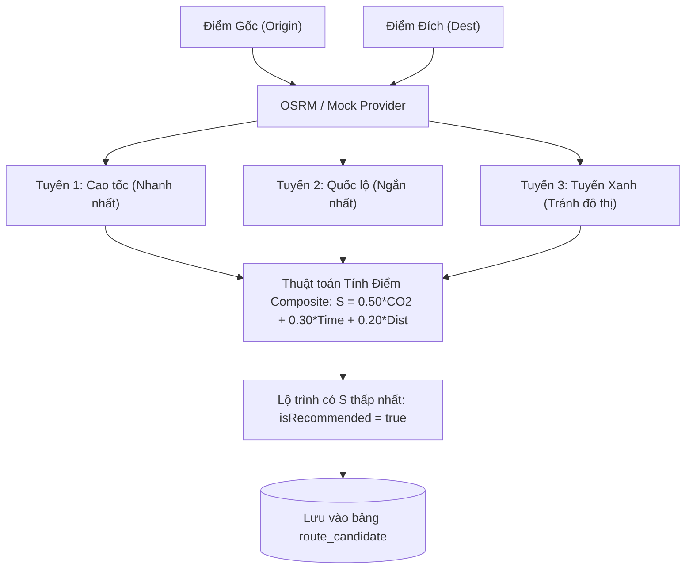

# TASK-05: Thuật Toán Lập Lộ Trình Đa Tiêu Chí Xanh (UC05)
> **Thời gian:** Ngày 5 (Thứ Sáu, Tuần 1)  
> **Phân hệ:** `com.ccadro.routing`  
> **Use Case:** **UC05: Green Multi-Criteria Route Planning**  
> **Mức độ ưu tiên:** P0 (Cốt Lõi Hệ Thống)  
> **Trạng thái:** [ ] Chưa bắt đầu | [ ] Đang làm | [ ] Đã hoàn thành

---

## 🎯 1. Mục Tiêu Nghiệp Vụ
Từ tọa độ gốc và đích của đơn vận chuyển, hệ thống tích hợp công cụ bản đồ số (OSRM) để sinh ra **3 phương án đường đi độc lập**. Sau đó, áp dụng thuật toán tối ưu hóa đa mục tiêu (phát thải $CO_2$, thời gian hành trình, quãng đường di chuyển) để tìm ra **Lộ trình Xanh nhất** và đề xuất cho điều phối viên.



---

## 📐 2. Công Thức Thuật Toán Chi Tiết

Điểm tổng hợp $S$ của mỗi phương án $i$ được tính bằng công thức chuẩn hóa Min-Max:

$$S_i = w_{co2} \cdot \hat{C}_i + w_{time} \cdot \hat{T}_i + w_{dist} \cdot \hat{D}_i$$

*Trong đó:*
- $w_{co2} = 0.50$ (Ưu tiên cắt giảm phát thải nhà kính $CO_2$)
- $w_{time} = 0.30$ (Ràng buộc tiến độ giao nhận hàng đúng hẹn)
- $w_{dist} = 0.20$ (Tối ưu hao mòn lốp và chi phí trạm thu phí)

**Công thức chuẩn hóa Min-Max:**
$$\hat{C}_i = \frac{C_i - C_{min}}{C_{max} - C_{min}}, \quad \hat{T}_i = \frac{T_i - T_{min}}{T_{max} - T_{min}}, \quad \hat{D}_i = \frac{D_i - D_{min}}{D_{max} - D_{min}}$$

*(Nếu $C_{max} == C_{min}$, gán $\hat{C}_i = 0$)*.

---

## 📂 3. Các File Cần Mở Để Làm Việc

| Tầng | Đường Dẫn File |
| :--- | :--- |
| **Controller** | `com.ccadro.routing.controller.RoutingController` |
| **Service** | `com.ccadro.routing.service.RoutingService` |
| **Repository** | `com.ccadro.routing.repository.RouteCandidateRepository` |
| **Adapter** | `com.ccadro.routing.repository.adapter.OsrmRoutingProvider` |
| **DTOs** | `RoutePlanRequest.java`, `RouteCandidateResponse.java` |
| **Mapper** | `com.ccadro.routing.mapper.RoutingMapper` |

---

## ⚙️ 4. Chi Tiết Thực Hiện Từng Bước (Step-by-Step)

### Bước 1: Viết hàm tính điểm đa tiêu chí trong `RoutingService.java`
```java
@Transactional
public List<RouteCandidateResponse> planRoutes(RoutePlanRequest request) {
    Shipment shipment = shipmentRepository.findById(request.getShipmentId())
            .orElseThrow(() -> new AppException(ErrorCode.SHIPMENT_NOT_FOUND));

    // 1. Gọi Provider tính 3 tuyến ứng viên
    List<RouteCandidate> candidates = routingProvider.calculateRoutes(
        shipment.getOriginGeom(), 
        shipment.getDestinationGeom()
    );

    if (candidates.isEmpty()) {
        throw new AppException(ErrorCode.ROUTING_PROVIDER_FAILED);
    }

    // 2. Tính toán lượng CO2 ước tính cho từng tuyến
    BigDecimal payload = shipment.getCargoWeightTons();
    BigDecimal factor = new BigDecimal("0.080"); // 0.080 kgCO2e/t-km (Euro 5 Diesel)

    for (RouteCandidate c : candidates) {
        c.setShipmentId(shipment.getId());
        BigDecimal distKm = c.getDistanceMeters().divide(new BigDecimal("1000"), 3, RoundingMode.HALF_UP);
        BigDecimal co2 = distKm.multiply(payload).multiply(factor);
        c.setEstimatedCo2Kg(co2);
    }

    // 3. Tìm Min / Max của CO2, Thời gian, Quãng đường
    BigDecimal minCo2 = candidates.stream().map(RouteCandidate::getEstimatedCo2Kg).min(BigDecimal::compareTo).orElse(BigDecimal.ZERO);
    BigDecimal maxCo2 = candidates.stream().map(RouteCandidate::getEstimatedCo2Kg).max(BigDecimal::compareTo).orElse(BigDecimal.ONE);
    BigDecimal minTime = candidates.stream().map(RouteCandidate::getDurationSeconds).min(BigDecimal::compareTo).orElse(BigDecimal.ZERO);
    BigDecimal maxTime = candidates.stream().map(RouteCandidate::getDurationSeconds).max(BigDecimal::compareTo).orElse(BigDecimal.ONE);
    BigDecimal minDist = candidates.stream().map(RouteCandidate::getDistanceMeters).min(BigDecimal::compareTo).orElse(BigDecimal.ZERO);
    BigDecimal maxDist = candidates.stream().map(RouteCandidate::getDistanceMeters).max(BigDecimal::compareTo).orElse(BigDecimal.ONE);

    // 4. Áp dụng công thức chuẩn hóa Min-Max và tính Composite Score
    RouteCandidate bestCandidate = null;
    BigDecimal bestScore = BigDecimal.valueOf(999999);

    for (RouteCandidate c : candidates) {
        double normCo2 = normalize(c.getEstimatedCo2Kg(), minCo2, maxCo2);
        double normTime = normalize(c.getDurationSeconds(), minTime, maxTime);
        double normDist = normalize(c.getDistanceMeters(), minDist, maxDist);

        double score = 0.50 * normCo2 + 0.30 * normTime + 0.20 * normDist;
        c.setCompositeScore(BigDecimal.valueOf(score).setScale(4, RoundingMode.HALF_UP));

        if (c.getCompositeScore().compareTo(bestScore) < 0) {
            bestScore = c.getCompositeScore();
            bestCandidate = c;
        }
    }

    // 5. Đánh dấu phương án tối ưu
    if (bestCandidate != null) {
        bestCandidate.setIsSelected(true);
    }

    // 6. Lưu vào DB và trả về danh sách Response DTO
    List<RouteCandidate> savedList = routeCandidateRepository.saveAll(candidates);
    return routingMapper.toResponseList(savedList);
}

private double normalize(BigDecimal val, BigDecimal min, BigDecimal max) {
    if (max.compareTo(min) == 0) return 0.0;
    return val.subtract(min).doubleValue() / max.subtract(min).doubleValue();
}
```

---

## 🧪 5. Kịch Bản Kiểm Thử

### Gửi Request Lập Lộ Trình:
```bash
curl -X POST http://localhost:8080/api/v1/routes/plan \
  -H "Content-Type: application/json" \
  -d '{
    "shipmentId": "<UUID_DON_HANG>",
    "weightDistance": 0.20,
    "weightDuration": 0.30,
    "weightEmission": 0.50
  }'
```
*Kết quả kỳ vọng (Trả về 3 phương án được xếp hạng rõ ràng):*
- Tuyến 1: Đi Cao tốc HCM - Long Thành - Dầu Giây (Nhanh nhất).
- Tuyến 2: Đi Quốc lộ 13 (Tuyến Xanh ít phát thải nhất, `isSelected = true`, `compositeScore` nhỏ nhất).
- Tuyến 3: Đi đường vòng tránh khu công nghiệp.

