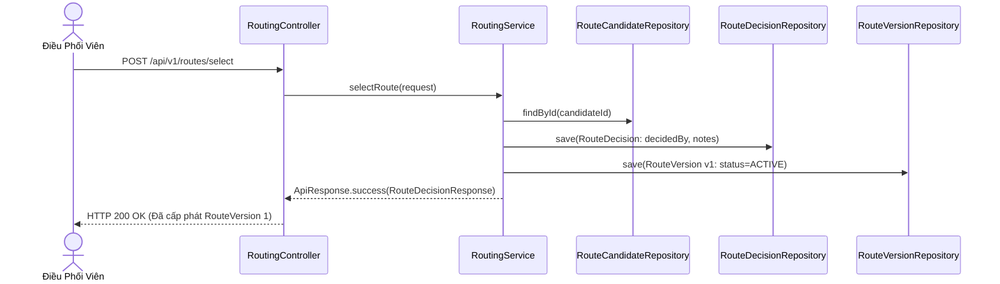

# TASK-06: Chốt Lộ Trình Chính Thức & Quản Lý Phiên Bản Tuyến
> **Thời gian:** Ngày 6 (Thứ Bảy, Tuần 1)  
> **Phân hệ:** `com.ccadro.routing`  
> **Use Case:** **UC05: Route Decision & Versioning**  
> **Mức độ ưu tiên:** P0 (Cốt Lõi Hệ Thống)  
> **Trạng thái:** [ ] Chưa bắt đầu | [ ] Đang làm | [ ] Đã hoàn thành

---

## 🎯 1. Mục Tiêu Nghiệp Vụ
Sau khi hệ thống đề xuất 3 phương án tại `TASK-05`, Điều phối viên xem xét và bấm nút chốt lộ trình.  
Hệ thống sẽ lưu vết quyết định (`RouteDecision`), đồng thời cấp phát phiên bản lộ trình chính thức `RouteVersion v1` (trạng thái `ACTIVE`) làm hành lang chuẩn cho xe chạy.



---

## 📂 2. Các File Cần Mở Để Làm Việc

| Tầng | Đường Dẫn File |
| :--- | :--- |
| **Controller** | `com.ccadro.routing.controller.RoutingController` |
| **Service** | `com.ccadro.routing.service.RoutingService` |
| **Repository** | `RouteDecisionRepository.java`, `RouteVersionRepository.java` |
| **DTOs** | `RouteDecisionRequest.java`, `RouteDecisionResponse.java` |
| **Mapper** | `com.ccadro.routing.mapper.RouteDecisionMapper` |

---

## ⚙️ 3. Chi Tiết Thực Hiện Từng Bước (Step-by-Step)

### Bước 1: Viết hàm `selectRoute` trong `RoutingService.java`
```java
@Transactional
public RouteDecisionResponse selectRoute(RouteDecisionRequest request) {
    // 1. Kiểm tra tồn tại ứng viên lộ trình
    RouteCandidate candidate = routeCandidateRepository.findById(request.getSelectedCandidateId())
            .orElseThrow(() -> new AppException(ErrorCode.ROUTE_NOT_FOUND));

    // 2. Tạo bản ghi RouteDecision ghi nhận quyết định
    RouteDecision decision = routeDecisionMapper.toEntity(request);
    decision.setDecidedAt(Instant.now());
    RouteDecision savedDecision = routeDecisionRepository.save(decision);

    // 3. Khởi tạo RouteVersion chính thức đầu tiên (Version 1)
    RouteVersion routeVersion = new RouteVersion();
    routeVersion.setShipmentId(request.getShipmentId());
    routeVersion.setVersionNumber(1);
    routeVersion.setRouteGeometry(candidate.getRouteGeometry());
    routeVersion.setTotalDistanceMeters(candidate.getDistanceMeters());
    routeVersion.setEstimatedDurationSeconds(candidate.getDurationSeconds());
    routeVersion.setStatus("ACTIVE");
    routeVersion.setCreatedAt(Instant.now());
    routeVersionRepository.save(routeVersion);

    return routeDecisionMapper.toResponse(savedDecision);
}
```

### Bước 2: Thêm Endpoint vào `RoutingController.java`
```java
@PostMapping("/select")
@Operation(summary = "Điều phối viên chốt lộ trình chính thức cho đơn hàng")
public ApiResponse<RouteDecisionResponse> selectRoute(@RequestBody @Valid RouteDecisionRequest request) {
    return ApiResponse.success("Đã chọn lộ trình và khởi tạo RouteVersion v1", routingService.selectRoute(request));
}
```

---

## 🧪 4. Kịch Bản Kiểm Thử

### Gửi Request Chốt Lộ Trình:
```bash
curl -X POST http://localhost:8080/api/v1/routes/select \
  -H "Content-Type: application/json" \
  -d '{
    "shipmentId": "<UUID_DON_HANG>",
    "selectedCandidateId": "<UUID_UNG_VIEN_XANH>",
    "decisionType": "RECOMMENDED",
    "dispatcherNotes": "Chốt tuyến Xanh theo gợi ý thuật toán",
    "decidedBy": "DISPATCHER_NAM"
  }'
```
*Kiểm tra kết quả trong DB:*
```sql
SELECT version_number, status, total_distance_meters, ST_AsText(route_geometry) 
FROM route_version WHERE shipment_id = '<UUID_DON_HANG>';
```
*(Thấy phiên bản 1 mang trạng thái `ACTIVE` kèm chuỗi tọa độ `LINESTRING(...)`)*.

