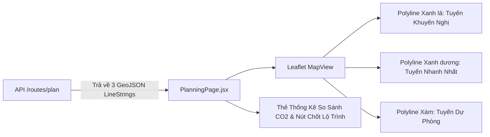

# TASK-07: Giao Diện Bản Đồ Lộ Trình 3 Tuyến Xanh Leaflet GIS
> **Thời gian:** Ngày 7 (Chủ Nhật, Tuần 1)  
> **Phân hệ:** `frontend` (React 18 + Leaflet)  
> **Use Case:** **UC05 UI Visualization**  
> **Mức độ ưu tiên:** P1 (Cao)  
> **Trạng thái:** [ ] Chưa bắt đầu | [ ] Đang làm | [ ] Đã hoàn thành

---

## 🎯 1. Mục Tiêu Nghiệp Vụ
Hiển thị trực quan 3 phương án lộ trình trên bản đồ số tương tác (OpenStreetMap / Leaflet), tô màu phân biệt theo mức độ thân thiện môi trường:
- 🟢 **Màu Xanh lá cây (`#10b981`):** Tuyến Xanh ưu tiên bảo vệ môi trường (`isRecommended = true`).
- 🔵 **Màu Xanh dương (`#3b82f6`):** Tuyến nhanh nhất về thời gian.
- ⚪ **Màu Xám tro (`#9ca3af`):** Tuyến dự phòng chạy vòng.



---

## 📂 2. Các File Cần Mở Để Làm Việc

| Tầng | Đường Dẫn File |
| :--- | :--- |
| **Trang Chính** | `frontend/src/pages/PlanningPage.jsx` |
| **Component Bản Đồ** | `frontend/src/components/map/MapView.jsx` |
| **Vẽ Polyline** | `frontend/src/components/map/RoutePolyline.jsx` |
| **API Client** | `frontend/src/services/api.js` |

---

## ⚙️ 3. Chi Tiết Thực Hiện Từng Bước (Step-by-Step)

### Bước 1: Bổ sung gọi API trong `frontend/src/services/api.js`
```javascript
export const planRoutes = async (shipmentId) => {
  const response = await httpClient.post('/api/v1/routes/plan', {
    shipmentId,
    weightDistance: 0.20,
    weightDuration: 0.30,
    weightEmission: 0.50
  });
  return response.data.result;
};

export const selectRoute = async (shipmentId, candidateId) => {
  const response = await httpClient.post('/api/v1/routes/select', {
    shipmentId,
    selectedCandidateId: candidateId,
    decisionType: 'RECOMMENDED',
    dispatcherNotes: 'Chọn qua giao diện bản đồ',
    decidedBy: 'DISPATCHER_UI'
  });
  return response.data.result;
};
```

### Bước 2: Viết component hiển thị bản đồ trong `PlanningPage.jsx`
```jsx
import React, { useState, useEffect } from 'react';
import { MapContainer, TileLayer, Polyline, Marker, Popup } from 'react-leaflet';
import { planRoutes, selectRoute } from '../services/api';

export default function PlanningPage({ shipmentId }) {
  const [candidates, setCandidates] = useState([]);
  const [selectedId, setSelectedId] = useState(null);

  useEffect(() => {
    planRoutes(shipmentId).then(data => {
      setCandidates(data);
      const recommended = data.find(c => c.isSelected || c.isRecommended);
      if (recommended) setSelectedId(recommended.id);
    });
  }, [shipmentId]);

  const handleConfirm = async () => {
    if (!selectedId) return;
    await selectRoute(shipmentId, selectedId);
    alert('Đã chốt lộ trình thành công! Chuyển sang màn hình điều vận.');
  };

  return (
    <div className="flex h-screen">
      {/* Bản đồ bên trái */}
      <div className="flex-1">
        <MapContainer center={[10.8231, 106.6297]} zoom={11} className="h-full w-full">
          <TileLayer url="https://{s}.tile.openstreetmap.org/{z}/{x}/{y}.png" />
          {candidates.map(c => {
            const isBest = c.id === selectedId;
            const color = c.candidateName.includes('Xanh') ? '#10b981' : '#3b82f6';
            return (
              <Polyline
                key={c.id}
                positions={c.coordinates || []}
                pathOptions={{ color, weight: isBest ? 6 : 3, opacity: isBest ? 1 : 0.6 }}
                eventHandlers={{ click: () => setSelectedId(c.id) }}
              />
            );
          })}
        </MapContainer>
      </div>

      {/* Bảng so sánh chỉ số xanh bên phải */}
      <div className="w-96 p-4 bg-gray-900 text-white overflow-y-auto">
        <h2 className="text-xl font-bold mb-4">So Sánh Lộ Trình Đa Tiêu Chí</h2>
        {candidates.map(c => (
          <div
            key={c.id}
            onClick={() => setSelectedId(c.id)}
            className={`p-3 mb-3 rounded-lg border cursor-pointer ${
              c.id === selectedId ? 'border-green-500 bg-gray-800' : 'border-gray-700'
            }`}
          >
            <div className="font-semibold text-lg">{c.candidateName}</div>
            <div className="text-green-400">Phát thải: {c.estimatedCo2Kg} kg CO₂e</div>
            <div className="text-gray-300">Quãng đường: {(c.distanceMeters / 1000).toFixed(1)} km</div>
            <div className="text-gray-300">Thời gian: {Math.round(c.durationSeconds / 60)} phút</div>
            <div className="text-sm text-yellow-400">Điểm tổng hợp: {c.compositeScore}</div>
          </div>
        ))}
        <button
          onClick={handleConfirm}
          className="w-full mt-4 py-3 bg-green-600 hover:bg-green-700 rounded-lg font-bold"
        >
          Xác Nhận & Điều Phối Lộ Trình Này
        </button>
      </div>
    </div>
  );
}
```

---

## 🧪 4. Tiêu chí nghiệm thu:
- Khởi động frontend: `npm run dev` tại thư mục `frontend/`.
- Mở trang `http://localhost:5173/planning`:
  * Bản đồ tải thành công với các polyline rõ nét.
  * Click vào từng tuyến đường đổi màu nổi bật và cập nhật thông số tương ứng.
  * Bấm nút "Xác Nhận" gọi API backend và nhận thông báo thành công.

