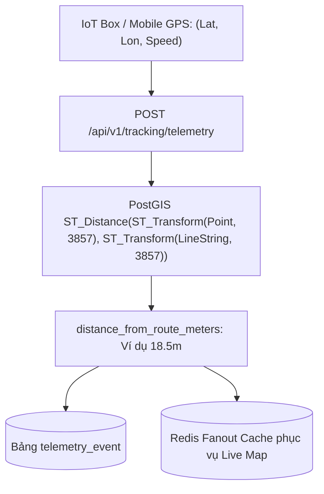

# TASK-08: Tiếp Nhận Luồng GPS & Khoảng Cách Không Gian PostGIS (UC09)
> **Thời gian:** Ngày 8 (Thứ Hai, Tuần 2)  
> **Phân hệ:** `com.ccadro.tracking`  
> **Use Case:** **UC09: Real-time GPS Ingestion & Spatial Distance**  
> **Mức độ ưu tiên:** P0 (Cốt Lõi Hệ Thống)  
> **Trạng thái:** [ ] Chưa bắt đầu | [ ] Đang làm | [ ] Đã hoàn thành

---

## 🎯 1. Mục Tiêu Nghiệp Vụ
Tiếp nhận luồng dữ liệu viễn thông GPS gửi lên từ xe với tần suất cao (1 - 5 giây/lần). Dùng hàm không gian **PostGIS `ST_Distance`** tính toán khoảng cách vuông góc thực tế tính bằng mét từ vị trí xe đến đường hình học lộ trình chuẩn (`RouteVersion.route_geometry`).



---

## 📂 2. Các File Cần Mở Để Làm Việc

| Tầng | Đường Dẫn File |
| :--- | :--- |
| **Controller** | `com.ccadro.tracking.controller.TrackingController` |
| **Service** | `com.ccadro.tracking.service.TrackingService` |
| **Repository** | `com.ccadro.tracking.repository.TelemetryEventRepository` |
| **DTOs** | `TelemetryIngestRequest.java`, `TelemetryResponse.java` |
| **Mapper** | `com.ccadro.tracking.mapper.TrackingMapper` |

---

## ⚙️ 3. Chi Tiết Thực Hiện Từng Bước (Step-by-Step)

### Bước 1: Khai báo hàm tính khoảng cách trong `TelemetryEventRepository.java`
Mở file `backend/src/main/java/com/ccadro/tracking/repository/TelemetryEventRepository.java`:
```java
package com.ccadro.tracking.repository;

import com.ccadro.tracking.entity.TelemetryEvent;
import org.springframework.data.jpa.repository.JpaRepository;
import org.springframework.data.jpa.repository.Query;
import org.springframework.data.repository.query.Param;
import org.springframework.stereotype.Repository;

import java.util.List;
import java.util.UUID;

@Repository
public interface TelemetryEventRepository extends JpaRepository<TelemetryEvent, UUID> {

    @Query(value = """
        SELECT ST_Distance(
            ST_Transform(ST_SetSRID(ST_MakePoint(:lon, :lat), 4326), 3857),
            ST_Transform(rv.route_geometry, 3857)
        )
        FROM route_version rv
        WHERE rv.id = :routeVersionId
        """, nativeQuery = true)
    Double calculateDistanceToRouteMeters(
        @Param("lon") Double lon,
        @Param("lat") Double lat,
        @Param("routeVersionId") UUID routeVersionId
    );

    List<TelemetryEvent> findTop3ByTripIdOrderByTimestampDesc(UUID tripId);
}
```

### Bước 2: Xử lý lưu vết trong `TrackingService.java`
```java
@Transactional
public TelemetryResponse ingestTelemetry(TelemetryIngestRequest request) {
    // 1. Kiểm tra chuyến đi và lấy lộ trình active
    Trip trip = tripRepository.findById(request.getTripId())
            .orElseThrow(() -> new AppException(ErrorCode.TRIP_NOT_FOUND));

    // 2. Tính khoảng cách vuông góc bằng PostGIS
    Double distanceMeters = telemetryEventRepository.calculateDistanceToRouteMeters(
            request.getLongitude(),
            request.getLatitude(),
            trip.getActiveRouteVersionId()
    );

    // 3. Khởi tạo Entity TelemetryEvent
    TelemetryEvent event = trackingMapper.toEntity(request);
    event.setDistanceFromRouteMeters(BigDecimal.valueOf(distanceMeters != null ? distanceMeters : 0.0));

    // 4. Lưu vào Database
    TelemetryEvent saved = telemetryEventRepository.save(event);

    // 5. Cập nhật vị trí tức thời vào Trip
    trip.setLastKnownLocation(event.getLocationGeom());
    tripRepository.save(trip);

    return trackingMapper.toTelemetryResponse(saved);
}
```

---

## 🧪 4. Kịch Bản Kiểm Thử

### Gửi tọa độ xe nằm ngay trên tim đường:
```bash
curl -X POST http://localhost:8080/api/v1/tracking/telemetry \
  -H "Content-Type: application/json" \
  -d '{
    "tripId": "<UUID_CHUYEN_DI>",
    "latitude": 10.7628,
    "longitude": 106.7917,
    "speedKmh": 45.0,
    "headingDegrees": 30.0
  }'
```
*Kết quả kỳ vọng:* `distanceFromRouteMeters` trả về $\approx 0 - 5\text{m}$.

