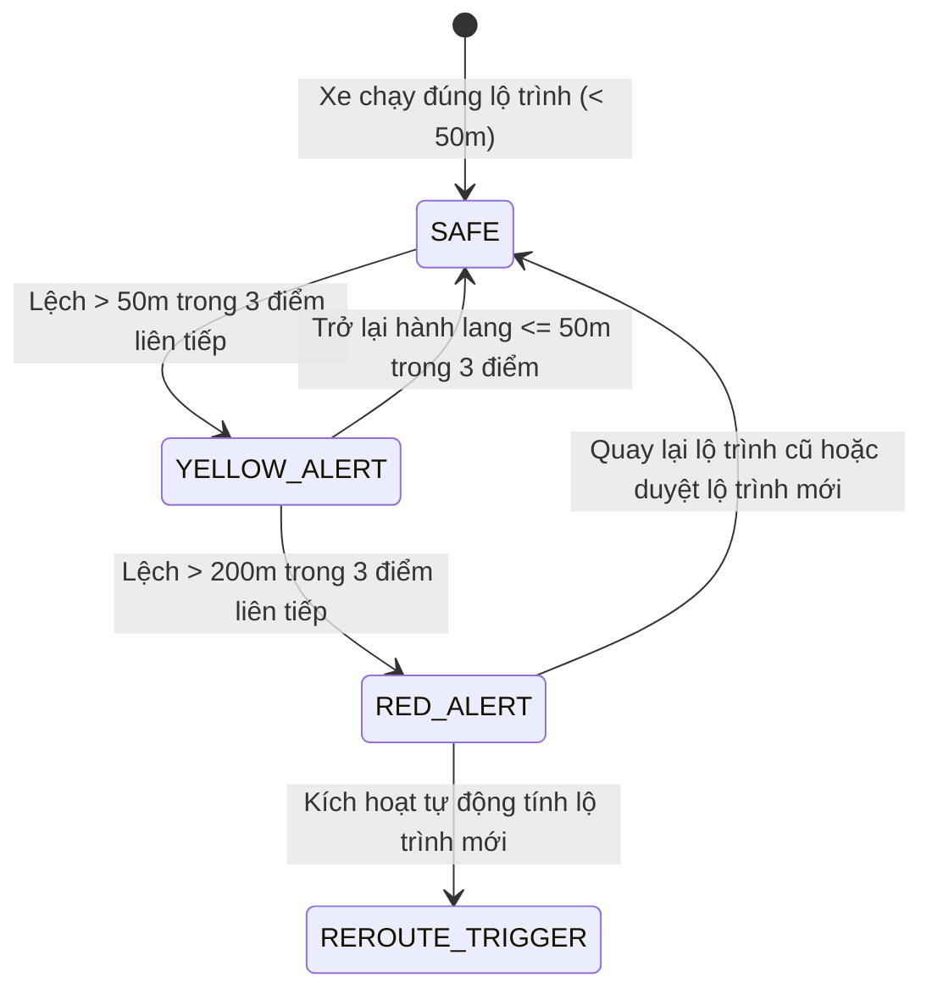

# TASK-09: Máy Trạng Thái Cảnh Báo Lệch Hành Lang 50m / 200m (UC09)
> **Thời gian:** Ngày 9 (Thứ Ba, Tuần 2)  
> **Phân hệ:** `com.ccadro.tracking`  
> **Use Case:** **UC09: Deviation Buffer State Machine**  
> **Mức độ ưu tiên:** P0 (Cốt Lõi Hệ Thống)  
> **Trạng thái:** [ ] Chưa bắt đầu | [ ] Đang làm | [ ] Đã hoàn thành

---

## 🎯 1. Mục Tiêu Nghiệp Vụ
Xây dựng máy trạng thái kiểm soát sai lệch hành lang bảo vệ (Buffer Corridor):
- 🟡 **Cảnh báo Vàng (`YELLOW`):** Xe lệch khỏi tim đường $> 50\text{m}$ liên tiếp trong 3 gói tin GPS. Nhắc nhở tài xế chú ý.
- 🔴 **Báo động Đỏ (`RED`):** Xe lệch $> 200\text{m}$ liên tiếp trong 3 gói tin GPS. Kích hoạt báo động khẩn cấp và gọi công cụ tính đổi tuyến (`Reroute Engine`).
- 🟢 **Khôi phục (`RESOLVED`):** Xe quay lại hành lang an toàn $\le 50\text{m}$ trong 3 gói tin liên tiếp $\rightarrow$ Tự động đóng cảnh báo.



---

## 📂 2. Các File Cần Mở Để Làm Việc

| Tầng | Đường Dẫn File |
| :--- | :--- |
| **Service** | `com.ccadro.tracking.service.TrackingService` |
| **Repository** | `com.ccadro.tracking.repository.DeviationAlertRepository` |
| **Entity** | `com.ccadro.tracking.entity.DeviationAlert` |
| **DTOs** | `DeviationAlertResponse.java` |
| **Mapper** | `com.ccadro.tracking.mapper.TrackingMapper` |

---

## ⚙️ 3. Chi Tiết Thực Hiện Từng Bước (Step-by-Step)

### Bước 1: Viết hàm đánh giá máy trạng thái trong `TrackingService.java`
```java
public void evaluateDeviationStateMachine(UUID tripId, TelemetryEvent latestEvent) {
    // 1. Lấy 3 điểm GPS gần nhất của chuyến đi
    List<TelemetryEvent> recentPoints = telemetryEventRepository.findTop3ByTripIdOrderByTimestampDesc(tripId);
    if (recentPoints.size() < 3) return; // Chưa đủ 3 điểm để xác nhận xu hướng

    // 2. Kiểm tra điều kiện vượt ngưỡng liên tiếp 3 điểm
    boolean allAbove200m = recentPoints.stream()
            .allMatch(p -> p.getDistanceFromRouteMeters().doubleValue() > 200.0);
    boolean allAbove50m = recentPoints.stream()
            .allMatch(p -> p.getDistanceFromRouteMeters().doubleValue() > 50.0);
    boolean allBackToSafe = recentPoints.stream()
            .allMatch(p -> p.getDistanceFromRouteMeters().doubleValue() <= 50.0);

    // 3. Xử lý Báo động ĐỎ (> 200m)
    if (allAbove200m) {
        triggerOrUpdateAlert(tripId, latestEvent, "RED");
        return;
    }

    // 4. Xử lý Cảnh báo VÀNG (> 50m)
    if (allAbove50m) {
        triggerOrUpdateAlert(tripId, latestEvent, "YELLOW");
        return;
    }

    // 5. Xe đã trở lại an toàn (<= 50m) -> Đóng tất cả cảnh báo đang mở
    if (allBackToSafe) {
        List<DeviationAlert> openAlerts = deviationAlertRepository.findByTripIdAndStatus(tripId, "OPEN");
        for (DeviationAlert alert : openAlerts) {
            alert.setStatus("RESOLVED");
            alert.setResolvedAt(Instant.now());
        }
        deviationAlertRepository.saveAll(openAlerts);
    }
}

private void triggerOrUpdateAlert(UUID tripId, TelemetryEvent event, String severity) {
    List<DeviationAlert> openAlerts = deviationAlertRepository.findByTripIdAndStatus(tripId, "OPEN");
    if (openAlerts.isEmpty()) {
        DeviationAlert newAlert = new DeviationAlert();
        newAlert.setTripId(tripId);
        newAlert.setSeverity(severity);
        newAlert.setDeviationDistanceMeters(event.getDistanceFromRouteMeters());
        newAlert.setLocationGeom(event.getLocationGeom());
        newAlert.setStatus("OPEN");
        newAlert.setDetectedAt(Instant.now());
        newAlert.setPersistenceCount(1);
        deviationAlertRepository.save(newAlert);
    } else {
        DeviationAlert existing = openAlerts.get(0);
        existing.setSeverity(severity); // Nâng cấp nếu chuyển từ YELLOW sang RED
        existing.setDeviationDistanceMeters(event.getDistanceFromRouteMeters());
        existing.setPersistenceCount(existing.getPersistenceCount() + 1);
        deviationAlertRepository.save(existing);
    }
}
```

---

## 🧪 4. Kịch Bản Kiểm Thử

1. Bắn liên tiếp 3 điểm GPS có `distanceFromRouteMeters = 65m`:
   - Kiểm tra DB: `SELECT severity, status FROM deviation_alert WHERE trip_id = '<UUID>';` $\rightarrow$ Trả về `YELLOW`, `OPEN`.
2. Bắn tiếp 3 điểm GPS có `distanceFromRouteMeters = 240m`:
   - Kiểm tra DB $\rightarrow$ Trạng thái tự động nâng cấp lên `RED`.
3. Bắn tiếp 3 điểm GPS có `distanceFromRouteMeters = 10m`:
   - Kiểm tra DB $\rightarrow$ Bản ghi chuyển sang `RESOLVED`.

