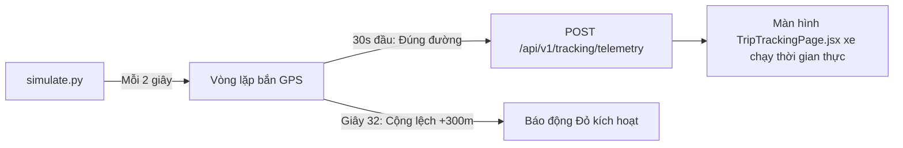

# TASK-10: Kịch Bản Mô Phỏng Xe Chạy GPS Tuyến TP.HCM - Bình Dương
> **Thời gian:** Ngày 10 (Thứ Tư, Tuần 2)  
> **Phân hệ:** `tools/gps-simulator`  
> **Use Case:** **UC09 Testing & Live Telemetry**  
> **Mức độ ưu tiên:** P1 (Cao)  
> **Trạng thái:** [ ] Chưa bắt đầu | [ ] Đang làm | [ ] Đã hoàn thành

---

## 🎯 1. Mục Tiêu Nghiệp Vụ
Cung cấp công cụ chạy nền tự động giả lập phát tọa độ GPS của xe chạy thực tế dọc hành lang Cảng Cát Lái (TP.HCM) $\leftrightarrow$ KCN VSIP 1 (Bình Dương).  
Kịch bản mô phỏng phải tạo ra 3 giai đoạn:
1. **Giai đoạn 1 (0s - 30s):** Xe chạy chuẩn tim đường Quốc lộ 13.
2. **Giai đoạn 2 (32s - 45s):** Giả lập xe rẽ nhầm vào đường làng, lệch tim đường $280\text{m}$ $\rightarrow$ Kích hoạt Báo động ĐỎ.
3. **Giai đoạn 3 (46s - 60s):** Xe quay lại trục đường chính hoặc chuyển sang tuyến đường mới đã đổi.



---

## 📂 2. Các File Cần Mở Để Làm Việc

| Tầng | Đường Dẫn File |
| :--- | :--- |
| **Python Script** | `tools/gps-simulator/simulate.py` |
| **Shell Script** | `scripts/simulate-trip.sh` |

---

## ⚙️ 3. Chi Tiết Kịch Bản Trong `simulate.py`

Mở file `tools/gps-simulator/simulate.py` và kiểm tra logic bắn tọa độ:
```python
import time
import requests
import json
import sys

API_URL = "http://localhost:8080/api/v1/tracking/telemetry"

# Danh sách tọa độ mẫu từ Cát Lái (10.7628, 106.7917) tới VSIP 1 (10.9383, 106.7028)
WAYPOINTS = [
    (10.7628, 106.7917, 0.0),   # Xuất phát tại Cảng
    (10.7800, 106.7800, 45.0),
    (10.8100, 106.7600, 50.0),
    (10.8400, 106.7400, 55.0),
    # Điểm giả lập lệch đường (> 200m)
    (10.8700 + 0.0030, 106.7200 + 0.0030, 30.0), # Lệch ~330 mét
    (10.8900 + 0.0035, 106.7150 + 0.0035, 25.0), # Vẫn tiếp tục lệch
    (10.9100, 106.7100, 50.0),   # Quay lại đường chính
    (10.9383, 106.7028, 0.0)    # Đến đích VSIP 1
]

def run_simulation(trip_id):
    print(f"[*] Bắt đầu mô phỏng GPS cho Trip ID: {trip_id}")
    for idx, (lat, lon, speed) in enumerate(WAYPOINTS):
        payload = {
            "tripId": trip_id,
            "latitude": lat,
            "longitude": lon,
            "speedKmh": speed,
            "headingDegrees": 45.0,
            "timestamp": time.strftime("%Y-%m-%dT%H:%M:%SZ", time.gmtime())
        }
        try:
            res = requests.post(API_URL, json=payload)
            data = res.json()
            dist = data.get("result", {}).get("distanceFromRouteMeters", 0)
            print(f"[Point {idx+1}/{len(WAYPOINTS)}] GPS: ({lat:.4f}, {lon:.4f}) | Lệch: {dist:.1f}m | HTTP: {res.status_code}")
        except Exception as e:
            print(f"[!] Lỗi kết nối: {e}")
        time.sleep(2) # Bắn chu kỳ 2 giây/lần

if __name__ == "__main__":
    if len(sys.argv) < 2:
        print("Cách dùng: python3 simulate.py <trip_id>")
        sys.exit(1)
    run_simulation(sys.argv[1])
```

---

## 🧪 4. Hướng Dẫn Thực Hiện Kiểm Thử

1. Lấy `tripId` từ chuyến hàng vừa điều phối ở `TASK-04`.
2. Mở cửa sổ terminal chạy lệnh:
   ```bash
   python3 tools/gps-simulator/simulate.py <UUID_TRIP>
   ```
3. Mở song song màn hình Web `http://localhost:5173/tracking`:
   - Quan sát biểu tượng xe di chuyển theo từng nhịp 2 giây.
   - Khi xe chạy đến điểm số 5 $\rightarrow$ Đốm đỏ nhấp nháy phát sáng báo động lệch tuyến trên màn hình.

