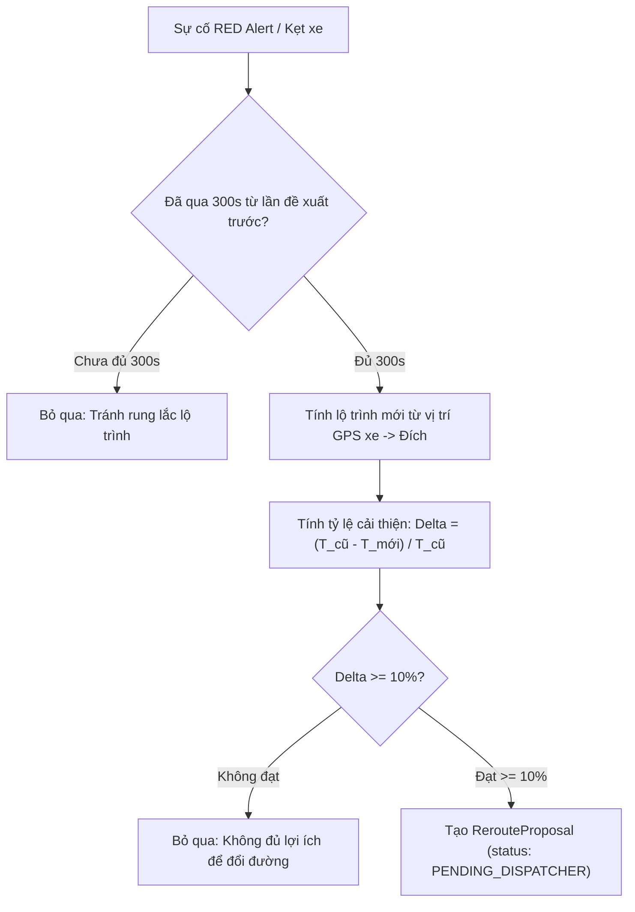

# TASK-11: Thuật Toán Tự Động Đổi Tuyến & Lọc Ngưỡng Lợi Ích 10% (UC10)
> **Thời gian:** Ngày 11 (Thứ Năm, Tuần 2)  
> **Phân hệ:** `com.ccadro.routing` + `com.ccadro.tracking`  
> **Use Case:** **UC10: Dynamic Rerouting Engine**  
> **Mức độ ưu tiên:** P0 (Cốt Lõi Hệ Thống)  
> **Trạng thái:** [ ] Chưa bắt đầu | [ ] Đang làm | [ ] Đã hoàn thành

---

## 🎯 1. Mục Tiêu Nghiệp Vụ
Khi hệ thống phát hiện sự cố tắc đường nghiêm trọng hoặc xe bị Báo động Đỏ (`RED`) do đi sai đường:
- Hệ thống tự động kích hoạt **Reroute Engine** để tính toán lộ trình mới từ vị trí hiện tại của xe về điểm đích.
- Áp dụng 2 bộ lọc bắt buộc theo tài liệu BRD v4:
  1. **Ngưỡng Lợi Ích Tối Thiểu ($\ge 10\%$):** Tuyến mới phải tiết kiệm ít nhất 10% thời gian hoặc hạn chế phát thải so với tiếp tục đi theo tuyến cũ.
  2. **Thời Gian Hồi (Cooldown Window 300s):** Không đề xuất liên tục trong vòng 5 phút để tránh gây nhiễu cho điều phối viên.



---

## 📐 2. Công Thức & Quy Tắc Lọc Lợi Ích

$$\text{Benefit Ratio } (\Delta) = \frac{\text{Duration}_{cũ, còn lại} - \text{Duration}_{mới, đề xuất}}{\text{Duration}_{cũ, còn lại}}$$

- Nếu $\Delta < 0.10$ ($< 10\%$): Hệ thống **không tạo đề xuất**, xe tiếp tục quay lại bám theo tuyến cũ.
- Nếu $\Delta \ge 0.10$ ($\ge 10\%$): Hệ thống tạo bản ghi `reroute_proposal` với trạng thái `PENDING_DISPATCHER`.

---

## 📂 3. Các File Cần Mở Để Làm Việc

| Tầng | Đường Dẫn File |
| :--- | :--- |
| **Service** | `com.ccadro.tracking.service.TrackingService` |
| **Service** | `com.ccadro.routing.service.RoutingService` |
| **Repository** | `com.ccadro.tracking.repository.RerouteProposalRepository` |
| **Mapper** | `com.ccadro.tracking.mapper.RerouteProposalMapper` |
| **DTOs** | `RerouteProposalResponse.java` |

---

## ⚙️ 4. Chi Tiết Thực Hiện Từng Bước (Step-by-Step)

### Bước 1: Viết hàm sinh đề xuất đổi tuyến trong `TrackingService.java`
```java
@Transactional
public Optional<RerouteProposalResponse> evaluateDynamicReroute(UUID tripId, TelemetryEvent currentEvent) {
    // 1. Kiểm tra Cooldown 300 giây (5 phút)
    Optional<RerouteProposal> lastProposal = rerouteProposalRepository.findTopByTripIdOrderByCreatedAtDesc(tripId);
    if (lastProposal.isPresent()) {
        long secondsSinceLast = Duration.between(lastProposal.get().getCreatedAt(), Instant.now()).getSeconds();
        if (secondsSinceLast < 300) {
            log.info("Bỏ qua tính Reroute cho Trip {}: Chưa hết thời gian hồi 300s (còn {}s)", tripId, 300 - secondsSinceLast);
            return Optional.empty();
        }
    }

    // 2. Lấy thông tin chuyến đi và điểm đích
    Trip trip = tripRepository.findById(tripId).orElseThrow();
    Shipment shipment = shipmentRepository.findById(trip.getShipmentId()).orElseThrow();

    // 3. Tính lộ trình mới từ vị trí hiện tại của xe về kho đích
    List<RouteCandidate> newCandidates = routingProvider.calculateRoutes(
            currentEvent.getLocationGeom(), 
            shipment.getDestinationGeom()
    );
    if (newCandidates.isEmpty()) return Optional.empty();

    RouteCandidate bestNew = newCandidates.get(0);

    // 4. Ước tính thời gian tuyến cũ còn lại (Giả định tốn 45 phút do kẹt xe)
    BigDecimal oldRemainingSeconds = new BigDecimal("2700"); // 45 phút
    BigDecimal newSeconds = bestNew.getDurationSeconds();     // Ví dụ tuyến mới tốn 30 phút (1800s)

    // 5. Tính tỷ lệ cải thiện (Delta)
    BigDecimal deltaSeconds = oldRemainingSeconds.subtract(newSeconds);
    BigDecimal benefitRatio = deltaSeconds.divide(oldRemainingSeconds, 4, RoundingMode.HALF_UP);

    // 6. Kiểm tra ngưỡng tối thiểu 10%
    if (benefitRatio.compareTo(new BigDecimal("0.10")) < 0) {
        log.info("Lộ trình mới không đạt ngưỡng lợi ích 10% (Chỉ đạt {}%), bỏ qua", benefitRatio.multiply(new BigDecimal("100")));
        return Optional.empty();
    }

    // 7. Tạo bản ghi RerouteProposal
    RerouteProposal proposal = new RerouteProposal();
    proposal.setTripId(tripId);
    proposal.setTriggerReason("DEVIATION_RED_ALERT");
    proposal.setOriginalRemainingDistanceMeters(oldRemainingSeconds.multiply(new BigDecimal("10"))); // Mô phỏng mét
    proposal.setProposedDistanceMeters(bestNew.getDistanceMeters());
    proposal.setBenefitRatio(benefitRatio);
    proposal.setProposedGeometry(bestNew.getRouteGeometry());
    proposal.setStatus("PENDING_DISPATCHER");
    proposal.setCreatedAt(Instant.now());
    proposal.setUpdatedAt(Instant.now());

    RerouteProposal saved = rerouteProposalRepository.save(proposal);
    return Optional.of(rerouteProposalMapper.toResponse(saved));
}
```

---

## 🧪 5. Kịch Bản Kiểm Thử

- Khi xe lệch đường và tính được tuyến mới tiết kiệm $25\%$ thời gian ($\Delta = 0.25 \ge 0.10$):
  * Kiểm tra DB: `SELECT trip_id, benefit_ratio, status FROM reroute_proposal;`
  * Bản ghi được tạo với `status = 'PENDING_DISPATCHER'` và `benefit_ratio = 0.2500`.

