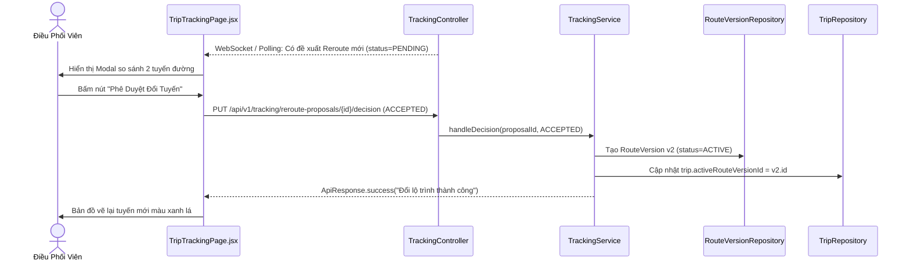

# TASK-12: Luồng Phê Duyệt Đổi Tuyến Của Điều Phối Viên (UC10)
> **Thời gian:** Ngày 12 (Thứ Sáu, Tuần 2)  
> **Phân hệ:** `com.ccadro.tracking` + `frontend`  
> **Nguyên tắc bất biến:** Phải có sự can thiệp của con người (Human-in-the-Loop) - Tuyệt đối không tự ý đổi lộ trình khi chưa có lệnh duyệt  
> **Trạng thái:** [ ] Chưa bắt đầu | [ ] Đang làm | [ ] Đã hoàn thành

---

## 🎯 1. Mục Tiêu Nghiệp Vụ
Sau khi hệ thống sinh đề xuất đổi tuyến tại `TASK-11`, giao diện Web của Điều phối viên sẽ hiển thị cửa sổ cảnh báo (Modal Popup). Điều phối viên xem so sánh trực quan tuyến cũ và tuyến mới:
- Nếu bấm **`ACCEPTED`**: Hệ thống chốt lộ trình mới, tự động nâng cấp phiên bản lộ trình lên `RouteVersion v2`, xe bắt đầu bám theo tuyến mới.
- Nếu bấm **`REJECTED`**: Hủy đề xuất, yêu cầu tài xế quay lại tuyến cũ.



---

## 📂 2. Các File Cần Mở Để Làm Việc

| Tầng | Đường Dẫn File |
| :--- | :--- |
| **Controller** | `com.ccadro.tracking.controller.TrackingController` |
| **Service** | `com.ccadro.tracking.service.TrackingService` |
| **Repository** | `RerouteProposalRepository.java`, `RouteVersionRepository.java` |
| **Frontend** | `frontend/src/pages/TripTrackingPage.jsx` |
| **DTOs** | `RerouteApprovalRequest.java` |

---

## ⚙️ 3. Chi Tiết Thực Hiện Từng Bước (Step-by-Step)

### Bước 1: Viết hàm phê duyệt trong `TrackingService.java`
```java
@Transactional
public void decideRerouteProposal(UUID proposalId, RerouteApprovalRequest request) {
    RerouteProposal proposal = rerouteProposalRepository.findById(proposalId)
            .orElseThrow(() -> new AppException(ErrorCode.ROUTE_NOT_FOUND));

    if (!"PENDING_DISPATCHER".equalsIgnoreCase(proposal.getStatus())) {
        throw new AppException(ErrorCode.DISPUTE_ALREADY_RESOLVED, "Đề xuất này đã được xử lý trước đó!");
    }

    if ("ACCEPTED".equalsIgnoreCase(request.getDecision())) {
        proposal.setStatus("ACCEPTED");

        // 1. Tạo RouteVersion mới (Version 2)
        Trip trip = tripRepository.findById(proposal.getTripId()).orElseThrow();
        RouteVersion newVersion = new RouteVersion();
        newVersion.setShipmentId(trip.getShipmentId());
        newVersion.setVersionNumber(2);
        newVersion.setRouteGeometry(proposal.getProposedGeometry());
        newVersion.setTotalDistanceMeters(proposal.getProposedDistanceMeters());
        newVersion.setStatus("ACTIVE");
        newVersion.setCreatedAt(Instant.now());
        RouteVersion savedVersion = routeVersionRepository.save(newVersion);

        // 2. Chuyển lộ trình active của xe sang phiên bản 2
        trip.setActiveRouteVersionId(savedVersion.getId());
        tripRepository.save(trip);

        // 3. Tự động giải quyết các cảnh báo lệch tuyến cũ
        List<DeviationAlert> openAlerts = deviationAlertRepository.findByTripIdAndStatus(trip.getId(), "OPEN");
        openAlerts.forEach(a -> {
            a.setStatus("RESOLVED");
            a.setResolvedAt(Instant.now());
        });
        deviationAlertRepository.saveAll(openAlerts);

        log.info("Trip {} đã được đổi thành công sang RouteVersion v2!", trip.getId());
    } else {
        proposal.setStatus("REJECTED");
    }

    proposal.setUpdatedAt(Instant.now());
    rerouteProposalRepository.save(proposal);
}
```

### Bước 2: Thêm Endpoint vào `TrackingController.java`
```java
@PutMapping("/reroute-proposals/{id}/decision")
@Operation(summary = "Điều phối viên duyệt hoặc từ chối đề xuất đổi lộ trình")
public ApiResponse<String> decideReroute(
        @PathVariable UUID id,
        @RequestBody @Valid RerouteApprovalRequest request) {
    trackingService.decideRerouteProposal(id, request);
    return ApiResponse.success("Đã ghi nhận quyết định: " + request.getDecision(), null);
}
```

---

## 🧪 4. Kịch Bản Kiểm Thử

### Gửi Request Phê Duyệt Tuyến Mới:
```bash
curl -X PUT http://localhost:8080/api/v1/tracking/reroute-proposals/<UUID_DE_XUAT>/decision \
  -H "Content-Type: application/json" \
  -d '{
    "decision": "ACCEPTED",
    "comments": "Đồng ý chuyển sang tuyến tránh ngập nước",
    "approvedBy": "DISPATCHER_NAM"
  }'
```
*Kết quả kiểm tra DB:*
```sql
SELECT active_route_version_id FROM trip WHERE id = '<UUID_TRIP>';
SELECT version_number, status FROM route_version WHERE id = '<ACTIVE_ID>';
```
*(Thấy `version_number = 2`, trạng thái `ACTIVE`)*.

