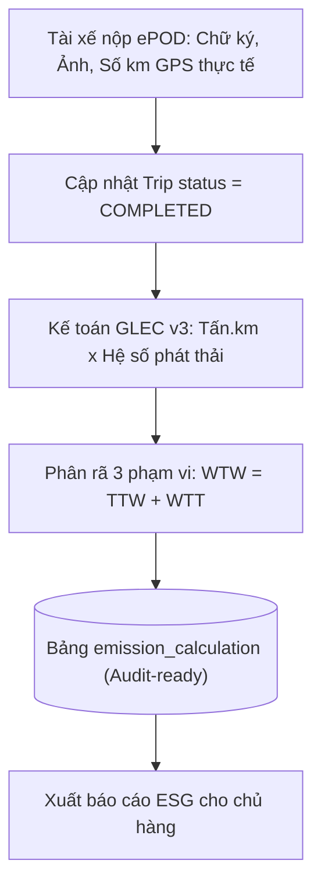

# TASK-13: Giao Hàng ePOD & Kế Toán Phát Thải GLEC v3 (UC12)
> **Thời gian:** Ngày 13 (Thứ Bảy, Tuần 2)  
> **Phân hệ:** `com.ccadro.carbon`  
> **Use Case:** **UC12: Post-trip Carbon Accounting (GLEC Framework v3 / ISO 14083)**  
> **Mức độ ưu tiên:** P0 (Cốt Lõi Hệ Thống)  
> **Trạng thái:** [ ] Chưa bắt đầu | [ ] Đang làm | [ ] Đã hoàn thành

---

## 🎯 1. Mục Tiêu Nghiệp Vụ
Sau khi phương tiện hoàn thành chặng vận chuyển và tới kho nhận hàng:
1. Tài xế nộp biên bản giao nhận hàng điện tử (**ePOD - Electronic Proof of Delivery**) kèm chữ ký số và số km GPS thực tế đã chạy.
2. Hệ thống tự động thực hiện **kế toán phát thải khí nhà kính (GHG Accounting)** đạt chuẩn kiểm toán quốc tế **GLEC Framework v3 / ISO 14083**, phân tách rạch ròi 3 phạm vi phát thải:
   - **WTW (Well-to-Wheel):** Tổng phát thải toàn vòng đời năng lượng.
   - **TTW (Tank-to-Wheel):** Phát thải trực tiếp từ ống xả phương tiện khi đốt nhiên liệu.
   - **WTT (Well-to-Tank):** Phát thải gián tiếp từ khâu khai thác, lọc dầu và vận chuyển nhiên liệu đến cây xăng.



---

## 📐 2. Công Thức Kế Toán Phát Thải GLEC v3

$$\text{Chỉ số Hoạt động Vận tải (Transport Activity)} = \text{Khối lượng hàng (Tấn)} \times \text{Quãng đường GPS (km)} \quad (\text{tấn}\cdot\text{km})$$

$$\text{Tổng phát thải } (E_{WTW}) = (\text{Tấn}\cdot\text{km}) \times F_{WTW} \quad (\text{kg CO}_2\text{e})$$

*Trong đó hệ số mặc định đối với xe tải Diesel Euro 5 (bảng `emission_factor`):*
- $F_{WTW} = 0.080000\text{ kg CO}_2\text{e/t-km}$
- $F_{TTW} = 0.065000\text{ kg CO}_2\text{e/t-km}$
- $F_{WTT} = 0.015000\text{ kg CO}_2\text{e/t-km}$

> [!WARNING]
> Theo tiêu chuẩn GLEC v3, khi đã sử dụng quãng đường đo đạc trực tiếp từ GPS viễn thông (`GPS_ACTUAL`), **tuyệt đối không nhân thêm hệ số điều chỉnh quãng đường (Distance Adjustment Factor - DAF)** để tránh tính toán trùng lặp làm sai lệch số liệu kiểm toán.

---

## 📂 3. Các File Cần Mở Để Làm Việc

| Tầng | Đường Dẫn File |
| :--- | :--- |
| **Controller** | `com.ccadro.carbon.controller.CarbonController` |
| **Service** | `com.ccadro.carbon.service.CarbonService` |
| **Repository** | `ProofOfDeliveryRepository.java`, `EmissionCalculationRepository.java` |
| **Mapper** | `com.ccadro.carbon.mapper.CarbonMapper`, `PodMapper` |
| **DTOs** | `PodSubmissionRequest.java`, `PodResponse.java`, `EmissionCalculationResponse.java` |

---

## ⚙️ 4. Chi Tiết Thực Hiện Từng Bước (Step-by-Step)

### Bước 1: Viết hàm nộp ePOD và quyết toán phát thải trong `CarbonService.java`
Mở file `backend/src/main/java/com/ccadro/carbon/service/CarbonService.java`:
```java
@Transactional
public PodResponse submitPodAndCalculateEmissions(PodSubmissionRequest request) {
    // 1. Lưu biên bản giao hàng ePOD
    ProofOfDelivery pod = podMapper.toEntity(request);
    pod.setDeliveryTime(Instant.now());
    ProofOfDelivery savedPod = proofOfDeliveryRepository.save(pod);

    // 2. Lấy thông tin chuyến đi và đơn hàng
    Trip trip = tripRepository.findById(request.getTripId()).orElseThrow();
    Shipment shipment = shipmentRepository.findById(request.getShipmentId()).orElseThrow();

    // 3. Cập nhật trạng thái chuyến đi thành COMPLETED
    trip.setStatus("COMPLETED");
    tripRepository.save(trip);

    // 4. Tính toán phát thải chuẩn GLEC v3
    BigDecimal payloadTons = shipment.getCargoWeightTons();
    BigDecimal distanceKm = request.getActualDistanceKm();
    BigDecimal tonKm = payloadTons.multiply(distanceKm);

    // Hệ số phát thải xe tải Diesel Euro 5
    BigDecimal fWtw = new BigDecimal("0.080000");
    BigDecimal fTtw = new BigDecimal("0.065000");
    BigDecimal fWtt = new BigDecimal("0.015000");

    BigDecimal totalWtw = tonKm.multiply(fWtw).setScale(4, RoundingMode.HALF_UP);
    BigDecimal totalTtw = tonKm.multiply(fTtw).setScale(4, RoundingMode.HALF_UP);
    BigDecimal totalWtt = tonKm.multiply(fWtt).setScale(4, RoundingMode.HALF_UP);

    // 5. Lưu bản ghi kiểm toán phát thải EmissionCalculation
    EmissionCalculation calc = new EmissionCalculation();
    calc.setTripId(trip.getId());
    calc.setCalculationType("POST_TRIP");
    calc.setCalculationMethod("GLEC_V3");
    calc.setCargoPayloadTons(payloadTons);
    calc.setTotalDistanceKm(distanceKm);
    calc.setTotalCo2eKg(totalWtw);
    calc.setTtwCo2eKg(totalTtw);
    calc.setWttCo2eKg(totalWtt);
    calc.setWtwCo2eKg(totalWtw);
    calc.setDataQualityTier("PRIMARY_TELEMETRY");
    calc.setCalculatedAt(Instant.now());

    emissionCalculationRepository.save(calc);

    return podMapper.toResponse(savedPod);
}
```

---

## 🧪 5. Kịch Bản Kiểm Thử

### Nộp biên bản ePOD:
```bash
curl -X POST http://localhost:8080/api/v1/carbon/pod \
  -H "Content-Type: application/json" \
  -d '{
    "tripId": "<UUID_TRIP>",
    "shipmentId": "<UUID_SHIPMENT>",
    "recipientName": "Trần Thị Thu Nhận",
    "recipientPhone": "0988776655",
    "signatureUrl": "https://storage.ccadro.com/sig.png",
    "photoEvidenceUrl": "https://storage.ccadro.com/photo.jpg",
    "actualDistanceKm": 38.650
  }'
```
*Kiểm tra kết quả trong DB:*
```sql
SELECT total_co2e_kg, ttw_co2e_kg, wtt_co2e_kg, calculation_method, data_quality_tier 
FROM emission_calculation WHERE trip_id = '<UUID_TRIP>';
```
*(Kết quả khớp chính xác: $14.20\text{ tấn} \times 38.650\text{ km} \times 0.080000 = 43.9064\text{ kg CO}_2\text{e}$)*.

