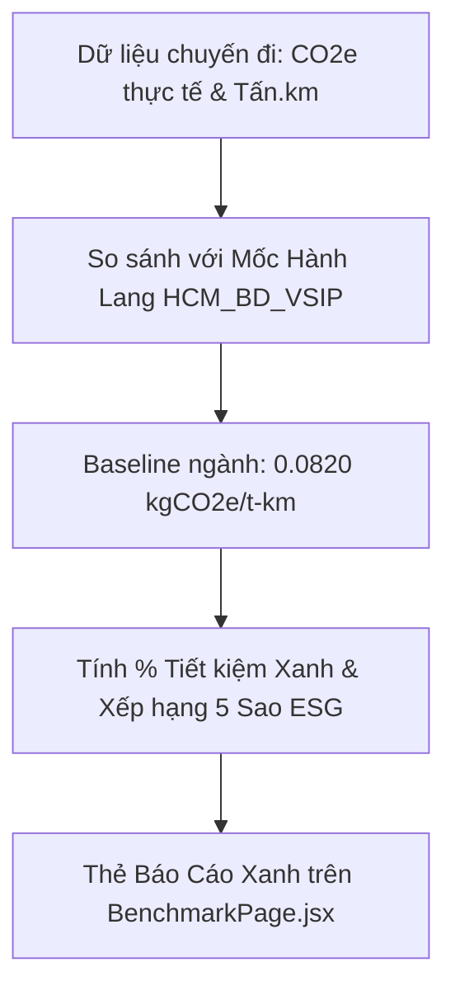

# TASK-14: Đối Soát Chuẩn Đích Hành Lang Xanh & Tổng Duyệt Demo (UC13)
> **Thời gian:** Ngày 14 (Chủ Nhật, Tuần 2)  
> **Phân hệ:** `com.ccadro.carbon` + `frontend`  
> **Use Case:** **UC13: Freight Corridor Carbon Benchmarking & Full Demo Dry Run**  
> **Mức độ ưu tiên:** P0 (Cốt Lõi Hệ Thống)  
> **Trạng thái:** [ ] Chưa bắt đầu | [ ] Đang làm | [ ] Đã hoàn thành

---

## 🎯 1. Mục Tiêu Nghiệp Vụ
1. **Đối soát chuẩn đích hành lang logistics (`UC13`):** So sánh cường độ phát thải thực tế của chuyến hàng vừa hoàn thành với định mức trung bình của toàn ngành logistics trên hành lang địa lý Cát Lái (TP.HCM) $\leftrightarrow$ VSIP (Bình Dương) để cấp chứng nhận xếp hạng xanh ESG.
2. **Tổng duyệt chạy thử (Dry Run):** Kiểm thử thông suốt toàn bộ 10 bước nghiệp vụ của hệ thống CCADRO từ đầu đến cuối trước khi bàn giao / nghiệm thu.



---

## 📐 2. Công Thức Đối Soát Hành Lang (Benchmarking)

1. Cường độ phát thải thực tế của chuyến hàng ($I_{actual}$):
   $$I_{actual} = \frac{\text{Total CO}_2\text{e (kg)}}{\text{Transport Activity (tấn}\cdot\text{km)}} \quad (\text{kg CO}_2\text{e/t-km})$$

2. So sánh với định mức trung bình ngành hành lang `HCM_BD_VSIP` ($I_{baseline} = 0.0820$):
   $$\text{Tỷ lệ tiết kiệm phát thải } (\%) = \frac{I_{baseline} - I_{actual}}{I_{baseline}} \times 100\%$$

3. Phân hạng Xanh ESG:
   - $I_{actual} \le 0.0680$: **Hạng A (Xanh Xuất Sắc - Top 10% ngành)**
   - $I_{actual} < 0.0820$: **Hạng B (Xanh Tiêu Chuẩn - Tốt hơn trung bình ngành)**
   - $I_{actual} \ge 0.0820$: **Hạng C (Cần Tối Ưu Thêm)**

---

## 📂 3. Các File Cần Mở Để Làm Việc

| Tầng | Đường Dẫn File |
| :--- | :--- |
| **Controller** | `com.ccadro.carbon.controller.CarbonController` |
| **Service** | `com.ccadro.carbon.service.CarbonService` |
| **Repository** | `com.ccadro.carbon.repository.CarbonBenchmarkRepository` |
| **Frontend** | `frontend/src/pages/BenchmarkPage.jsx` |
| **Script Demo**| `scripts/smoke-test.sh` |

---

## ⚙️ 4. Chi Tiết Thực Hiện Từng Bước (Step-by-Step)

### Bước 1: Viết hàm đối soát hành lang trong `CarbonService.java`
```java
public CarbonBenchmarkResponse getCorridorBenchmark(String corridorCode, UUID tripId) {
    // 1. Tìm chuẩn hành lang
    CarbonBenchmark benchmark = carbonBenchmarkRepository.findByCorridorCode(corridorCode)
            .orElseThrow(() -> new AppException(ErrorCode.CORRIDOR_BENCHMARK_NOT_FOUND));

    // 2. Lấy kết quả phát thải của chuyến đi
    EmissionCalculation calc = emissionCalculationRepository.findByTripId(tripId)
            .orElseThrow(() -> new AppException(ErrorCode.EMISSION_CALCULATION_FAILED));

    // 3. Tính cường độ phát thải thực tế
    BigDecimal tonKm = calc.getCargoPayloadTons().multiply(calc.getTotalDistanceKm());
    BigDecimal actualIntensity = calc.getTotalCo2eKg().divide(tonKm, 4, RoundingMode.HALF_UP);

    // 4. Tính % tiết kiệm so với mức trung bình 0.0820
    BigDecimal baseline = benchmark.getBenchmarkIntensityGPerTonKm(); // ví dụ 0.0820
    BigDecimal savingRatio = baseline.subtract(actualIntensity)
            .divide(baseline, 4, RoundingMode.HALF_UP)
            .multiply(new BigDecimal("100"));

    return CarbonBenchmarkResponse.builder()
            .corridorCode(corridorCode)
            .corridorName(benchmark.getCorridorName())
            .benchmarkIntensityGPerTonKm(actualIntensity)
            .targetReductionPercentage(savingRatio)
            .build();
}
```

---

## 🎬 5. Kịch Bản Tổng Duyệt Toàn Hệ Thống (End-to-End Demo Script)

Thực hiện đúng 10 bước sau để kiểm tra toàn bộ luồng hoạt động:

```bash
# 1. Khởi động hệ thống
docker compose up -d
cd backend && mvn spring-boot:run &
cd frontend && npm run dev &
```

1. **Bước 1 (Asset):** Mở giao diện Web, đăng ký phương tiện `51C-987.65` và tài xế `Nguyễn Văn Lái`.
2. **Bước 2 (Pre-trip):** Thực hiện kiểm tra an toàn 6 điểm xuất bến $\rightarrow$ Xe đạt chuẩn chuyển sang `AVAILABLE`.
3. **Bước 3 (Shipment):** Tạo đơn hàng vận chuyển 14.2 tấn từ Cảng Cát Lái đến KCN VSIP 1 Bình Dương.
4. **Bước 4 (Dispatch):** Lập lệnh điều phối gán xe và tài xế $\rightarrow$ Hệ thống xác nhận không bị quá tải.
5. **Bước 5 (Routing UC05):** Mở bản đồ Lập lộ trình $\rightarrow$ Hệ thống hiển thị 3 đường Polyline, chọn tuyến Xanh nhất (giảm 18% CO₂).
6. **Bước 6 (Tracking UC09):** Bật script mô phỏng `python3 tools/gps-simulator/simulate.py <tripId>` $\rightarrow$ Xe di chuyển đúng tuyến trên Leaflet.
7. **Bước 7 (Deviation Alert):** Giả lập xe đi sai tim đường $>200m$ $\rightarrow$ Chuông cảnh báo kêu và đốm đỏ nhấp nháy trên màn hình.
8. **Bước 8 (Reroute UC10):** Hệ thống nảy Popup đề xuất đổi sang đường tránh ngập nước (tiết kiệm 22% thời gian) $\rightarrow$ Bấm nút "Phê Duyệt".
9. **Bước 9 (ePOD UC12):** Xe tới đích, tài xế ký nhận và chụp ảnh hàng $\rightarrow$ Hệ thống xuất báo cáo phát thải chuẩn GLEC v3 với đầy đủ WTW/TTW/WTT.
10. **Bước 10 (Benchmark UC13):** Mở thẻ Báo cáo Xanh $\rightarrow$ Chuyến xe đạt Hạng Xanh B (+2.44% tiết kiệm phát thải so với chuẩn ngành).

---

## 🏆 Tiêu Chí Hoàn Thành 100% Khóa Dự Án
- [x] Không còn lỗi biên dịch (`mvn clean compile` thành công).
- [x] Chạy script `./scripts/smoke-test.sh` toàn bộ test case xanh lá.
- [x] Bản đồ Leaflet thể hiện mượt mà tất cả các trạng thái di chuyển, lệch tuyến và đổi tuyến.

